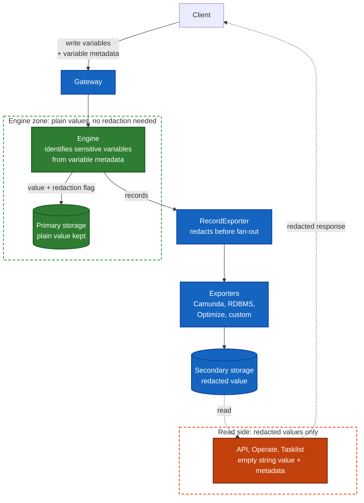

# Variable redaction

## Table of contents

- [Context](#context)
  - [Constraints](#constraints)
- [Decision](#decision)
  - [D1. Redaction applies on export only](#d1-redaction-applies-on-export-only-primary-storage-keeps-the-plain-value)
  - [D2. Declaring a variable sensitive through variable metadata](#d2-a-variable-is-declared-sensitive-through-variable-metadata-variablesmetadata)
  - [D3. API: variable metadata on every endpoint that writes variables](#d3-api-variable-metadata-on-every-endpoint-that-writes-variables)
  - [D4. API: variable search introduces a `metadata` field](#d4-api-variable-search-introduces-a-metadata-field)
  - [D5. Engine: records carry the variable metadata](#d5-engine-records-carry-the-variable-metadata)
  - [D6. Exporter: a sanctioned redaction step](#d6-exporter-a-sanctioned-redaction-step-in-the-broker-exporter-pipeline)
  - [D7. Redact once in the `RecordExporter`](#d7-redact-once-in-the-recordexporter-before-the-export-fan-out)
  - [D8. What a redacted value looks like](#d8-what-a-redacted-value-looks-like-and-where-the-ui-gets-its-text)
  - [D9. The Variable Records Matrix defines scope](#d9-the-variable-records-matrix-defines-scope-four-categories-of-variable-carrying-data)
  - [D10. Delivery order follows the categories](#d10-delivery-order-follows-the-categories)
- [Guarantees](#guarantees)
- [Known limitations](#known-limitations)
- [Appendix A: Variable Records Matrix](#appendix-a-variable-records-matrix)
- [Appendix B: Option B, configurable name patterns](#appendix-b-option-b-configurable-name-patterns)
- [Appendix C: Alternatives considered](#appendix-c-alternatives-considered)
- [References](#references)

**DRI**: Konstantinos Mylosis

**Status**: Proposal. Every decision below is a current proposal, to be reviewed with the customer
before it is accepted. Option A (variable metadata) is the chosen way to declare a variable sensitive.
Option B (name pattern) and the combination of both options are fallbacks we offer to the
customer (D2).

**Deciders**
- Konstantinos Mylosis
- Stephan Epping
- Philipp Ossler

**Purpose**: Record how a process variable is declared sensitive, what the engine persists for it,
where and how its value is redacted, which records and fields are covered in which order, and what
the feature does and does not guarantee.

**Audience**: Engineers working on the engine variable and mapping behaviors, the exporter pipeline,
the Camunda and RDBMS exporters, the v2 REST API, Operate and Tasklist; authors of custom exporters;
AI agents reasoning about why a value is redacted in secondary storage or still readable somewhere.

**Related**: product-hub epic [#3805](https://github.com/camunda/product-hub/issues/3805) (Redact).
Companion artifacts: the [Variable Protection Proposal](https://claude.ai/artifact/DWp5ryaMBwnugSxTETicKT?sk=O__T2mJJW73ITcHA10JqIw)
and the [Variable Records Matrix](https://claude.ai/artifact/W61sUZygdXqHGqNjsYRM6c?sk=oSutcOlcwpm-XlLq7ThHsg).
The matrix, the source of truth for which records and fields
carry variable data, is part of this ADR
([Appendix A](#appendix-a-variable-records-matrix),
[D9](#d9-the-variable-records-matrix-defines-scope-four-categories-of-variable-carrying-data)).

## Context

Sensitive data ends up in process variables because the process needs it to route, decide and call
the next system. Today a variable cannot be declared sensitive, and its value is written in plain
text to every downstream store: the secondary storage, the raw record indices, Optimize and any
custom exporter.

The standing advice to keep sensitive data out of Camunda is a liability for regulated customers
(card numbers, personal data). They need the value inside the engine, but not in Elasticsearch,
OpenSearch, RDBMS or the UI.

### Constraints

The following constraints shape the decisions below:

1. **The engine needs the real value.** FEEL, conditions, mappings, DMN and job workers all operate
   on it. Destroying it before the log append would break execution.
2. **A value reaches many places.** One variable lands in a named `VARIABLE` record, in the
   `variables` maps of roughly 26 command and event records, in error text that quotes it, and in
   values derived from it.
3. **Every exporter must be covered**, including customer-built ones. The exporter SPI has no
   "rewrite" hook, only accept or reject.
4. **Protection modes beyond redaction are planned**, so the declaration must extend to them without
   a new mechanism.

## Decision

The decisions follow the path of a protected value, from the principle to the result:

|             Step             | Decisions |                                Topic                                |
|------------------------------|-----------|---------------------------------------------------------------------|
| Principle                    | D1        | Redaction applies on export only                                    |
| Identify sensitive variables | D2        | Variable metadata (option A), Name pattern (option B) in Appendix B |
| API                          | D3, D4    | Metadata on write endpoints, `metadata` field on variable search    |
| Engine                       | D5        | Records carry the variable metadata                                 |
| Exporter                     | D6        | A sanctioned redaction step in the exporter pipeline                |
| Redact once                  | D7        | A single redaction in the `RecordExporter`                          |
| Result                       | D8        | What a redacted value looks like                                    |
| Scope and delivery           | D9, D10   | Variable Records Matrix, and milestones                             |

Variable metadata on the API (D3, D4), on the records (D5), the exporter step (D6) and the single
redaction (D7) are one proposal. They are delivered together, milestone by milestone (D10).

The diagram shows the same path at a glance. The plain value stays inside the engine zone (engine and
primary storage). Redaction is only needed outside that zone, from the exporters out. The read side
(orange) only ever sees the redacted copy.



### D1. Redaction applies on export only; primary storage keeps the plain value

The engine processes the real value. The exported copy carries no value. The Raft log, RocksDB,
snapshots and backups stay plaintext.

*Rejected: engine-side destruction before the append.* It is the only option that also clears the log
and state, but:

- it destroys the value for execution (FEEL cannot branch on it, workers never receive it), and
- it makes the declaration replicated engine state, because the transform must be deterministic across
  replay.

### D2. A variable is declared sensitive through variable metadata (`variablesMetadata`)

**Decision: option A.** Sensitive variables are identified by metadata sent with the variables, not by
their names. It is the better product: protection is explicit, per variable, extensible to other modes
and visible in the API. The remaining decisions (D3 to D8) describe option A.

`variablesMetadata` is the working name of the property on API requests and on records that carry a
`variables` map. It is keyed by variable name and holds a list of protection modes per variable:

```json
"variablesMetadata": {
  "cardNumber": { "protectionModes": ["REDACT"] }
}
```

The metadata of a single variable is a `metadata` property holding the same `{ "protectionModes": [...] }`
object. It is used where one variable is described: on `VariableRecord` (the existing
`VariableRecordValue#getMetadata()`) and on the variable results of the read APIs (D4). The translation
is deliberate: a request or document-carrying record has many variables and so a map next to `variables`,
a variable record or result has one and so a single `metadata`.

- `protectionModes` is a list so that modes combine. `REDACT` is the mode delivered first. `MASK` and
  `ENCRYPT` are planned and are not part of this decision beyond leaving room for them.
- Other metadata fields (the proposal shows `propagationBehavior` as an example) may be added later.
  Their names and semantics are not decided here.
- Protection is sticky. It is stored with the variable, so a later write that omits the metadata does
  not remove it (D5).
- The BPMN model can declare protection on input and output mappings, and the engine applies it to the
  mapped variable. The Modeler presentation is illustrative and not yet confirmed.

**Option A: pros and cons**

|                                    Pros                                    |                                                     Cons                                                      |
|----------------------------------------------------------------------------|---------------------------------------------------------------------------------------------------------------|
| Protection is explicit and per variable                                    | Larger effort: protocol, engine, API, UI and Modeler                                                          |
| Modes combine, and further modes fit later without a new mechanism         | More surface to deliver (D10)                                                                                 |
| Visible in the API, because search results return the metadata (D4)        | Every endpoint that carries variables needs the new property (D3)                                             |
| Variable names stay as they are, so workers and expressions are unaffected | The Modeler presentation is still to be designed, and several places change (mappings, forms, variable views) |

**Option B (name pattern)** is the lighter alternative: a variable whose name matches a
configured pattern is redacted. It is not part of this decision. Appendix B describes it and compares it
with option A. If the customer decides to proceed with option B, this ADR is revised.

### D3. API: variable metadata on every endpoint that writes variables

Every v2 REST endpoint that accepts `variables` also accepts `variablesMetadata` next to it. Process
instance creation is the first one:

```json
POST /process-instances
{
  "processDefinitionId": "order-process",
  "variables": { "cardNumber": "4111111111111111" },
  "variablesMetadata": {
    "cardNumber": { "protectionModes": ["REDACT"] }
  }
}
```

Each key must be the name of a variable set in the same request. A key without a matching variable, or
an entry that is `null` or has no valid `protectionModes`, is rejected with a 400. A variable without an
entry has no metadata on creation, and keeps the metadata it already has when it is set again.

The same property is added to the other endpoints that carry variables:

- set variables on an element instance (`PUT /element-instances/{elementInstanceKey}/variables`)
- job completion
- user task completion
- message publication and correlation
- signal broadcast
- conditional evaluation
- process instance modification
- ad-hoc sub-process activation

The list is derived from every request schema that carries a `variables` object, and the Variable
Records Matrix (D9) is kept in step with it. The first two endpoints (create instance and set
variables) ship in M1, the rest in M2 (D10).

**gRPC and the Java client.** Variables also enter through the gRPC gateway (`CreateProcessInstance`,
`SetVariables`, `CompleteJob`, `FailJob`, `ThrowError`, message and signal commands) and the Java client
built on it. The same declaration is added there, so a value written through them can be marked and is
redacted like one written through REST. Each gRPC request message that carries variables gains the
matching variable metadata field, and the Java client exposes it. The exact wire shape is settled in the
protocol work. An endpoint that has no metadata field cannot protect its values, so the guarantees below
hold only for the endpoints and RPCs delivered by the milestones (D10).

### D4. API: variable search introduces a `metadata` field

Today the variable search and get results carry only the value. A redacted value is returned as an empty
string (D8), so the value alone does not tell a client that the variable is protected. The variable
results therefore gain a `metadata` field that holds the protection modes of the variable:

```json
POST /variables/search
{
  "items": [
    {
      "name": "cardNumber",
      "value": "",
      "metadata": { "protectionModes": ["REDACT"] }
    }
  ]
}
```

- The field is added to the results of `POST /variables/search`, `GET /variables/{variableKey}`,
  `POST /user-tasks/{userTaskKey}/variables/search` and
  `POST /user-tasks/{userTaskKey}/effective-variables/search`, and later to the decision-instance and
  incident searches. `metadata` is always present, and `protectionModes` is an empty list for a variable
  that is not protected.
- For a redacted variable the value is an empty string and the metadata contains `REDACT` (D8). Clients
  must check `metadata.protectionModes` before they use `value`.
- The exporters persist the modes with the redacted value, and the search layer returns them. This is
  part of M1 for the Camunda and RDBMS exporters (D6).
- Cluster variables already return a generic `metadata` bag of string and number values. The name is
  kept for consistency. The exact shape for process variables, and how it relates to the cluster
  variable bag, is settled in the protocol work and not here.

### D5. Engine: records carry the variable metadata

The metadata is not an API-only concept. The record properties are enhanced with the same
`variablesMetadata`, so that the declaration travels with the data through the log and reaches the
exporter pipeline:

- `VariableRecord` carries the protection modes of the variable it describes in its `metadata` (M1).
- Records with a `variables` map (the category B records in D9) carry a `variablesMetadata` map keyed
  by variable name next to it. The engine propagates the metadata from the command to the
  `VariableRecord` it produces (M2).
- The engine reads and writes the metadata in its Processors and Behaviors and persists it per variable
  in primary storage, which makes protection sticky (D2).

### D6. Exporter: a sanctioned redaction step in the broker exporter pipeline

Every exporter must be covered, including customer-built ones, and the exporter SPI has no "rewrite"
hook, only accept or reject. The broker exporter pipeline therefore gets a sanctioned transform step
that runs before any exporter sees the record.

Mutating the record from inside an exporter works in practice, but it is undeclared and
order-dependent, and is not relied on.

The Camunda and RDBMS exporters persist the protection modes together with the redacted value (M1), so
that the read APIs can return them (D4).

*Rejected: field replacement inside the Camunda exporter handlers, or inside both of our
serialization chokepoints.* Both miss custom exporters. Replacing in the handlers additionally needs
six or more write sites kept in step and misses the raw indices Optimize imports.

### D7. Redact once in the `RecordExporter`, before the export fan-out

The record is redacted once, after the engine has processed it and before it is handed to any
exporter.

**Where.** The redaction runs in the `RecordExporter`, which the `ExporterDirector` calls for every
logged event. It is the single point where the event is decoded once and passed to each exporter in
turn. It does not run in the per-exporter dispatch in `ExporterContainer`, which would run the
transform once per exporter over a shared mutable record.

**How.** The `RecordExporter` replaces the protected values with the JSON empty string `""` (D8), using only the variable
metadata the record carries (D5). It does not look up engine state. The protection modes stay on the
exported record so that the exporters, the read APIs and the UI can tell a redacted value from an
absent one (D8).

**Result.** Every subscriber receives the redacted record: the Camunda exporter, the RDBMS exporter,
the raw ES/OS exporters (and so Optimize), and custom exporters.

Consequence: an operator cannot keep a plaintext copy in one destination and a redacted copy in
another. That is intended.

### D8. What a redacted value looks like, and where the UI gets its text

A redacted variable is exported with the JSON empty string `""` as its value and its protection
metadata. That value is valid JSON of type string, so exporters, the exporter variable-type filters and
Optimize keep working with it. The API read layer returns an empty string (no characters) together with
the metadata for a variable whose protection modes contain `REDACT`. How a UI presents a redacted
variable is up to that UI and not part of this decision. `value` stays required and non-nullable in the
REST schema, so the response shape does not change for any client.

**Why an empty string.** Making `value` nullable is a breaking change under the REST API
guidelines (section 2.7 of `docs/rest-api-endpoint-guidelines.md`) and changes the generated client
types for every consumer, for example `string | null` in the TypeScript SDK, including consumers that
never enable redaction. Redaction is opt-in, so an
existing consumer only meets the empty string after it starts redacting variables. The `"REDACTED"`
sentinel was rejected because it is a magic string that can collide with a real value, duplicates the
metadata and leaks into every consumer and component, without
being safer for clients that parse `value`.

**What customers need to know.** The `value` of a redacted variable is an empty string, not `null` and not a marker text.
`metadata.protectionModes` is the source of truth, so a client that processes `value` must check it
first for any variable that can be protected.

### D9. The Variable Records Matrix defines scope: four categories of variable-carrying data

| Category |            Description            |                                                                                                                     Examples                                                                                                                     |
|----------|-----------------------------------|--------------------------------------------------------------------------------------------------------------------------------------------------------------------------------------------------------------------------------------------------|
| A        | Named variable                    | `VariableRecord.value`                                                                                                                                                                                                                           |
| B        | Variable list (name → value maps) | `variables` in the document-carrying records: `VARIABLE_DOCUMENT`, `PROCESS_INSTANCE_CREATION`, `MESSAGE`, `SIGNAL`, `JOB` (completion), `JOB_BATCH` `jobs[]`, `USER_TASK` completion, modification, ad-hoc sub-process activation, and the rest |
| C        | Free text that can quote a value  | `Incident.errorMessage`, `Job.errorMessage`, decision `evaluationFailureMessage`, `Expression.warnings`, `ErrorRecord.exceptionMessage` and `stacktrace`, `rejectionReason` in the record metadata                                               |
| D        | Values derived from a variable    | decision inputs and outputs, `Expression.resultValue`, `correlationKey`, `MultiInstance.inputCollection`, and any field computed by an expression (assignee, job type, timer, signal name and so on)                                             |

The full matrix is [Appendix A](#appendix-a-variable-records-matrix) of this ADR. It lists each record
with its category, the scenario and the REST endpoints that write and read it, and the
variable-carrying field. It lives in the ADR so that it is reviewed and versioned with the code. The
[Variable Records Matrix artifact](https://claude.ai/artifact/W61sUZygdXqHGqNjsYRM6c?sk=oSutcOlcwpm-XlLq7ThHsg)
it was derived from is kept as a reference only.

- Where a record carries more than one kind of data, it is listed once per kind. For example,
  `JobRecord` is listed as B for `variables` and as C for `errorMessage`, and `MessageRecord` as B for
  `variables` and as D for `correlationKey`.
- `JobRecord.customHeaders` is not listed as variable-carrying.
- `ClusterVariableRecord` is out of scope. Cluster variables are not process variables and are not protected.
- Categories C and D are listed so that the gap is visible, but they are out of scope (L3).
- Records that wrap other commands (`COMMAND_DISTRIBUTION`, `BUFFERED_COMMAND`) and `AGENT_HISTORY` are
  tracked as uncategorized in the matrix. The variable history ([#3517](https://github.com/camunda/product-hub/issues/3517)) is listed there too.
  It stores the new value of each variable change and redacts it only when the command explicitly
  carries protection modes.

**Priorities**

- **Must have:** `BUFFERED_COMMAND`, because it wraps a command that can carry protected variables.
- **Nice to have:** `COMMAND_DISTRIBUTION` and `AGENT_HISTORY`.

Appendix A is maintained as the source of truth. A new record type or field that can carry a value is
added there before it is protected.

### D10. Delivery order follows the categories

| Milestone |                                                                                                                                                                                                                                                                                                                     Scope                                                                                                                                                                                                                                                                                                                     |
|-----------|-----------------------------------------------------------------------------------------------------------------------------------------------------------------------------------------------------------------------------------------------------------------------------------------------------------------------------------------------------------------------------------------------------------------------------------------------------------------------------------------------------------------------------------------------------------------------------------------------------------------------------------------------|
| M1        | Category A: named variable, plus the category B records emitted by create instance and set variables (`PROCESS_INSTANCE_CREATION`, `VARIABLE_DOCUMENT`). Foundation (ADR, Variable Records Matrix (Appendix A), `REDACT` protection mode in the protocol, `metadata` on `VariableRecord`), engine (persist and keep modes, accept metadata on create instance and set variables, input/output mapping), exporter (redact `VariableRecord` and those category B records before the fan-out, persist modes in the Camunda and RDBMS exporters), API and UI (return metadata, Operate and Tasklist presentation, Modeler checkbox), verification |
| M2        | Category B: the remaining variable documents. Metadata on the other document-carrying records, propagation from commands to `VariableRecord`, metadata accepted on the remaining endpoints, redaction of document variables including `jobs[]` in `JOB_BATCH` and nested job results, user task variable responses                                                                                                                                                                                                                                                                                                                            |

Each milestone ships end to end (protocol, engine, exporter, API and UI, tests) before the next starts.
Categories C and D are not milestones: they are covered by a limitation (L3).

## Guarantees

For values written after a variable was declared sensitive, in the scope delivered by the milestones
above:

1. **Variables are still exported, with a redacted value (categories A and B only).** A redacted
   variable keeps being exported to secondary storage (Elasticsearch, OpenSearch or RDBMS), but its real
   value is not written there.
2. **The value is not visible in the UI.** A redacted variable is still listed, but Operate and Tasklist
   do not show its value.
3. **The value is not visible in the API reads served from secondary storage**, that is the search and
   get endpoints (for example `POST /variables/search`, `GET /variables/{variableKey}`, user task
   variables). A redacted variable is still returned, with its value redacted. Endpoints served from
   primary storage, such as job activation, return the plain value (L2).

## Known limitations

- **L1. No redaction of nested variables.** A sensitive field inside an object variable is not
  addressed. The whole variable is protected or none of it.
- **L2. Primary storage is not protected.** The engine needs the real value, so the Raft log, RocksDB,
  snapshots, backups and every API served from primary storage (job activation, process instance
  result, scoped expression evaluation) carry the plain value. Redaction protects reads that observe a
  process (search, Operate, Tasklist), not reads that execute a step. Anyone able to register a worker
  for a task still receives the value of the variables it uses. This is intentional.
- **L3. Only categories A and B are supported.** Category C free text that can quote a value (error
  messages, warnings, rejection reasons) and category D derived values (decision inputs and outputs,
  copies, FEEL transformations, correlation keys, multi-instance values) are not protected. A derived
  value, for example the result of a FEEL expression that reads a protected variable, is protected only
  if the variable it is written to is also explicitly marked as protected. The matrix still lists these
  records so the gap is visible.
- **L4. No backfill.** A declaration protects values written after it is made. Values already exported
  stay readable, so turning redaction on does not clean up existing data.
- **L5. Tasklist forms with redacted initial variables cannot be displayed.**
- **L6. Search by value finds nothing.** A redacted value cannot be matched by a variable-value filter,
  because the stored value is the JSON empty string `""`.
- **L7. Correlation keys are persisted by the Camunda and RDBMS exporters** from the message
  subscription records today. They are often derived from a variable (see L3).
- **L8. The variable history keeps each change as it was protected at the time.** A change written
  without protection stays readable. A change written with protection is redacted. Adding protection
  later does not rewrite earlier entries, and removing it needs an explicit action, not a missing
  field. Sensitive variables must be protected when they are created, otherwise their earlier values
  stay visible in the history ([#3517](https://github.com/camunda/product-hub/issues/3517)).
- **L9. The engine redacts only what a command explicitly marks as protected.** A command without
  protection modes is processed as though its variables were not protected, so no redaction is applied
  to it.

## Appendix A: Variable Records Matrix

Zeebe records that carry process or user variable data, with the scenario and REST endpoint where each
shows up. *Write* is the endpoint that creates or updates it. *Search* is the endpoint that reads it
back. No REST endpoint means the engine produces it only. Categories are defined in D9.

The *Expected* column states what the feature does for each record and field, so a reader can tell
what is covered and what is not:

- **Redact (M1)** and **Redact (M2)**: the value is redacted on export, delivered in that milestone (D10).
- **Not redacted (L3)**: out of scope. Categories C and D are listed so that the gap is visible.
- **Must have** and **Nice to have**: uncategorized records that wrap other commands or carry
  conversation data. They are redacted when delivered, with the priority given in D9.
- **Redact**: the variable history of the Variable Trace epic
  ([#3517](https://github.com/camunda/product-hub/issues/3517)) stores the new value of each variable
  change, and redacts it only when the command explicitly carries protection modes.

### Category A: named variable

|  Expected   |     Record (ValueType)      |                                                 Scenario and REST endpoint                                                  | Variable-carrying field |
|-------------|-----------------------------|-----------------------------------------------------------------------------------------------------------------------------|-------------------------|
| Redact (M1) | `VariableRecord` (VARIABLE) | Result of any variable write below. Created by the engine. Search: `POST /variables/search`, `GET /variables/{variableKey}` | `value`                 |

### Category B: variable list (name to value maps)

|  Expected   |                                                            Record (ValueType)                                                             |                                                                                             Scenario and REST endpoint                                                                                             |                           Variable-carrying field                           |
|-------------|-------------------------------------------------------------------------------------------------------------------------------------------|--------------------------------------------------------------------------------------------------------------------------------------------------------------------------------------------------------------------|-----------------------------------------------------------------------------|
| Redact (M2) | `VariableDocumentRecord` (VARIABLE_DOCUMENT)                                                                                              | Set variables on a running scope. Write: `PUT /element-instances/{elementInstanceKey}/variables`                                                                                                                   | `variables`                                                                 |
| Redact (M2) | `ProcessInstanceCreationRecord` (PROCESS_INSTANCE_CREATION)                                                                               | Start a process instance with variables. Write: `POST /process-instances`                                                                                                                                          | `variables`                                                                 |
| Redact (M2) | `JobRecord` (JOB)                                                                                                                         | A worker completes, fails or errors a job. Write: `POST /jobs/{jobKey}/completion`, `/failure`, `/error`, `PATCH /jobs/{jobKey}`. Search: `POST /jobs/search`                                                      | `variables`                                                                 |
| Redact (M2) | `JobBatchRecord` (JOB_BATCH)                                                                                                              | A worker activates jobs and receives their variables. Write (activation): `POST /jobs/activation`                                                                                                                  | `jobs[].variables`                                                          |
| Redact (M2) | `JobResult` / `JobResultActivateElement` (nested in `JobRecord`)                                                                          | A worker completes, fails or errors a job. Write: `POST /jobs/{jobKey}/completion`, `/failure`, `/error`, `PATCH /jobs/{jobKey}`. Search: `POST /jobs/search`                                                      | `result.activateElements[].variables`                                       |
| Redact (M2) | `UserTaskRecord` (USER_TASK)                                                                                                              | A user completes a task with variables. Write: `POST /user-tasks/{userTaskKey}/completion`. Search: `POST /user-tasks/{userTaskKey}/variables/search`, `POST /user-tasks/{userTaskKey}/effective-variables/search` | `variables` (on completion)                                                 |
| Redact (M2) | `SignalRecord` (SIGNAL)                                                                                                                   | Broadcast a signal with a payload. Write: `POST /signals/broadcast`                                                                                                                                                | `variables`                                                                 |
| Redact (M2) | `CompensationSubscriptionRecord` (COMPENSATION_SUBSCRIPTION)                                                                              | Compensation handling inside the engine. No REST endpoint                                                                                                                                                          | `variables`                                                                 |
| Redact (M2) | `ConditionalEvaluationRecord` (CONDITIONAL_EVALUATION)                                                                                    | Trigger conditional events with variables. Write: `POST /conditionals/evaluation`                                                                                                                                  | `variables`                                                                 |
| Redact (M2) | `ProcessEventRecord` (PROCESS_EVENT)                                                                                                      | Event triggering inside the engine. No REST endpoint                                                                                                                                                               | `variables`                                                                 |
| Redact (M2) | `ProcessInstanceModificationRecord` (PROCESS_INSTANCE_MODIFICATION), with `ActivateInstruction`, `MoveInstruction`, `VariableInstruction` | Modify a running instance and set variables while doing so. Write: `POST /process-instances/{processInstanceKey}/modification`                                                                                     | `variableInstructions[].variables`                                          |
| Redact (M2) | `AdHocSubProcessInstructionRecord` (AD_HOC_SUB_PROCESS_INSTRUCTION), with `ActivateElementInstruction`                                    | Activate elements in an ad-hoc sub-process with variables. Write: `POST /element-instances/ad-hoc-activities/{adHocSubProcessInstanceKey}/activation`                                                              | `activateElements[].variables`                                              |
| Redact (M2) | `MessageRecord` (MESSAGE)                                                                                                                 | Publish a message with variables. Write: `POST /messages/publication`                                                                                                                                              | `variables`                                                                 |
| Redact (M2) | `MessageSubscriptionRecord`, `ProcessMessageSubscriptionRecord`, `MessageStartEventSubscriptionRecord`                                    | A process waits for a message. Created by the engine. Search: `POST /message-subscriptions/search`, `POST /correlated-message-subscriptions/search`                                                                | `variables`                                                                 |
| Redact (M2) | `MessageStartProcessInstanceRequestRecord`, `MessageCorrelationRecord`                                                                    | Correlate a message to a process. Write: `POST /messages/correlation`                                                                                                                                              | `variables`                                                                 |
| Redact (M2) | `BatchOperationCreationRecord` (BATCH_OPERATION_CREATION), with `NestedRecord`                                                            | Run an operation on many instances, for example a modification with variable instructions. Write: `POST /process-instances/modification`. Search: `POST /batch-operations/search`                                  | `modificationPlan` variable instructions, `entityFilter`, `followUpCommand` |
| Redact (M2) | `ProcessInstanceResultRecord` (PROCESS_INSTANCE_RESULT)                                                                                   | Caller waits for the instance to finish. Response of `POST /process-instances` (await completion)                                                                                                                  | `variables`                                                                 |

### Category C: free text that can quote a value

|     Expected      |     Record (ValueType)      |                                                                  Scenario and REST endpoint                                                                   |     Variable-carrying field      |
|-------------------|-----------------------------|---------------------------------------------------------------------------------------------------------------------------------------------------------------|----------------------------------|
| Not redacted (L3) | `IncidentRecord` (INCIDENT) | Show why an instance is stuck. Created by the engine. Search: `POST /incidents/search`                                                                        | `errorMessage`                   |
| Not redacted (L3) | `JobRecord` (JOB)           | A worker completes, fails or errors a job. Write: `POST /jobs/{jobKey}/completion`, `/failure`, `/error`, `PATCH /jobs/{jobKey}`. Search: `POST /jobs/search` | `errorMessage`                   |
| Not redacted (L3) | `ErrorRecord` (ERROR)       | Unexpected engine failure. No REST endpoint                                                                                                                   | `exceptionMessage`, `stacktrace` |

### Category D: values derived from a variable

|     Expected      |                                                           Record (ValueType)                                                           |                                                             Scenario and REST endpoint                                                              |                                Variable-carrying field                                 |
|-------------------|----------------------------------------------------------------------------------------------------------------------------------------|-----------------------------------------------------------------------------------------------------------------------------------------------------|----------------------------------------------------------------------------------------|
| Not redacted (L3) | `ExpressionRecord` (EXPRESSION), also C                                                                                                | Evaluate a FEEL expression on demand. Write (evaluate): `POST /expression/evaluation`                                                               | `resultValue`, `variables`, `expression`, `warnings`                                   |
| Not redacted (L3) | `MultiInstanceRecord` (MULTI_INSTANCE)                                                                                                 | Multi-instance activity handling inside the engine. No REST endpoint                                                                                | `inputCollection` items                                                                |
| Not redacted (L3) | `DecisionEvaluationRecord` (DECISION_EVALUATION), with `EvaluatedDecision`, `EvaluatedInput`, `MatchedRule`, `EvaluatedOutput`, also C | Evaluate a decision, or a business rule task runs. Write: `POST /decision-definitions/evaluation`. Search: `POST /decision-instances/search`        | `inputValue`, `outputValue`, `decisionOutput`, `variables`, `evaluationFailureMessage` |
| Not redacted (L3) | `MessageRecord` (MESSAGE)                                                                                                              | Publish a message with variables. Write: `POST /messages/publication`                                                                               | `correlationKey`                                                                       |
| Not redacted (L3) | `MessageSubscriptionRecord`, `ProcessMessageSubscriptionRecord`, `MessageStartEventSubscriptionRecord`                                 | A process waits for a message. Created by the engine. Search: `POST /message-subscriptions/search`, `POST /correlated-message-subscriptions/search` | `correlationKey`                                                                       |
| Not redacted (L3) | `MessageStartProcessInstanceRequestRecord`, `MessageCorrelationRecord`                                                                 | Correlate a message to a process. Write: `POST /messages/correlation`                                                                               | `correlationKey`                                                                       |

### Not categorized

|   Expected   |                 Record (ValueType)                 |                                                                   Scenario and REST endpoint                                                                    |                Variable-carrying field                |
|--------------|----------------------------------------------------|-----------------------------------------------------------------------------------------------------------------------------------------------------------------|-------------------------------------------------------|
| Nice to have | `CommandDistributionRecord` (COMMAND_DISTRIBUTION) | Command copied to other partitions inside the engine. No REST endpoint                                                                                          | wraps any command value                               |
| Must have    | `BufferedCommandRecord` (BUFFERED_COMMAND)         | Command held back inside the engine. No REST endpoint                                                                                                           | wraps a buffered command                              |
| Nice to have | `AgentHistoryRecord` (AGENT_HISTORY)               | An AI agent appends conversation history. Write: `PATCH /agent-instances/{agentInstanceKey}`. Search: `POST /agent-instances/{agentInstanceKey}/history/search` | message content, system prompt, tool-call `arguments` |
| Redact       | Variable history (variable create or update)       | Who changed a variable, and to which value. Not an engine record: stored in new secondary storage                                                               | variable **value** of each change                     |

`ClusterVariableRecord` is out of scope (D9) and is not listed.

## Appendix B: Option B, configurable name patterns

Option B is not the decision (D2). It is kept here so that the ADR can be revised quickly if the
customer prefers the smaller scope.

### How option B works

A pattern is configured for the cluster. It can be a prefix or a suffix, whichever the customer prefers,
for example `redact_.*`. A variable whose name matches the pattern is redacted. Option B ends in the same
redaction step (D7) and the same redacted result (D8) as option A. Search results still return
`protectionModes` (D4). It reuses D6 to D8.

Not decided:

- How option B marks the exported record. The proposal is to set the same `REDACT` metadata as in D8,
  so that the read APIs and UI behave identically.
- Where the patterns are configured.

### Option A compared with option B

|                  |                               A. Variable metadata (decision)                               |                                                      B. Configurable name patterns                                                       |
|------------------|---------------------------------------------------------------------------------------------|------------------------------------------------------------------------------------------------------------------------------------------|
| Declaration      | `variablesMetadata` on the API, in the BPMN mappings and on the records (D2, D3, D5)        | A pattern configured for the cluster, for example `redact_.*`. A variable whose name matches the pattern is redacted                     |
| Protection modes | A list per variable, so modes combine and further modes fit later                           | `REDACT` only. Other modes would need further naming conventions                                                                         |
| API              | New property on every endpoint that carries variables, in requests and responses            | No new property on write endpoints. Search results still return `protectionModes` (D4)                                                   |
| Modeler          | Presentation to be designed, and several places to change (mappings, forms, variable views) | None. The Modeler team has no UX work                                                                                                    |
| Effort           | Larger: protocol, engine, API, UI, Modeler                                                  | Smaller: configuration and a name match at the redaction point                                                                           |
| Weak points      | More surface to deliver (D10)                                                               | Workers and expressions must use a name that matches the pattern. A typo silently disables protection. The customer owns the naming rule |

### Option B: pros and cons

|                                          Pros                                           |                               Cons                               |
|-----------------------------------------------------------------------------------------|------------------------------------------------------------------|
| Smaller effort: configuration and a name match at the redaction point                   | `REDACT` only. Other modes would need further naming conventions |
| No API change to declare protection. Search results still return `protectionModes` (D4) | Workers and expressions must use a name that matches the pattern |
| No Modeler work and no UX decisions for the Modeler team                                | A typo silently disables protection                              |
| Quicker to start                                                                        | The customer owns the naming rule                                |
|                                                                                         | A variable can match the pattern by accident                     |

### Both options together

The options do not exclude each other. If both are delivered, each customer chooses how it redacts its
data: by metadata, by name pattern, or both. A variable is redacted when either declaration applies.

|                                         Pros                                         |                                    Cons                                    |
|--------------------------------------------------------------------------------------|----------------------------------------------------------------------------|
| Each customer chooses how it redacts its data: by metadata, by name pattern, or both | A variable is redacted when either declaration applies                     |
| The customer can start with B and move to A                                          | Both mechanisms are delivered, so two declarations must be kept consistent |

### Option B in the UI

The examples use the prefix `redact_`. A suffix works the same way. A variable whose name matches the
pattern is redacted, so the Modeler needs no extra control: the user only names the variable. In the
Modeler, a mapping such as `redact_pan = redact_cardNumber` produces a redacted local variable, and an
output mapping to `redact_networkToken` produces a redacted process variable. Operate and Tasklist do not
show the value of `redact_cardNumber`, while `amount` shows its value. The final Modeler design is still
to be confirmed.

## Appendix C: Alternatives considered

- Engine-side destruction before the append (D1).
- Redaction by exporter handler or exporter serialization hook (D6).
- Variable-name prefix or suffix patterns (option B): not chosen, described in Appendix B. On its own it
  cannot express combined modes without further naming conventions, forces whatever reads the variable
  (workers, expressions) to use the prefixed name, and a typo silently disables protection.
- Returning `null` as the redacted value: rejected for D8, it makes `value` nullable, a breaking change
  for generated clients that hits every consumer, not only those who enable redaction.
- Returning a `"REDACTED"` sentinel as the redacted value: rejected for D8. It is a magic string that
  can collide with a real value, duplicates `protectionModes`, and leaks into every consumer and
  component (APIs, exporters, search indices, clients), each of which has to know and handle it, which
  is not necessary.
- Omitting the redacted variable or its `value` from the response: rejected for D8, it breaks the
  required `value` and hides that the variable exists, and pagination and `totalItems` would no longer
  match what Operate shows.
- Suppressing a redacted variable for Optimize instead of sending the marker: rejected for D7 because
  it needs a second redaction behavior and makes Optimize disagree with Operate about what exists. A
  marker keeps instances visible and countable in reports.

## References

- Epic: [camunda/camunda#64644](https://github.com/camunda/camunda/issues/64644)
- Proposal artifact: [Variable Protection Proposal](https://claude.ai/artifact/DWp5ryaMBwnugSxTETicKT?sk=O__T2mJJW73ITcHA10JqIw)
- Matrix artifact: [Variable Records Matrix](https://claude.ai/artifact/W61sUZygdXqHGqNjsYRM6c?sk=oSutcOlcwpm-XlLq7ThHsg), reference only. Appendix A is the source of truth.

