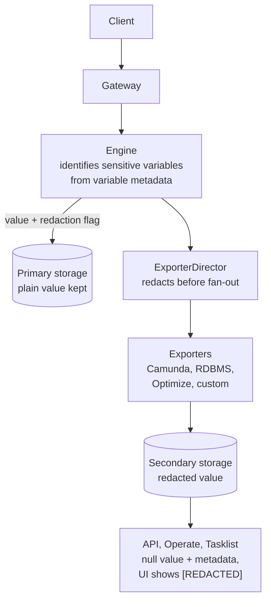

# Variable redaction

**DRI**: Konstantinos Mylosis

**Status**: Proposal. Every decision below is a current proposal, to be reviewed with the customer
before it is accepted. Option A (variable metadata) is the chosen way to declare a variable sensitive.
Option B and both are fallbacks we offer to the customer (D3).

**Deciders**
- Konstantinos Mylosis
- Stephan Epping
- Philipp Ossler

**Purpose**: Record how a process variable is declared sensitive, what the engine persists for it,
where and how its value is redacted, which records and fields are covered in which order, and what
the feature does and does not guarantee.

**Audience**: Engineers working on the engine variable and mapping behaviors, the exporter pipeline,
the Camunda and RDBMS exporters, the v2 REST API, Operate and Tasklist; authors of custom exporters;
AI agents reasoning about why a value is `null` in secondary storage or still readable somewhere.

**Related**: product-hub epic [#3805](https://github.com/camunda/product-hub/issues/3805) (Redact).
Companion artifacts: the *Variable Protection Proposal* and the *Variable Records Matrix*. The
matrix is the source of truth for which records and fields carry variable data (see D10).

## Context

Sensitive data ends up in process variables because the process needs it to route, decide and call
the next system. Today a variable cannot be declared sensitive, and its value is written in plain
text to every downstream store: the secondary storage, the raw record indices, Optimize and any
custom exporter.

The standing advice to keep sensitive data out of Camunda is a liability for regulated customers
(card numbers, personal data). They need the value inside the engine, but not in Elasticsearch,
OpenSearch, RDBMS or the UI.

### Constraints

The following constraints shape the decisions below:

1. **The engine needs the real value.** FEEL, conditions, mappings, DMN and job workers all operate
   on it. Destroying it before the log append would break execution.
2. **A value reaches many places.** One variable lands in a named `VARIABLE` record, in the
   `variables` maps of roughly 26 command and event records, in error text that quotes it, and in
   values derived from it.
3. **Every exporter must be covered**, including customer-built ones. The exporter SPI has no
   "rewrite" hook, only accept or reject.
4. **Protection modes beyond redaction (mask, encrypt) are planned**, so the declaration must extend
   to them without a new mechanism.

## Decision

The decisions follow the path of a protected value, from the principle to the result:

|             Step             | Decisions |                                           Topic                                            |
|------------------------------|-----------|--------------------------------------------------------------------------------------------|
| Principle                    | D1        | Redaction applies on export only                                                           |
| Identify sensitive variables | D2, D3    | Variable metadata (option A, chosen), with option B and both as fallbacks for the customer |
| API                          | D4, D5    | Metadata on write endpoints, `metadata` field on variable search                           |
| Engine                       | D6        | Records carry the variable metadata                                                        |
| Exporter                     | D7        | A sanctioned redaction step in the exporter pipeline                                       |
| Redact once                  | D8        | A single redaction in the `ExporterDirector`                                               |
| Result                       | D9        | What a redacted value looks like                                                           |
| Scope and delivery           | D10, D11  | Variable Records Matrix, and milestones                                                    |

Variable metadata on the API (D4, D5), on the records (D6), the exporter step (D7) and the single
redaction (D8) are one proposal. They are delivered together, milestone by milestone (D11).

The diagram shows the same path at a glance. The plain value stays in primary storage. Only the exported
copy is redacted.



### D1. Redaction applies on export only; primary storage keeps the plain value

The engine processes the real value. The exported copy carries no value. The Raft log, RocksDB,
snapshots and backups stay plaintext.

*Rejected: engine-side destruction before the append.* It is the only option that also clears the log
and state, but:

- it destroys the value for execution (FEEL cannot branch on it, workers never receive it), and
- it makes the declaration replicated engine state, because the transform must be deterministic across
  replay.

### D2. A variable is declared sensitive through variable metadata (`variablesMetadata`)

Sensitive variables are identified by metadata sent with the variables, not by their names.
`variablesMetadata` is the working name of the property on API requests, API responses and records. It
is keyed by variable name and holds a list of protection modes per variable:

```json
"variablesMetadata": {
  "cardNumber": { "protectionModes": ["REDACT"] }
}
```

- `protectionModes` is a list so that modes combine. `REDACT` is the mode delivered first. `MASK` and
  `ENCRYPT` are planned and are not part of this decision beyond leaving room for them.
- Other metadata fields (the proposal shows `propagationBehavior` as an example) may be added later.
  Their names and semantics are not decided here.
- Protection is sticky. It is stored with the variable, so a later write that omits the metadata does
  not remove it (D6).
- The BPMN model can declare protection on input and output mappings, and the engine applies it to the
  mapped variable. The Modeler presentation is illustrative and not yet confirmed.

This is option A of D3, the chosen one.

### D3. Option A, variable metadata, is the chosen way to declare a variable sensitive

**Decision: option A.** Variables are declared sensitive through variable metadata (D2). It is the better
product: protection is explicit, per variable, extensible to other modes and visible in the API.

Option A and its fallbacks end in the same redaction step (D8) and the same redacted result (D9). The
remaining decisions (D4 to D8) describe option A. Option B reuses D7 to D9.

**Option A: pros and cons**

|                                    Pros                                    |                                                     Cons                                                      |
|----------------------------------------------------------------------------|---------------------------------------------------------------------------------------------------------------|
| Protection is explicit and per variable                                    | Larger effort: protocol, engine, API, UI and Modeler                                                          |
| Modes combine, and `MASK` and `ENCRYPT` fit later without a new mechanism  | More surface to deliver (D11)                                                                                 |
| Visible in the API, because search results return the metadata (D5)        | Every endpoint that carries variables needs the new property (D4)                                             |
| Variable names stay as they are, so workers and expressions are unaffected | The Modeler presentation is still to be designed, and several places change (mappings, forms, variable views) |

#### Fallbacks offered to the customer: option B, or both

We also put the following to the customer. They do not replace the decision above.

**Option B, a lighter alternative.** If the customer accepts a naming convention, option B (configurable
name patterns) is the quicker path. It needs no API change and no Modeler work, so the Modeler team does
not have to touch several places or settle the UX. If the customer is content with it, we can start
with B.

**Both can ship.** The options do not exclude each other. If both are delivered, each customer chooses
how it redacts its data: by metadata, by name pattern, or both. In that case a variable is redacted
when either declaration applies.

|                  |                                A. Variable metadata (chosen)                                |                                                      B. Configurable name patterns                                                       |
|------------------|---------------------------------------------------------------------------------------------|------------------------------------------------------------------------------------------------------------------------------------------|
| Declaration      | `variablesMetadata` on the API, in the BPMN mappings and on the records (D2, D4, D6)        | A pattern configured for the cluster, for example `redact_.*`. A variable whose name matches the pattern is redacted                     |
| Protection modes | A list per variable, so modes combine and `MASK` and `ENCRYPT` fit later                    | `REDACT` only. Other modes would need further naming conventions                                                                         |
| API              | New property on every endpoint that carries variables, in requests and responses            | No new property on write endpoints. Search results still return `protectionModes` (D5)                                                   |
| Modeler          | Presentation to be designed, and several places to change (mappings, forms, variable views) | None. The Modeler team has no UX work                                                                                                    |
| Effort           | Larger: protocol, engine, API, UI, Modeler                                                  | Smaller: configuration and a name match at the redaction point                                                                           |
| Weak points      | More surface to deliver (D11)                                                               | Workers and expressions must use a name that matches the pattern. A typo silently disables protection. The customer owns the naming rule |

**Option B: pros and cons**

|                                          Pros                                           |                               Cons                               |
|-----------------------------------------------------------------------------------------|------------------------------------------------------------------|
| Smaller effort: configuration and a name match at the redaction point                   | `REDACT` only. Other modes would need further naming conventions |
| No API change to declare protection. Search results still return `protectionModes` (D5) | Workers and expressions must use a name that matches the pattern |
| No Modeler work and no UX decisions for the Modeler team                                | A typo silently disables protection                              |
| Quicker to start                                                                        | The customer owns the naming rule                                |
|                                                                                         | A variable can match the pattern by accident                     |

**Both options together: pros and cons**

|                                         Pros                                         |                                                Cons                                                |
|--------------------------------------------------------------------------------------|----------------------------------------------------------------------------------------------------|
| Each customer chooses how it redacts its data: by metadata, by name pattern, or both | A variable is redacted when either declaration applies                                             |
| The customer can start with B and move to A                                          | Both mechanisms are delivered, which makes an explicit opt-out necessary (see the edge case below) |
| An explicit `NONE` can opt out a variable that a pattern matches by accident         |                                                                                                    |

**Edge case when both options are chosen: a variable that must stay unprotected (`NONE`)**

An unintended pattern match can make a variable sensitive. For example, a variable coming from an
external system has a name that matches the configured pattern and would become sensitive unwantedly.

When both options are chosen, the protection mode `NONE` states explicitly that the variable must not
be protected:

```json
"variablesMetadata": {
  "externalOrderId": { "protectionModes": ["NONE"] }
}
```

An explicit `NONE` takes precedence over a name-pattern match.

**Not decided here:**

- How option B marks the exported record. The proposal is to set the same `REDACT` metadata as in D9,
  so that the read APIs and UI behave identically.
- Where the patterns are configured.

Whether the customer takes B instead, or both, is open decision O3.

### D4. API: variable metadata on every endpoint that writes variables

Every v2 REST endpoint that accepts `variables` also accepts `variablesMetadata` next to it. Process
instance creation is the first one:

```json
POST /process-instances
{
  "processDefinitionId": "order-process",
  "variables": { "cardNumber": "4111111111111111" },
  "variablesMetadata": {
    "cardNumber": { "protectionModes": ["REDACT"] }
  }
}
```

The same property is added to the other endpoints that carry variables:

- set variables on an element instance (`PUT /element-instances/{elementInstanceKey}/variables`)
- job completion
- user task completion
- message publication and correlation
- signal broadcast
- conditional evaluation
- process instance modification
- ad-hoc sub-process activation
- cluster variables

The Variable Records Matrix (D10) is the list. The first two endpoints (create instance and set
variables) ship in M1, the rest in M2 (D11).

### D5. API: variable search introduces a `metadata` field

Today the variable search and get results carry only the value. A redacted value is `null`, and a
client cannot tell it from a variable that is genuinely `null`. The variable results therefore gain a
`metadata` field that holds the protection modes of the variable:

```json
POST /variables/search
{
  "items": [
    {
      "name": "cardNumber",
      "value": null,
      "metadata": { "protectionModes": ["REDACT"] }
    }
  ]
}
```

- The field is added to the results of `POST /variables/search`, `GET /variables/{variableKey}` and the
  user task variable and effective-variable searches, and later to the decision-instance and incident
  searches. It is empty or absent for a variable that is not protected.
- For a redacted variable the value is `null` and the metadata contains `REDACT`. Operate and Tasklist
  read it and show `[REDACTED]` (D9).
- The exporters persist the modes with the redacted value, and the search layer returns them. This is
  part of M1 for the Camunda and RDBMS exporters (D7).
- Cluster variables already return a generic `metadata` bag of string and number values. The name is
  kept for consistency. The exact shape for process variables, and how it relates to the cluster
  variable bag, is settled in the protocol work and not here.

### D6. Engine: records carry the variable metadata

The metadata is not an API-only concept. The record properties are enhanced with the same
`variablesMetadata`, so that the declaration travels with the data through the log and reaches the
exporter pipeline:

- `VariableRecord` carries the protection modes of the variable it describes (M1).
- Records with a `variables` map (the category B records in D10) carry a `variablesMetadata` map keyed
  by variable name next to it. The engine propagates the metadata from the command to the
  `VariableRecord` it produces (M2).
- The engine reads and writes the metadata in its Processors and Behaviors and persists it per variable
  in primary storage, which makes protection sticky (D2).
- Free text that can quote a value is handled separately, and only if we implement it (D12).

### D7. Exporter: a sanctioned redaction step in the broker exporter pipeline

Every exporter must be covered, including customer-built ones, and the exporter SPI has no "rewrite"
hook, only accept or reject. The broker exporter pipeline therefore gets a sanctioned transform step
that runs before any exporter sees the record.

Mutating the record from inside an exporter works in practice, but it is undeclared and
order-dependent, and is not relied on.

The Camunda and RDBMS exporters persist the protection modes together with the redacted value (M1), so
that the read APIs can return them (D5).

*Rejected: field replacement inside the Camunda exporter handlers (R1) and inside both of our
serialization chokepoints (R2).* Both miss custom exporters. R1 additionally needs six or more write
sites kept in step and misses the raw indices Optimize imports.

### D8. Redact once in the `ExporterDirector`, before the export fan-out

The record is redacted once, after the engine has processed it and before it is handed to any
exporter.

**Where.** The redaction runs in the `ExporterDirector`, at the single point where the logged event is
decoded once and passed to each exporter in turn (`RecordExporter`). It does not run in the
per-exporter dispatch in `ExporterContainer`, which would run the transform once per exporter over a
shared mutable record.

**How.** The `ExporterDirector` replaces the protected values with `null`, using only the variable
metadata the record carries (D6). It does not look up engine state. The protection modes stay on the
exported record so that the exporters, the read APIs and the UI can tell a redacted value from an
absent one (D9).

**Result.** Every subscriber receives the redacted record: the Camunda exporter, the RDBMS exporter,
the raw ES/OS exporters (and so Optimize), and custom exporters.

Consequence: an operator cannot keep a plaintext copy in one destination and a redacted copy in
another. That is intended.

### D9. What a redacted value looks like, and where the UI gets its text

A redacted variable is exported with the value `null` and its protection metadata. Operate and
Tasklist show `[REDACTED]` when the value is `null` and the metadata contains `REDACT`. The API
returns the `null` value together with the metadata so that clients can tell a redacted value from an
absent one.

The API examples in the proposal show the value as the string `"null"`. Whether the wire value is JSON
`null` or a marker string is a detail of the API change and is settled in the protocol work, not here.

### D10. The Variable Records Matrix defines scope: four categories of variable-carrying data

| Category |            Description            |                                                                                                                     Examples                                                                                                                     |
|----------|-----------------------------------|--------------------------------------------------------------------------------------------------------------------------------------------------------------------------------------------------------------------------------------------------|
| A        | Named variable                    | `VariableRecord.value`, `ClusterVariableRecord`                                                                                                                                                                                                  |
| B        | Variable list (name → value maps) | `variables` in the document-carrying records: `VARIABLE_DOCUMENT`, `PROCESS_INSTANCE_CREATION`, `MESSAGE`, `SIGNAL`, `JOB` (completion), `JOB_BATCH` `jobs[]`, `USER_TASK` completion, modification, ad-hoc sub-process activation, and the rest |
| C        | Free text that can quote a value  | `Incident.errorMessage`, `Job.errorMessage`, decision `evaluationFailureMessage`, `Expression.warnings`, `ErrorRecord.exceptionMessage` and `stacktrace`, `rejectionReason` in the record metadata                                               |
| D        | Values derived from a variable    | decision inputs and outputs, `Expression.resultValue`, `correlationKey`, `MultiInstance.inputCollection`, and any field computed by an expression (assignee, job type, timer, signal name and so on)                                             |

The full matrix is the
[Variable Records Matrix](https://claude.ai/artifact/W61sUZygdXqHGqNjsYRM6c?sk=oSutcOlcwpm-XlLq7ThHsg).
It lists each record with its category, the scenario and the REST endpoints that write and read it, and
the variable-carrying field.

- Where a record carries more than one kind of data, it is listed once per kind. For example,
  `JobRecord` is listed as B for `variables` and as C for `errorMessage`, and `MessageRecord` as B for
  `variables` and as D for `correlationKey`.
- `JobRecord.customHeaders` is not listed as variable-carrying.
- Records that wrap other commands (`COMMAND_DISTRIBUTION`, `BUFFERED_COMMAND`) and `AGENT_HISTORY` are
  tracked as uncategorized in the matrix.

**Priorities**

- **Must have:** `BUFFERED_COMMAND`, because it wraps a command that can carry protected variables.
- **Nice to have:**
  - `COMMAND_DISTRIBUTION` and `AGENT_HISTORY`.
  - In category C: `INCIDENT` `errorMessage`, `JOB` `errorMessage`, and `ERROR` `exceptionMessage` and
    `stacktrace`.

The matrix is maintained as the source of truth. A new record type or field that can carry a value is
added there before it is protected.

### D11. Delivery order follows the categories

| Milestone |                                                                                                                                                                                                                             Scope                                                                                                                                                                                                                              |
|-----------|----------------------------------------------------------------------------------------------------------------------------------------------------------------------------------------------------------------------------------------------------------------------------------------------------------------------------------------------------------------------------------------------------------------------------------------------------------------|
| M1        | Category A: named variable. Foundation (ADR, `REDACT` protection mode in the protocol, `variablesMetadata` on `VariableRecord`), engine (persist and keep modes, accept metadata on create instance and set variables, input/output mapping), exporter (redact `VariableRecord` before the fan-out, persist modes in the Camunda and RDBMS exporters), API and UI (return metadata, show `[REDACTED]` in Operate and Tasklist, Modeler checkbox), verification |
| M2        | Category B: variable documents. Metadata on the document-carrying records, propagation from commands to `VariableRecord`, metadata accepted on the remaining endpoints, redaction of document variables including `jobs[]` in `JOB_BATCH` and nested job results, user task variable responses                                                                                                                                                                 |
| M3        | Category C: free text (nice to have). If delivered, the engine redacts the free-text fields that can quote a protected variable when it builds them (D12), incident and decision-instance responses                                                                                                                                                                                                                                                            |

Each milestone ships end to end (protocol, engine, exporter, API and UI, tests) before the next starts.
Category D is not a milestone: it is covered by a limitation (L3).

### D12. Error messages (nice to have): if implemented, they are redacted at the engine

Error messages are a nice to have. If we implement them, the only way to redact them is at the engine.

Category C free text (incident and job `errorMessage`, `ErrorRecord` `exceptionMessage` and
`stacktrace`, decision `evaluationFailureMessage`, expression `warnings`, `rejectionReason`) is built
from text that can quote a variable value, for example a failed expression that prints the value it
could not evaluate. The engine redacts it when it builds the message:

- The engine knows which variables were read to produce the failure. It cross-checks them against the
  variable state and their stored `protectionModes` (D2, D6), and removes the value of every variable
  whose modes contain `REDACT` before the message is written to the record.
- The `ExporterDirector` does not redact free text (D8). It sees a finished string and cannot tell which
  part came from a protected variable. Matching the text against known values would be guesswork and
  would miss any transformed form of the value.
- The redacted text is part of the written event, so replay does not recompute it, and every exporter
  and the Raft log receive the redacted message. This is the one exception to D1: for these fields the
  primary storage does not keep the plain value either.
- Only values of variables that are protected at that moment are removed. A message that quotes a
  derived value is covered only to the extent L3 allows.

How much of the text is removed, only the protected values or the whole message, is open decision O1.

## Guarantees

For values written after a variable was declared sensitive, in the scope delivered by the milestones
above:

1. **Not exported to secondary storage.** A redacted variable is not written to Elasticsearch,
   OpenSearch or RDBMS. Whether category C free text that can quote a value is redacted depends on
   open decision O1.
2. **Not visible in the UI.** Operate and Tasklist show `[REDACTED]`.
3. **Not visible in the API reads served from secondary storage**, that is the search and get
   endpoints (for example `POST /variables/search`, `GET /variables/{variableKey}`, user task
   variables, decision instance search, incident search). Endpoints served from primary storage return
   the plain value (L2).
4. **Not visible in the logs.**
5. **Not visible in the audit log history.** The audit log records only the variable name for a
   variable add or update, never the value.
6. **Every exporter receives the redacted record**, including custom exporters, because redaction runs
   before the fan-out (D8).

Redaction is irreversible: once exported as `null`, nothing can reveal the value.

## Known limitations

- **L1. No redaction of nested variables.** A sensitive field inside an object variable is not
  addressed. The whole variable is protected or none of it.
- **L2. Primary storage is not protected.** The Raft log, RocksDB, snapshots, backups and every API
  served from primary storage (job activation, process instance result, scoped expression evaluation)
  carry the plain value. Anyone able to register a worker for a task still receives the value of the
  variables it uses.
- **L3. Category D derived values are only protected if written to a protected variable.** Copies,
  FEEL transformations, correlation keys and multi-instance values (input collection, input element,
  output element) are not protected by default. This is not retroactive. The matrix still lists these
  records so the gap is visible.
- **L4. No backfill.** A declaration protects values written after it is made. Existing data stays as
  it is, which leaves a period of partial compliance.
- **L5. Tasklist forms with redacted initial variables cannot be displayed.**
- **L6. Search by value finds nothing.** A redacted value cannot be matched by a variable-value filter,
  because the stored value is `null`.
- **L7. Correlation keys are persisted by the Camunda and RDBMS exporters** from the message
  subscription records today. They are often derived from a variable (see L3).

## Open decisions

These are deliberately left open and may change without superseding this ADR.

- **O1. Error messages and prompts that may quote a protected value** (incident error messages, job
  error messages, user prompts). Options:

  - Redact only the protected values inside the text. The rest of the message stays readable.
  - Keep the text as is. This is easiest to troubleshoot, but a quoted value could be exposed.

  Redacting the whole text was also considered. The property that marks a free-text field as protected
  supports either outcome (D2, M3). Until this is decided, the free-text guarantee in guarantee 1 does
  not hold.

- **O2. Updating redacted variables.** Options: not supported, or supported for users holding a special
  permission. A redacted variable has no visible value to correct, which argues for "not supported" in
  Operate.

- **O3. Whether the customer needs a fallback to option A (D3).** Option A (variable metadata) is the
  chosen way to declare a variable sensitive. If the customer prefers the smaller scope, we can offer
  option B (configurable name patterns) instead, or both.

## Alternatives considered

- Engine-side destruction before the append (D1).
- Redaction by exporter handler or exporter serialization hook (D7).
- Redacting error messages in the `ExporterDirector`: rejected for D12 because the exporter sees only
  the finished text and cannot tell which part quotes a protected variable.
- Variable-name prefix or suffix patterns: not rejected, offered to the customer as option B (D3). On
  its own it cannot express combined modes without further naming conventions, forces whatever reads
  the variable (workers, expressions) to use the prefixed name, and a typo silently disables
  protection.
- Suppressing a redacted variable for Optimize instead of sending the marker: rejected for D8 because
  it needs a second redaction behavior and makes Optimize disagree with Operate about what exists. A
  marker keeps instances visible and countable in reports.

## References

- Epic: [camunda/camunda#64644](https://github.com/camunda/camunda/issues/64644)
- Proposal artifact: [Variable Protection Proposal](https://claude.ai/artifact/DWp5ryaMBwnugSxTETicKT?sk=O__T2mJJW73ITcHA10JqIw)

