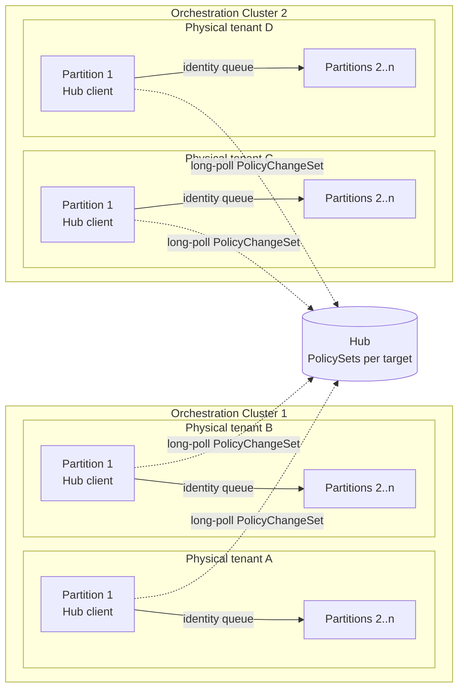
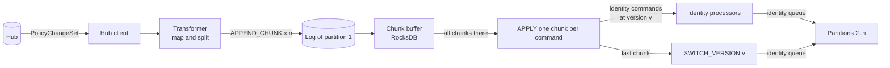
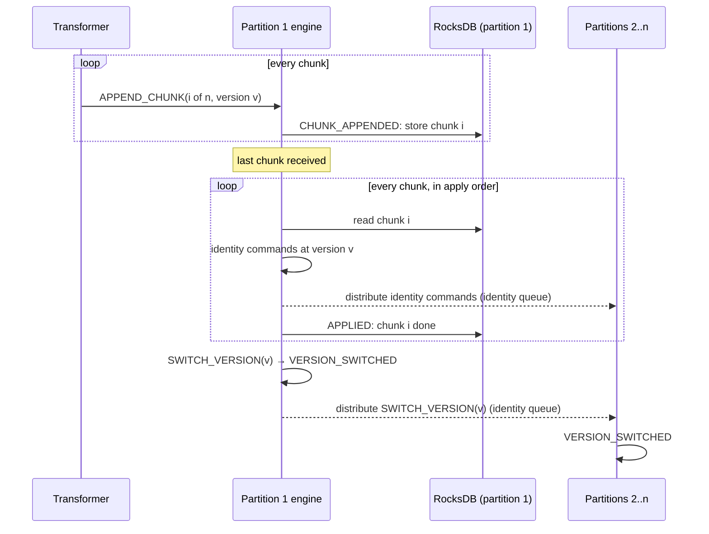

# Hub-managed identity data

An Orchestration Cluster (OC) either manages its identity data locally or receives it from Hub.
This document describes how Hub distributes identity data to OCs and how the engine applies it.
The decisions behind the engine design are recorded in
[ADR 0014](../../zeebe/docs/adr/0014-811-hub-managed-identity-policy-updates.md).

The overall architecture of the identity fan-out from Hub is described in the
[arc42 documentation of centralized IAM management via Hub](https://github.com/camunda/pdp-initiative-ea-identity--access-at-scale/tree/main/centralized-iam-management-via-hub/arc42)
(internal, until it has its final place).

## Solution architecture

### Terms

|      Term       |                                                                                                       Meaning                                                                                                       |
|-----------------|---------------------------------------------------------------------------------------------------------------------------------------------------------------------------------------------------------------------|
| Policy          | The identity data that authorizes access in an OC: tenants, roles, groups, mapping rules, memberships and authorizations. Users and clients are not entities; they appear only as members and authorization owners. |
| Policy version  | A number Hub assigns to each committed state of a policy. It starts at 1 and only grows.                                                                                                                            |
| PolicySet       | The complete policy of one target at one policy version, as Hub holds it.                                                                                                                                           |
| PolicyChangeSet | The unit Hub sends to an OC through the Hub client: the upserts and deletions up to a target policy version, and the Hub sequence it was polled up to.                                                              |
| Hub sequence    | The polling cursor of the Hub client. The OC stores it with the committed policy version and resumes polling from it.                                                                                               |

A `PolicyChangeSet` always contains exactly the upserts and deletions that turn version `n-x` into
version `n`. It may aggregate more than one version change.

The change set defines a fixed apply order, which the OC follows:

1. Upsert tenants, roles, groups and mapping rules.
2. Upsert memberships.
3. Upsert authorizations.
4. Delete authorizations.
5. Delete memberships.
6. Delete mapping rules, groups, roles and tenants.

A change set for a policy version that is already applied is rejected, so a repeated delivery has
no effect.

### Modes

Each physical tenant runs in one of two modes. The modes are not mixed, and switching a running
physical tenant from one mode to the other is not covered.

|      Mode       |                                       Who writes identity data                                       | Policy version of the data |
|-----------------|------------------------------------------------------------------------------------------------------|----------------------------|
| **Local**       | The identity APIs of the OC, as without Hub.                                                         | Always 0                   |
| **Hub managed** | Hub, through policy updates. The OC only projects the policy; it is not the source of identity data. | 1 or more                  |

The engine supports both modes with the same state and processors. A local physical tenant never
leaves version 0, and its state has exactly the layout it had before policy versioning.

### Distribution

Every physical tenant has its own partition set, and each set has its own partition 1. In
hub-managed mode, the leader of partition 1 uses the Hub client library to long-poll Hub, starting
from the stored Hub sequence. While an update is open, the client does not poll the next change
set; how the client learns that the update is applied is an open question of the ADR. The engine
distributes each update to the other partitions of the same physical tenant.



## Technical architecture in the OC

### Overview

A policy update passes through four steps. Steps 2 to 4 run in the engine of partition 1, which
coordinates the update. Policy update records are only ever processed on partition 1; the other
partitions only receive identity commands and the final version switch.

1. **Receive and split.** The Hub client hands the change set to the transformer in the broker,
   which maps the Hub DTOs to records. It accepts the update only while the broker leads
   partition 1. The transformer splits the change set into chunks and writes one `APPEND_CHUNK`
   command per chunk to the log.
2. **Buffer.** The engine stores each chunk in RocksDB until all chunks of the update are there.
3. **Apply.** The engine applies the buffered chunks one at a time. Each chunk becomes ordinary
   identity commands, written at the update's policy version. The existing identity processors
   handle them and distribute them to the other partitions.
4. **Switch.** After the last chunk, the engine switches partition 1 to the new policy version and
   distributes the switch. Only then does the new policy become visible.



### Splitting

A record and the event batch of one command are each limited to 4 MB, while a change set can be far
larger. The transformer keeps every chunk under a configurable byte budget:

- A chunk holds only whole entities; an entity is never split. An entity larger than the budget
  gets a chunk of its own.
- The size of an entity is its msgpack length plus a fixed margin, so the estimate stays above the
  size it takes in the chunk.
- Chunks never mix apply phases, and they are ordered by the apply order. So the chunk index is also
  the apply order.

A small change set results in a single chunk.

### Buffering and applying



- **Buffering.** The chunks are stored on partition 1 under the update's `updateId`. They are not
  applied before the last chunk arrives, so a partially received update never changes identity
  data. Chunks may arrive in any order; a duplicate chunk is rejected without effect.
- **One chunk per `APPLY_CHUNK`.** Each `APPLY_CHUNK` command applies exactly one chunk and then writes the next
  `APPLY_CHUNK`. This bounds the batch of the `APPLY_CHUNK` command itself. Each identity command it writes is
  processed in its own batch, which includes its cascades: deleting a role, for example, also
  removes its memberships and owned authorizations. The chunk budget does not bound those.
- **Reuse of identity commands.** A chunk becomes the existing identity commands, for example
  `RoleIntent.CREATE` or `UPDATE`, `GroupIntent.ADD_ENTITY` or `AuthorizationIntent.DELETE`. An
  upsert of an existing entity becomes an update, and an authorization upsert is reconciled to the
  exact permission set of its key. The commands are internal commands without request metadata, so
  they bypass the authorization check of the requesting user. They carry the update's
  `policyVersion`, so every exported identity record shows which policy version it belongs to.
- **Distribution.** The identity processors distribute each command to all other partitions on the
  `IDENTITY` distribution queue, as they do for commands from the identity APIs. A queue delivers in
  order to each partition.
- **One update at a time.** The Hub client does not hand over a new change set while an update is
  open.

The buffer uses two column families on partition 1:

| Column family         | Key                 | Value                                                                                     |
|-----------------------|---------------------|-------------------------------------------------------------------------------------------|
| `POLICY_UPDATE`       | `updateId`          | The open update: policy version, seqNo, chunk count, received and applied chunks, status. |
| `POLICY_UPDATE_CHUNK` | (`updateId`, index) | A buffered chunk.                                                                         |

### Version switch

The last `APPLY_CHUNK` writes the `SWITCH_VERSION` command. Partition 1 processes it first and writes
`VERSION_SWITCHED`, which sets its current policy version and Hub sequence and removes the update's
buffered chunks. It then distributes the command on the `IDENTITY` queue. Because the update's
identity commands were distributed on the same queue before, every partition switches only after it
has applied the whole update. A partition that is already at that version or a newer one rejects
the switch and still acknowledges the distribution.

Partitions switch independently, so for a short time some partitions may still authorize with the
old policy while others already use the new one.

## Records and intents

All policy update records share one value type, `ValueType.POLICY_UPDATE`, with the record value
`PolicyUpdateRecordValue`. Only `APPEND_CHUNK` transports policy data: it carries one chunk. The
other intents control the update and carry only its identifiers.

|          Property          |                                                         Content                                                          |
|----------------------------|--------------------------------------------------------------------------------------------------------------------------|
| `policyId`                 | The ID of the policy.                                                                                                    |
| `policyVersion`            | The version the update establishes.                                                                                      |
| `basePolicyVersion`        | The base version this update is derived from.                                                                            |
| `seqNo`                    | The Hub sequence the change set was polled up to.                                                                        |
| `updateId`                 | A grouping identifier for the chunks of one update, defined by the transformer.                                          |
| `chunkIndex`, `chunkCount` | Position of the chunk and the total number of chunks.                                                                    |
| Upserts                    | `tenants`, `roles`, `groups`, `mappingRules`, `authorizations` (the existing identity record values), and `memberships`. |
| Deletes                    | `deletes` (entity type and ID), `membershipDeletes` and `authorizationDeletes`.                                          |
| `errorMessage`             | An error message if the update failed.                                                                                   |

A membership is a `PolicyMembershipEntryValue`: target type and ID (tenant, role or group), member
type and ID.

|       Intent       |  Kind   |                                              Usage                                              |
|--------------------|---------|-------------------------------------------------------------------------------------------------|
| `APPEND_CHUNK`     | Command | Written by the transformer, one per chunk. Validated and buffered.                              |
| `CHUNK_APPENDED`   | Event   | A chunk is stored. After the last chunk, the processor writes the first `APPLY_CHUNK`.          |
| `APPLY_CHUNK`      | Command | Internal follow-up. Applies the next buffered chunk.                                            |
| `CHUNK_APPLIED`    | Event   | A chunk is applied.                                                                             |
| `SWITCH_VERSION`   | Command | Internal follow-up after the last chunk; distributed to all partitions on the `IDENTITY` queue. |
| `VERSION_SWITCHED` | Event   | The partition's current policy version is set; the new policy becomes visible.                  |
| `ABORT`            | Command | Written by the transformer to abort a pending policy update (e.g. from a leader change).        |
| `ABORTED`          | Event   | An open update was discarded; its buffered chunks are removed.                                  |

The identity record values (`TenantRecordValue`, `RoleRecordValue`, `GroupRecordValue`,
`MappingRuleRecordValue`, `AuthorizationRecordValue`) carry an optional `policyVersion`, default 0.
Records without it read as version 0.

## Two-phase commit in the engine

An update can span many commands and many partitions, but it must become visible all at once. The
engine therefore writes the update first (phase 1) and makes it visible with a single version switch
per partition (phase 2).

### Versioned identity state

The identity column families keep every version of an entity side by side. The policy version is
the last part of the key:

|                 Column family                 |                        Key                        |
|-----------------------------------------------|---------------------------------------------------|
| `ROLES`, `TENANTS`, `GROUPS`                  | (ID, version)                                     |
| `MAPPING_RULES`                               | (claim name, claim value, version)                |
| `CLAIM_BY_ID`                                 | (mapping rule ID, version)                        |
| `RELATIONS_BY_ENTITY`, `ENTITIES_BY_RELATION` | (entity, relation, version)                       |
| `AUTHORIZATIONS`                              | (authorization key, version)                      |
| `AUTHORIZATION_KEYS_BY_OWNER`, `PERMISSIONS`  | (owner, version), (owner, resource type, version) |

- **Deletes are tombstones.** A delete writes a row with `deleted` set, instead of removing the row.
  A removed membership is stored with status `REMOVED`.
- **Lookup rows are copied on write.** `AUTHORIZATION_KEYS_BY_OWNER` (the authorization keys of an
  owner) and `PERMISSIONS` (the permissions of an owner per resource type) each combine several
  authorizations in one row. When an authorization changes, the row is copied to the new version
  first and then changed there.
- **Backwards compatible.** The key uses `DbVersionedKey`, which writes no suffix for version 0.
  A version-0 key is byte-identical to the key without a version, and the new value properties
  have defaults. A membership row stores `0xFF` for `ACTIVE`, the byte the earlier `DbNil` value
  wrote. Existing data therefore reads as version 0 without a migration, and local mode keeps
  writing that layout.

### Reading

A partition's current policy version is stored in `POLICY`. A read returns the latest version
of an entity that is not newer than the visible version, and treats a tombstone as absent:

```
visible = max(current policy version, policyVersion of the command)
```

- **Authorization checks** come from commands without a policy version, so they only see the
  committed version. Rows of an update in progress stay invisible to them.
- **The update's own commands** carry the update's version, so the update reads its own writes.
  The identity processors need this for their checks against the state: adding a member to a role
  that an earlier chunk created, deciding whether an upsert creates or updates an entity,
  reconciling an authorization with its permissions at version v, and finding the memberships a
  delete cascades to.
- **At version 0**, which is always the case in local mode, a read is a point lookup on the
  unversioned key.

### Commit

`VERSION_SWITCHED` is the commit. Until a partition processes it, the update's rows exist in that
partition's state but no authorization check sees them. A version that is never switched stays
invisible.

The committed policy of a partition is stored in the `POLICY` column family under a constant key:

|    Property     |                         Content                          |
|-----------------|----------------------------------------------------------|
| `policyId`      | The ID of the policy.                                    |
| `policyVersion` | The current policy version of the partition.             |
| `seqNo`         | The Hub sequence of that version; polling resumes there. |

### Cleanup

#### PolicyUpdate State

Only the last `PolicyUpdateRecordValue` of an update is kept in the `POLICY_UPDATE_ASSEMBLY` column family.

All chunks of a policy update are removed when
- the version switch, so they do not accumulate
- an update is aborted, so a failed update does not block the next one

#### Identity State

When a new policy version is committed, the old versions are deleted in the identity related entity
columns. In case of tombstones, the tombstone itself will be deleted so the whole entity is removed
from the state.

## Open points

The [ADR](../../zeebe/docs/adr/0014-811-hub-managed-identity-policy-updates.md) tracks these as open
questions, with options:

- **Rejected identity commands.** An identity processor can reject a command of the update, and the
  update would still be committed.
- **Pausing the polling.** The Hub client has to learn that an update is applied or has failed.
