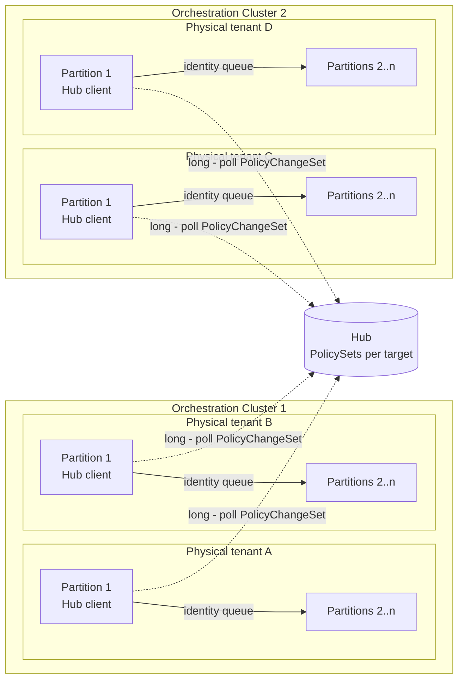
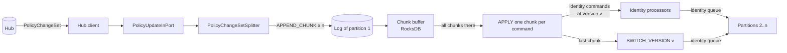
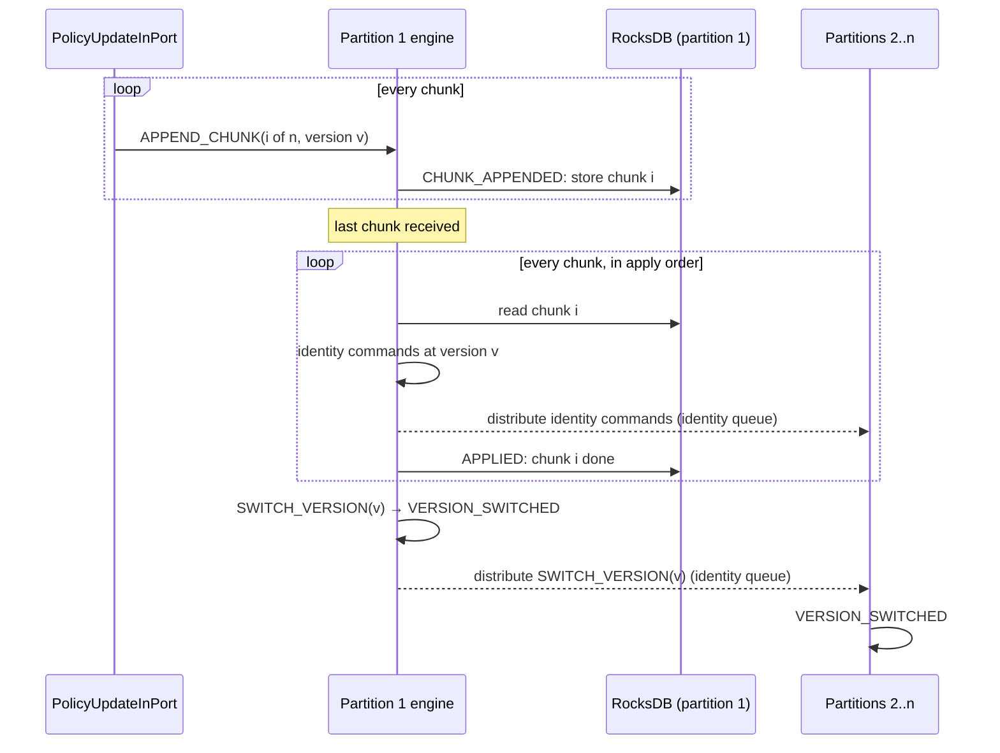

# Hub-managed identity data

An Orchestration Cluster (OC) either manages its identity data locally or receives it from Hub.
This document describes how Hub distributes identity data to OCs and how the engine applies it.
The decisions behind the engine design are recorded in
[ADR 0014](../../zeebe/docs/adr/0014-811-hub-managed-identity-policy-updates.md).

## Solution architecture

### Terms

| Term            | Meaning                                                                                                                                                                                                             |
|-----------------|---------------------------------------------------------------------------------------------------------------------------------------------------------------------------------------------------------------------|
| Policy          | The identity data that authorizes access in an OC: tenants, roles, groups, mapping rules, memberships and authorizations. Users and clients are not entities; they appear only as members and authorization owners. |
| Policy version  | A number Hub assigns to each committed state of a policy. It starts at 1 and only grows.                                                                                                                            |
| PolicySet       | The complete policy of one target at one policy version, as Hub holds it.                                                                                                                                           |
| PolicyChangeSet | The unit Hub sends to an OC: `PolicyChangeSet(policyVersion, kind, upserts, deletions)` from the hub-client.                                                                                                        |

A `PolicyChangeSet` contains always exactly the listed upserts and deletions that turn version `n-x`
into version `n`. The `PolicyChangeSet` may be an aggregation of more than one version change.

The change set defines a fixed apply order, which the OC follows:

1. Upsert tenants, roles, groups and mapping rules.
2. Upsert memberships.
3. Upsert authorizations.
4. Delete authorizations.
5. Delete memberships.
6. Delete mapping rules, groups, roles and tenants.

Applying the same policy version twice is idempotent and must be rejected by the broker.

### Modes

Each physical tenant runs in one of two modes. The modes are not mixed, and switching a running
physical tenant from one mode to the other is not covered.

| Mode            | Who writes identity data                                                                             | Policy version of the data |
|-----------------|------------------------------------------------------------------------------------------------------|----------------------------|
| **Local**       | The identity APIs of the OC, as without Hub.                                                         | Always 0                   |
| **Hub managed** | Hub, through policy updates. The OC only projects the policy; it is not the source of identity data. | 1 or more                  |

The engine supports both modes with the same state and processors. A local physical tenant never
leaves version 0, and its state has exactly the layout it had before policy versioning.

### Distribution

Every physical tenant has its own partition set, and each set has its own partition 1. In
hub-managed mode, the leader of partition 1 uses the Hub client library to long-poll Hub for change
sets newer than its current policy version. The engine then distributes the result to the other
partitions of the same physical tenant.



## Technical architecture in the OC

### Overview

A policy update passes through four steps. Steps 2 to 4 run in the engine of partition 1, which
coordinates the update. Policy update records are only ever processed on partition 1; the other
partitions only receive identity commands and the final version switch.

1. **Receive and split.** The Hub client hands the change set to `PolicyUpdateInPort` in the broker.
   It accepts the update only while the broker leads partition 1. `PolicyChangeSetSplitter` splits
   the
   change set into chunks, and the in-port writes one `APPEND_CHUNK` command per chunk to the log.
2. **Buffer.** The engine stores each chunk in RocksDB until all chunks of the update are there.
3. **Apply.** The engine applies the buffered chunks one at a time. Each chunk becomes ordinary
   identity commands, written at the update's policy version. The existing identity processors
   handle them and distribute them to the other partitions.
4. **Switch.** After the last chunk, the engine switches partition 1 to the new policy version and
   distributes the switch. Only then does the new policy become visible.



### Splitting

A record and the event batch of one command are each limited to 4 MB, while a change set can be far
larger. The splitter keeps every chunk under a byte budget, initially 1 MiB:

- A chunk holds only whole entities; an entity is never split. An entity larger than the budget
  gets a chunk of its own.
- The size of an entity is its msgpack length plus a fixed margin, so the estimate stays above the
  size it takes in the chunk.
- Chunks never mix apply phases, and they are ordered by the apply order. So the chunk index is also
  the apply order.

A small change set results in a single chunk.

### Buffering and applying



- **Buffering.** The chunks are stored on partition 1 under the update's `envelopeId`. They are not
  applied before the last chunk arrives, so a partially received update never changes identity
  data. Chunks may arrive in any order; a duplicate chunk is rejected without effect.
- **One chunk per `APPLY`.** Each `APPLY` command applies exactly one chunk and then writes the next
  `APPLY`, so the events of one command stay within the chunk budget.
- **Reuse of identity commands.** A chunk becomes the existing identity commands, for example
  `RoleIntent.CREATE` or `UPDATE`, `GroupIntent.ADD_ENTITY` or `AuthorizationIntent.DELETE`. An
  upsert of an existing entity becomes an update, and an authorization upsert is reconciled to the
  exact permission set of its key. The commands are internal commands without request metadata, so
  they bypass the authorization check of the requesting user.
- **Distribution.** The identity processors distribute each command to all other partitions on the
  `IDENTITY` distribution queue, as they do for commands from the identity APIs. A queue delivers in
  order to each partition.
- **Superseding.** Only one update is open at a time. A chunk of a newer version aborts an open
  update of an older version (`ABORTED`) and discards its buffered chunks. A chunk of the current
  version is rejected as already applied; a chunk of an older version, or of a version that is not
  newer than the open update, is rejected as invalid.

### Version switch

The last `APPLY` writes the `SWITCH_VERSION` command. Partition 1 processes it first and writes
`VERSION_SWITCHED`, which sets its current policy version and removes the update's buffered chunks.
It then distributes the command on the `IDENTITY` queue. Because the update's identity commands were
distributed on the same queue before, every partition switches only after it has applied the whole
update. A partition that is already at that version or a newer one rejects the switch and still
acknowledges the distribution.

Partitions switch independently, so for a short time some partitions may still authorize with the
old policy while others already use the new one.

## Records and intents

All policy update records share one value type, `ValueType.POLICY_UPDATE`, with the record value
`PolicyUpdateRecordValue`.

| Property                   | Content                                                                                                                  |
|----------------------------|--------------------------------------------------------------------------------------------------------------------------|
| `policyId`                 | The ID of the policy.                                                                                                    |
| `policyVersion`            | The version the update establishes.                                                                                      |
| `updateId`                 | A grouping identifier for related chunks, defined by the splitter.                                                       |
| `chunkIndex`, `chunkCount` | Position of the chunk and the total number of chunks.                                                                    |
| Upserts                    | `tenants`, `roles`, `groups`, `mappingRules`, `authorizations` (the existing identity record values), and `memberships`. |
| Deletes                    | `deletes` (entity type and ID), `membershipDeletes` and `authorizationDeletes`.                                          |
| `errorMessage`             | An error message if the update failed.                                                                                   |

A membership is a `PolicyMembershipEntryValue`: target type and ID (tenant, role or group), member
type and ID.

| Intent             | Kind    | Usage                                                                                           |
|--------------------|---------|-------------------------------------------------------------------------------------------------|
| `APPEND_CHUNK`     | Command | Written by `PolicyUpdateInPort`, one per chunk. Validated and buffered.                         |
| `CHUNK_APPENDED`   | Event   | A chunk is stored. After the last chunk, the processor writes the first `APPLY`.                |
| `APPLY`            | Command | Internal follow-up. Applies the next buffered chunk.                                            |
| `APPLIED`          | Event   | A chunk is applied; `lastPage` marks the last one.                                              |
| `SWITCH_VERSION`   | Command | Internal follow-up after the last chunk; distributed to all partitions on the `IDENTITY` queue. |
| `VERSION_SWITCHED` | Event   | The partition's current policy version is set; the new policy becomes visible.                  |
| `ABORTED`          | Event   | An open update was superseded by a newer version; its buffered chunks are removed.              |

The identity record values (`TenantRecordValue`, `RoleRecordValue`, `GroupRecordValue`,
`MappingRuleRecordValue`, `AuthorizationRecordValue`) carry an optional `policyVersion`, default 0.
Records without it read as version 0.

## Two-phase commit in the engine

An update can span many commands and many partitions, but it must become visible all at once. The
engine therefore writes the update first (phase 1) and makes it visible with a single version switch
per partition (phase 2).

### Versioned identity state

The identity column families keep every version of an entity side by side. The policy version is
the last part of the key:

| Column family                                 | Key                                               |
|-----------------------------------------------|---------------------------------------------------|
| `ROLES`, `TENANTS`, `GROUPS`                  | (ID, version)                                     |
| `MAPPING_RULES`                               | (claim name, claim value, version)                |
| `CLAIM_BY_ID`                                 | (mapping rule ID, version)                        |
| `RELATIONS_BY_ENTITY`, `ENTITIES_BY_RELATION` | (entity, relation, version)                       |
| `AUTHORIZATIONS`                              | (authorization key, version)                      |
| `AUTHORIZATION_KEYS_BY_OWNER`, `PERMISSIONS`  | (owner, version), (owner, resource type, version) |

- **Deletes are tombstones.** A delete writes a row with `deleted` set, instead of removing the row.
  A removed membership is stored with status `REMOVED`.
- **Aggregates are copy-on-write.** The authorization keys of an owner and the permissions are
  copied to the new version before they change.
- **Backwards compatible.** The key uses `DbVersionedKey`, which writes no suffix for version 0.
  A version-0 key is byte-identical to the key without a version, and the new value properties
  have defaults. A membership row stores `0xFF` for `ACTIVE`, the byte the earlier `DbNil` value
  wrote. Existing data therefore reads as version 0 without a migration, and local mode keeps
  writing that layout.

### Reading

A partition's current policy version is stored in `POLICY`. A read returns the latest version
of an entity that is not newer than the visible version, and treats a tombstone as absent:

```
visible = max(current policy version, policyVersion of the command)
```

- **Authorization checks** come from commands without a policy version, so they only see the
  committed version. Rows of an update in progress stay invisible to them.
- **The update's own commands** carry the update's version, so the update reads its own writes, for
  example a role it created in an earlier chunk.
- **At version 0**, which is always the case in local mode, a read is a point lookup on the
  unversioned key.

### Commit

`VERSION_SWITCHED` is the commit. Until a partition processes it, the update's rows exist in that
partition's state but no authorization check sees them. A version that is never switched stays
invisible.

### Column families of the update itself

| Column family            | Key                   | Value                                                               |
|--------------------------|-----------------------|---------------------------------------------------------------------|
| `POLICY`                 | constant              | The current policy.                                                 |
| `POLICY_UPDATE_ASSEMBLY` | `envelopeId`          | The open update: version, chunk count, received and applied chunks. |
| `POLICY_UPDATE_CHUNK`    | (`envelopeId`, index) | A buffered chunk.                                                   |

#### Local Policy state

| Property        | Content                                      |
|-----------------|----------------------------------------------|
| `policyId`      | The ID of the policy.                        |
| `policyVersion` | The current policy version of the partition. |

## Open points

- **Hub client.** The polling contract of the Hub client library (long-poll timeout, back-off,
  gap detection) is defined outside the engine.
- **Aborted updates.** Aborting an update removes only its buffered chunks. If it had already
  applied chunks, their rows stay in the state and would become visible with the next switched
  version, because a read takes the latest version up to the visible one.
- **Old versions.** No cleanup of superseded versions and tombstones is defined yet.
- **Switch window.** Partitions switch independently (see [Version switch](#version-switch)).

The [ADR](../../zeebe/docs/adr/0014-811-hub-managed-identity-policy-updates.md) tracks these as open
questions.

