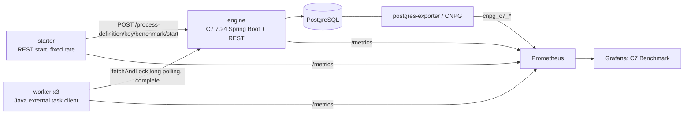

# Camunda 7 Load Tests

Performance benchmark for Camunda 7, built to compare with the Camunda 8 load tests in
[`load-tests/`](..) (C8).

Measures:

- Process instances started and completed per second
- Process instance duration (latency) p50/p90/p99
- How both change as state grows (history tables, database size)
- Database cost per process instance (transactions, rows, WAL bytes)

## Architecture



Mapping to the C8 load test:

| C8 load test | C7 load test |
|---|---|
| Orchestration Cluster (broker + gateway) | `engine`: embedded C7 engine + REST API, N replicas on one DB |
| RocksDB/Raft (primary), ES/RDBMS (secondary) | PostgreSQL only (runtime + history in one DB) |
| `starter` (REST, 300 PI/s default) | `starter` (REST, same metric names, same rate model) |
| `worker` job worker (streaming, capacity 60, 50 ms delay) | `worker` external task client (long polling, capacity 60, 50 ms delay) |
| `bpmn/one_task.bpmn` | `bpmn/one_task.bpmn` with `camunda:type="external"` |
| `typical_payload.json` | same file, objects stored as `Json` variables (Spin) |
| `zeebe_process_instance_execution_time` | `c7_process_instance_duration_seconds` |
| `zeebe_element_instance_events_total{type="PROCESS"}` | `c7_process_instances_total{event}` |

## Layout

| Path | Content |
|---|---|
| `engine/` | C7 engine app: REST API, Prometheus metrics, engine plugin with command and history metrics |
| `load-tester/` | Starter and worker (one app, Spring profile `starter` or `worker`) |
| `local/` | Docker Compose stack: PostgreSQL, engine, starter, 3 workers, Prometheus, Grafana |
| `monitor/grafana/` | Dashboard `C7 Benchmark` and its generator |
| `monitor/postgres/queries.yaml` | PostgreSQL metrics (table growth, WAL, backlog), shared by local exporter and CNPG |
| `setup/` | Helm chart, `newLoadTest.sh` and Makefile for the benchmark GKE cluster |
| ECS + Aurora | Terraform lives in [camunda-load-tests-ecs `aws/c7_benchmark`](https://github.com/camunda/camunda-load-tests-ecs/tree/main/aws/c7_benchmark) |
| `results/` | Results collector: `loadtestctl report` queries, time series, CloudWatch, S3 upload |
| `docs/metrics.md` | Metrics and PromQL |

## Run locally

Requires Docker (about 6 GB memory for the stack).

```bash
cd local
docker compose up -d --build
```

- Grafana: http://localhost:3000 (dashboard `C7 Benchmark`, no login)
- Prometheus: http://localhost:9090
- Engine REST: http://localhost:8080/engine-rest
- Cockpit: http://localhost:8080/camunda (demo/demo)

Parameters (environment variables for `docker compose up`):

| Variable | Default | Meaning |
|---|---|---|
| `RATE` | 50 | Process instances started per second |
| `WORKER_REPLICAS` | 3 | Worker containers |
| `WORKER_CAPACITY` | 60 | Tasks in progress per worker |
| `WORKER_COMPLETION_DELAY` | 50ms | Simulated work per task |
| `PAYLOAD` | `payload/typical_payload.json` | Variables payload |
| `HISTORY_LEVEL` | full | `none`, `activity`, `audit`, `full` |
| `HISTORY_REMOVAL_TIME_STRATEGY` | end | C7 default; `start` avoids updating history rows at instance end |
| `DB_URL_PARAMS` | empty | Extra JDBC URL parameters, e.g. `?reWriteBatchedInserts=true` |
| `COCKPIT_ENABLED` | true | Serve Cockpit (off by default on the cluster) |
| `ENGINE_PROFILES` | default | `history-cleanup` enables history cleanup |
| `DB_POOL_SIZE` | 30 | Hikari pool size of the engine |

Change the rate while running:

```bash
RATE=300 docker compose up -d starter
```

Start over with an empty database:

```bash
docker compose down -v
```

Local numbers depend on the laptop. Use them to validate the setup and to compare runs on the same machine, not as reference results.

## Run on the benchmark cluster

Same conventions as the C8 load tests: one namespace per test, TTL via `deadline-date`, CNPG PostgreSQL, Prometheus Operator scraping. Access via Teleport as described in the [C8 load-tests README](../README.md).

1. Build and push the images (once per change):

   Run the [C7 load test images workflow](../../.github/workflows/c7-load-test-images.yml) (Actions tab, `workflow_dispatch`). It pushes `c7-benchmark-engine`, `c7-benchmark-load-tester` and `c7-benchmark-results` to `registry.camunda.cloud/team-zeebe`. `make push` does the same from a machine logged in to that registry.

2. Create and install a test:

   ```bash
   cd setup
   ./newLoadTest.sh my-test 3
   cd c7-my-test
   # set global.nodeSelector / tolerations to a non-N2 pool in values.yaml
   make install
   ```

3. Operate:

   ```bash
   make rate rate=500     # change load
   make state             # table sizes
   make top-queries       # pg_stat_statements
   make clean             # delete
   ```

The chart deploys: `engine` (Deployment + Service), `starter`, `worker`, CNPG `Cluster` with the C7 custom queries, two PodMonitors. Set `monitoring.grafanaDashboard.enabled=true` to ship the dashboard as a ConfigMap, or import `monitor/grafana/c7-benchmark.json` into https://dashboard.benchmark.camunda.cloud.

## Scenarios

| Scenario | How |
|---|---|
| Max throughput (C8 `max`) | Increase `starter.rate` until `completed PI/s` stops following `started PI/s` or open external tasks grow |
| Latency (C8 `latency`) | `starter.rate=1` |
| Growing state | Default. History cleanup off, history level `full`. Run for hours, read the "Growing state" row |
| Steady state | `engine.historyCleanup=true`, `starter.historyTimeToLive=PT1H` (local: `ENGINE_PROFILES=history-cleanup`) |
| C7 cluster | `engine.replicas=N` on the same database |
| Bigger payload | `starter.payloadPath=payload/big_payload.json`, same for worker |

To pre-fill history before a measurement, run the starter at high rate with `worker.completionDelay=0ms` until `act_hi_procinst` reaches the target size, then switch to the measurement rate.

## What the numbers include

- One start via REST is two engine transactions: `ProcessDefinitionQueryImpl` (resolve key to latest version) and `StartProcessInstanceCmd`. Both show up in the "Engine commands" row.
- `c7_process_instance_duration_seconds` is end time minus start time from `ACT_HI_PROCINST`. It includes the worker completion delay (50 ms default), like the C8 metric.
- Engine counters are recorded on commit. Rolled back transactions (e.g. optimistic locking) are not counted as throughput; they show up as `outcome="optimistic_locking"` on `c7_command_duration_seconds`.
- PostgreSQL table rows come from `pg_stat_user_tables.n_live_tup` (estimate, cheap to query at any size). Runtime backlog (`cnpg_c7_runtime_*`) uses exact `count(*)`.

## Local baseline (2026-11-10, MacBook, Docker Desktop)

Engine 3 CPU, PostgreSQL 4 CPU, history level `full`, `typical_payload.json`, 3 workers, fresh database, 50 PI/s:

| Metric | Value |
|---|---|
| Started / completed | 50.0 / 50.0 PI/s |
| Open external tasks | 3 to 5 |
| PI duration p50 | 60 to 75 ms |
| PI duration p99 | 0.11 to 1.0 s |

At 100 PI/s the local PostgreSQL saturates and the external task backlog grows. In that state durations rise to minutes because instances wait in the queue, not because they fail. Keep local runs below saturation, or use `./local/ramp.sh "50 75 100" 180` to find the limit on a given machine.

## Results

`make results DURATION=1800` writes `results-out/<run-id>/` with `report.json`/`report.csv` (`loadtestctl report`, C8-compatible keys), `timeseries.csv` and `metadata.json`. Same format on GKE and ECS, see the [ECS runbook](https://github.com/camunda/camunda-load-tests-ecs/tree/main/aws/c7_benchmark).

## Open points

- Node pool for C7 on the benchmark cluster (workshop: not N2).
- Image registry and pull secret: chart defaults to `registry.camunda.cloud/team-zeebe` with `harbor-registry`, same as C8. Confirm push rights.
- Engine sizing to match the C8 Orchestration Cluster resources for a fair comparison.
- Aurora on ECS: see [camunda-load-tests-ecs](https://github.com/camunda/camunda-load-tests-ecs/tree/main/aws/c7_benchmark).
- GKE deploy workflow (`camunda-load-test.yml` equivalent). Images are built by `c7-load-test-images.yml`; deployment is manual (`make install`).
