# The log archive: one copy of the log for restore and replay

Status: proof of concept, October 2026. Code on branch `poc/log-archive` in `camunda/camunda` (head
`fb69e1eb8b0`) and in `camunda/event-plane` (head `ea6c7ce`). The full implementation spec is
[`log-archive-poc.md`](log-archive-poc.md), the manual test runs are in
[`log-archive-manual-test.md`](log-archive-manual-test.md), and how to start the whole stack
locally in each configuration is in [`log-archive-run-locally.md`](log-archive-run-locally.md).

**In short:**

- **Problem.** Restore and consumer replay both need each partition's log. Kept separately, that is
  two copies, two implementations, and continuous backup cannot reach an RPO of seconds.
- **Approach.** The cluster writes its log to object storage every few seconds, as small objects,
  plus periodic snapshots and a gap-free commit log, so the bucket describes itself and restore
  needs nothing else. Existing backups stay untouched; a cluster switches over once, at a handover.
- **Event plane.** Consumers read the same copy. One authority compacts it and applies retention,
  removes only what lies below the restore hold, and records every change in a log of its own that
  restore checks.
- **Cost.** Far cheaper than frequent backups plus a separate copy for consumers, and about the same
  as backups every 15 minutes, with an RPO of seconds instead of minutes.
- **Recommendation.** Build it. The one real risk is restore correctness, handled by checking restore
  points continuously and keeping mistakes repairable (section 7).

Terms are explained in the glossary (section 10), and where to find things in the code in section 11.

This document builds the concept up in layers. Each layer works on its own, and the next one only
adds to it:

1. **The problem**: why one copy.
2. **Layer 1, the log archive in the cluster**: the cluster writes its log and snapshots to object
   storage, and restore works from there.
3. **Layer 2, clusters that already have backups**: how an existing cluster switches over without
   touching its old backups.
4. **Layer 3, the event plane**: consumers read the same copy, and one component compacts it and
   applies retention without putting restore at risk.
5. **What the PoC shows**, **frequently asked questions**, **the recommendation** and **what is
   open**.

Claims are marked **[run]** when a test or a manual run showed them, **[code]** when they were
checked in the code but not run, and **[proposed]** when they are not built.

**Constraints that hold for every layer:**

- **Restore needs only the cluster's code and the bucket.** No other service, including the event
  plane, has to run or be correct for a restore to work.
- **Nothing a restore needs is deleted.** Only data before the restore floor is ever removed. If a
  component breaks that rule, the cluster notices it while the deleted data can still be recovered
  (4.7).
- **One representation** of the log serves restore and replay; nobody converts between formats.
- **Existing backups are never modified.** They stay restorable with the code that wrote them.
- **The cluster never waits** for the event plane.
- **No extra burden for users**: no second copy and no extra system to operate.

## 1. The problem

Two features need the history of every partition's log:

- **Restore** needs a snapshot plus the log from that snapshot up to the restore point.
- **Consumers** of the event plane want to read the log from any position, including far back.

Built separately, that means two copies of the same data, written by two implementations.

### 1.1 What one copy costs, compared with two

Restore and replay together, for an example cluster: 8 partitions, 1 GB of state each, 1 MB/s of
log each, everything kept for 7 days, on S3. Per month:

|                    Setup                     | Cost per month |     RPO      |
|----------------------------------------------|----------------|--------------|
| Continuous backup every 15 minutes + a copy for consumers | about $210 | 15 minutes |
| Continuous backup every minute + a copy for consumers     | about $2,200 | 1 minute |
| Log archive, one copy for both                | about $180     | a few seconds |

Why: every continuous backup uploads the whole state again, so a lower RPO quickly gets expensive.
The log archive uploads each piece of log once and a snapshot every 30 minutes; most of what it pays
is for writing every few seconds.

The state size shifts the picture a little: with 100 MB per partition, backups every 15 minutes are
somewhat cheaper than the archive (about $100 against $125); with 10 GB, the archive costs about
half (about $740 against $1,320).

How the numbers come about:

**Assumptions** (illustrative, not measured on a real cluster):

|      Assumption       |                                                Value                                                 |
|-----------------------|------------------------------------------------------------------------------------------------------|
| Cluster               | 8 partitions, each writing 1 MB/s of log and holding 1 GB of state                                   |
| Retention             | 7 days, for restore and for replay                                                                   |
| Prices                | S3 Standard list prices (us-east-1): $0.023 per GB-month, $0.005 per 1,000 PUTs; check current prices |
| Compression           | the log compresses about 8 times with zstd (the PoC measured 7 to 11 times on its test load)        |
| Freshness for consumers | new log reaches the bucket every 2 seconds                                                         |

**Where the money goes.** Each setup pays for storage and for write requests (PUTs):

- **Continuous backup** uploads a full snapshot (the whole state, 1 GB) and the journal segment it
  ends in (a 128 MB file, uploaded whole because segment files are preallocated) with every backup,
  and keeps every backup for 7 days. Its cost is set by the state size and how often it backs up,
  which is also its RPO. How backups choose their files was read in the code **[code]**.
- **A separate copy for consumers** stores the compressed log and writes one object every 2 seconds
  per partition.
- **The log archive** stores the compressed log once, writes one object and one commit entry every 2
  seconds per partition, and uploads a full snapshot every 30 minutes, kept for 7 days. Its RPO is a
  few seconds.

**Worked example:** 1 GB of state, continuous backup every 15 minutes, per month for the cluster.

|                     | Two copies: backup every 15 min + copy for consumers | One copy: log archive              |
|---------------------|-------------------------------------------------------|------------------------------------|
| Log storage         | $14 (the consumer copy)                               | $14                                |
| Snapshot storage    | $139 (672 backups of 1.128 GB per partition)          | $62 (336 snapshots of 1 GB per partition) |
| PUTs                | $3 (backups) + $52 (consumer copy)                    | $104 (objects and commit entries) + $1 (snapshots) |
| **Total**           | **$208**                                              | **$181**                           |
| RPO for restore     | at least 15 minutes                                   | a few seconds                      |

**The same for other backup intervals and state sizes,** totals per month:

| State per partition | Backup every minute + copy | Backup every 15 min + copy | Log archive |
|---------------------|----------------------------|----------------------------|-------------|
| 100 MB              | $530                       | $97                        | $125        |
| 500 MB              | $1,272                     | $146                       | $150        |
| 1 GB                | $2,199                     | $208                       | $181        |
| 5 GB                | $9,618                     | $703                       | $428        |
| 10 GB               | $18,892                    | $1,321                     | $737        |
| **RPO**             | at least 1 minute          | at least 15 minutes        | a few seconds |

What the numbers say:

- **Against frequent backups the archive is far cheaper**, 4 to 26 times here. Frequent backups are
  the only way continuous backup gets a low RPO, and each one uploads the whole state.
- **Against backups every 15 minutes it costs about the same for a small state and less for a large
  one**, while its RPO drops from 15 minutes to a few seconds.
- **The archive's largest item is the PUTs for freshness** ($104). New log every 10 seconds instead of
  every 2 brings them to $21, if consumers and restore can live with that.
- **Its snapshots can be taken less often** without changing the RPO, since the log covers the time in
  between; a restore then replays more log.
- **Restore alone** (no consumers): the archive only needs to be as fresh as the RPO. At an RPO of 15
  minutes and 1 GB of state it costs $77, against $142 for continuous backup.

Left out on both sides: read requests (restores, consumers) and the archive's compaction (layer 3).

### 1.2 Two implementations to maintain

Two copies need two writers, two formats, two retention policies and two sets of bugs. They can
drift apart: a consumer may read history that restore no longer has, or the other way round.

### 1.3 A missed opportunity: an RPO of seconds

Continuous backup takes a backup every interval (for example every minute): a fresh snapshot plus
the journal segments from the one holding the snapshot's index to the newest one (1.1). A restore point (a marker checkpoint) only
becomes restorable once the next backup has uploaded the segments that contain it. The recovery
point objective (RPO) is therefore the backup interval plus the time the backup takes, and a
shorter interval multiplies the cost (1.1).

The cluster already replicates every entry within milliseconds. If the copy in object storage
followed the log within seconds, restore points would be restorable seconds after they are taken.

### 1.4 The goal

One copy of each partition's log in object storage, a few seconds behind the leader, that serves
restore and replay, and from which the cluster can restore on its own.

## 2. Layer 1: the log archive in the cluster

### 2.1 The idea

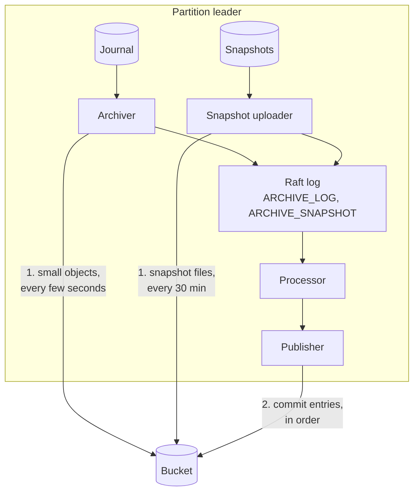

- The **archiver** cuts committed journal entries into an object every few seconds and uploads it.
- The **snapshot uploader** uploads the newest local snapshot on its own schedule (every 30 minutes
  by default). Snapshots are no longer tied to backups.
- Every upload is then **committed through the partition's Raft log**, like any other record. Only
  then does it count.
- The **publisher** writes every committed upload to the bucket as a numbered **commit entry**, so
  the bucket describes itself.

### 2.2 Why a commit log in object storage

**The cluster itself needs no commit log.** The archiver uploads an object and then writes a
command to the Raft log: "object X holds entries 481 to 960". Once Raft commits it, every replica
knows that the object is part of the archive. If the leader dies before that, the object is simply
never recorded, and the next leader uploads those entries again. The replicated state is all the
cluster needs.

**Readers outside the cluster cannot see that state.** Restore runs when the cluster is gone, and
the event plane only sees the bucket. So after Raft has committed an upload, the cluster writes the
same information into the bucket as a numbered file, a **commit entry**. Readers then get the same
answers the replicas have:

- **One answer per index.** The archiver only reads committed entries, so every object in the
  bucket holds correct entries. But after a leader change, objects of the old and the new leader can
  overlap with different boundaries. The commit entries name exactly one object for every index;
  the others are orphans that nobody reads (layer 3 deletes them).
- **Gap-free and ordered.** Commit entries are numbered 1, 2, 3, … per partition, in the order the
  events were applied. A reader knows when it has everything, and the event plane applies them in
  the same order as the replicas did (layer 3).
- **Deterministic.** Entry N is a pure function of the replicated state after event N, so any
  leader that publishes entry N writes the same bytes. Retries and leader changes are safe.
- **No listing.** A reader starts from a recent **summary** of the archive and reads only the few
  commit entries after it, instead of listing the bucket (see the request costs below).
- **Restore needs nothing else.** The bucket describes itself, so restore needs neither a running
  cluster nor any other service.

The commit log adds no new decisions; it is a copy of decisions Raft has already made, written for
readers.

**Couldn't readers work it out from the keys?** A key such as `data/…481-…960-t7.seg` holds the
first and last index and the term, so a reader could list `data/` and chain the objects by index.
For the log alone that almost works. What the keys do not say:

|                    Readers need                     |               Key or listing tells               |           Commit log tells           |
|-----------------------------------------------------|--------------------------------------------------|--------------------------------------|
| which object to use where objects overlap           | several candidates, all plausible                | exactly one per index                |
| record positions (consumers seek by position)       | no; read every object's footer                   | first and last position per object   |
| checkpoints: id, position, type, time               | no; read the log itself                          | covered checkpoints per object       |
| whether a snapshot upload is complete and usable    | files exist, maybe partly                        | committed with its index ≤ F         |
| whether an index gap is a lost object or an upload in flight | cannot tell                             | F says what is archived              |
| which timeline is current, where it takes over      | no                                               | `TIMELINE_STARTED`, `timeline.json`  |
| what compaction replaced or removed (layer 3)       | only what is still there                         | the maintenance log                  |

Restore needs the checkpoints and positions to choose a restore point at all, so without the commit
log it would have to read the whole log to find them.

**What it saves in requests.** S3 charges a LIST request like a PUT ($0.005 per 1,000) and a GET
12.5 times less ($0.0004 per 1,000). A LIST returns at most 1,000 keys and nothing but keys and
sizes. With the assumptions of 1.1 (8 partitions, one object every 2 s):

- **A reader that follows the log** by listing every 2 s pays 8 × 0.5 LIST/s × 2.59 M s = 10.4 M
  LISTs, $52 a month, and still learns only keys. Reading the next commit entries with GETs at the
  same rate costs $4. In the PoC the event plane does neither: the cluster sends it the commit
  entries (layer 3).
- **Restore** would have to list 7 days of one partition, 302,400 keys in 303 LIST pages, one
  after the other, and then read each candidate object's footer to learn its positions, since keys
  hold only indexes. With the commit log it reads the pointer to the newest summary, that summary,
  the index chunks it needs and the commit entries after the summary. In money both are cents per restore; the gain is fewer,
  parallel requests and no guessing which objects are valid.

### 2.3 The state machines

**Processor.** A new record type, `LOG_ARCHIVE`, carries the archive's commands. The engine and the
exporters ignore it. A command is accepted only if it fits the replicated state, so a stale or
duplicate command from an old leader is rejected and changes nothing.

|      Command       |                 Accepted when                  |    Event (gets the next commit seq)     |
|--------------------|------------------------------------------------|-----------------------------------------|
| `START_TIMELINE`   | a new timeline id                              | `TIMELINE_STARTED`                      |
| `ARCHIVE_LOG`      | objects start right after the archived index F | `LOG_ARCHIVED`, with covered checkpoints |
| `ARCHIVE_SNAPSHOT` | the snapshot's index is at or below F          | `SNAPSHOT_ARCHIVED`                     |
| `SEAL_INDEX`       | it names the next chunk number and exactly the oldest 1,000 open objects | `INDEX_SEALED`: those objects leave the open list |
| `CONFIRM_PUBLISHED`| a seq above the last confirmed one that has been taken | `PUBLISHED` (no seq): outbox rows up to it are dropped |

F, the **archived index**, is the last journal index that is archived. It only moves forward, and
the archived ranges are contiguous from the timeline's start.

The first three commands are the archive itself. The last two are bookkeeping for readers and for
the publisher:

- **`SEAL_INDEX`: keeping the summary small.** A reader starts from a **summary**: the state of
  the archive after commit N, written every 100 commit entries and at every seal. If the summary listed every object, it would grow by 43,200 objects a day per
  partition (one every 2 s). So objects are kept in two groups: the newest ones are **open** and
  listed one by one; every 1,000 objects, the processor turns the oldest 1,000 into a **sealed
  chunk**. The publisher uploads the chunk as `index/<firstIndex>-<lastIndex>.json` (the 1,000
  objects with their positions, checksums and covered checkpoints) and then writes `SEAL_INDEX`.
  `INDEX_SEALED` removes those objects from the open list in the replicated state and keeps one line
  for the chunk: its index and position range, its first and last checkpoint id and the chunk
  file's SHA-256. A sealed chunk is never changed. A summary then lists one line per 1,000 objects,
  and a restore downloads only the chunks that hold its snapshot and its checkpoint.
- **`CONFIRM_PUBLISHED`: the outbox.** A commit entry that is not yet in the bucket is kept in the
  replicated state (the **outbox**), so a new leader can publish it if the old one died first. After
  writing a summary, the publisher writes `CONFIRM_PUBLISHED(seq)`, and the processor drops the outbox
  rows up to that seq. It takes no seq of its own, so confirming does not create new entries to
  publish.

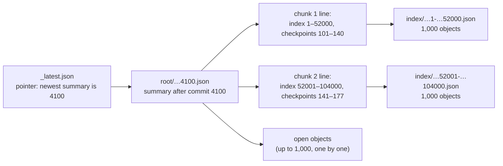

**Archiver** (leader only, one object in flight):

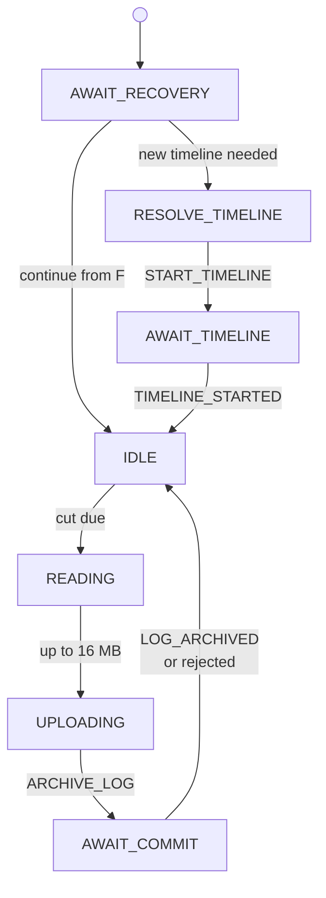

On a store error the archiver backs off and tries again from F.

The **snapshot uploader** reserves the newest local snapshot, uploads its files, writes
`ARCHIVE_SNAPSHOT` and waits for the event. The **publisher** writes commit entries strictly in
seq order and retries each one until it succeeds; it never skips one. On a new leader it first
checks whether the bucket is already ahead of the replicated state, which happens when the state was
rolled back. In that case it starts a fork instead of overwriting history (2.7).

One cut, end to end:

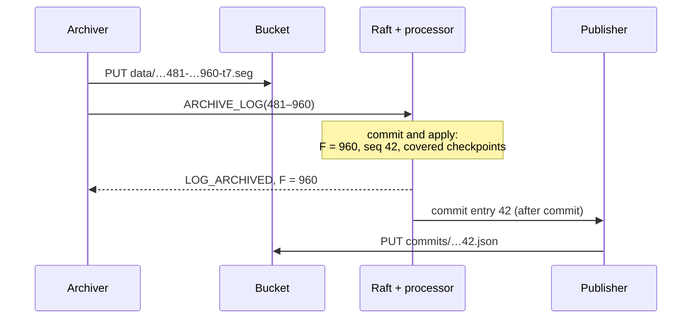

### 2.4 The object format

Objects use the event plane's segment format, so restore and consumers read the same bytes:

- **Body:** zstd-compressed frames; a small object is one frame. Each entry is the journal's own
  bytes for that entry, including its checksum. Restore appends them unchanged, so the rebuilt
  journal is identical to the original.
- **Metadata:** cluster, tenant and partition, and a frame index (the first position and the offset
  of each frame), so a reader can jump to the frame that holds a position.
- **Footer** (66 bytes): first and last index and position, the latest record timestamp, body
  length, level and format version.

Compression uses fixed zstd settings, so the same entries always give the same bytes. On the PoC's
test load, objects were 7 to 11 times smaller than the journal **[run]**.

### 2.5 The folders in the bucket

```
log-archive/<timeline>/p<partition>/
  data/<firstIndex>-<lastIndex>-t<term>.seg   the log, in small objects
  state/<snapshotId>/…                        archived snapshots and their descriptor
  commits/<seq>.json                          the commit log, numbered from 1, gap-free
  root/<seq>.json                             summary of the archive after commit <seq>
  _latest.json                                pointer: the seq of the newest summary
  index/<firstIndex>-<lastIndex>.json         sealed chunks of the object index (1000 objects each)
  timeline.json                               the timeline's parent and start point
```

Everything except `_latest.json` is written once and never changed.

Two names to keep apart: a **summary** is a file in the folder `root/` and holds the state of the
archive after one commit entry. The **pointer** `_latest.json` only names the newest summary and is
the one file that is overwritten. A stale pointer is harmless: the reader reads the commit entries
after the summary it names until one is missing. If the pointer is missing, the reader lists
`root/` and takes the highest. Neither has anything to do with the bucket's top-level folder.

### 2.6 An example

A fresh cluster with the log archive on (numbers made up for illustration). On partition 1 the
leader starts timeline `tl-0` and takes a few cuts, a marker checkpoint is taken, and the snapshot
uploader archives a snapshot:

| seq |    Commit entry    |                               What it says                                |
|-----|--------------------|---------------------------------------------------------------------------|
| 1   | `TIMELINE_STARTED` | timeline `tl-0` starts at index 1                                         |
| 2   | `LOG_ARCHIVED`     | object `1-480-t1.seg`, F = 480                                            |
| 3   | `LOG_ARCHIVED`     | object `481-960-t1.seg`, F = 960, covers checkpoint 1001 at position 1700 |
| 4   | `SNAPSHOT_ARCHIVED`| snapshot at index 900, processed position 1650                            |
| 5   | `LOG_ARCHIVED`     | object `961-1300-t1.seg`, F = 1300                                        |

The commit entry with seq 3, slightly shortened:

```json
{"formatVersion":1,"timelineId":"tl-0","partitionId":1,"seq":3,"type":"LOG_ARCHIVED",
 "archivedIndex":960,"archivedPosition":1712,
 "objects":[{"key":"data/…481-…960-t1.seg","term":1,"firstIndex":481,"lastIndex":960,
   "firstPosition":980,"lastPosition":1712,"entryCount":480,"sizeBytes":61344,"sha256":"9c1f…"}],
 "checkpoints":[{"checkpointId":1001,"checkpointPosition":1700,"checkpointType":"MARKER"}]}
```

To **restore to checkpoint 1001**, restore reads the newest summary and the commit entries after it, and picks
the newest archived snapshot whose state lies below position 1700: the one at index 900. It
downloads the objects from index 900 up to the entry at position 1700 (`481-960`; `1-480` is not
needed), checks each object's size and SHA-256, appends the entries to a fresh journal, stops at
the checkpoint entry and installs the snapshot. On the first start, the cluster continues on a new
timeline, `tl-0.r1001`.

### 2.7 Timelines

**The problem a restore creates.** Say partition 1 has archived up to index 5000 in the folder
`log-archive/tl-0/p1/`, and checkpoint C sits at index 3841. An operator restores to C, for example
to undo a bad deployment. The restored cluster continues from index 3841 and writes new entries
3842, 3843, … that differ from the entries 3842 to 5000 already in the bucket. If it archived them
into the same folder, it would overwrite those objects and commit entries, and the history after C
would be lost. Someone may still need it, for example to undo the restore.

**The answer: a new timeline per restore.** The restored cluster archives into a new folder,
`log-archive/tl-0.rC/p1/` (`.r` for restore, C for the checkpoint). Its `timeline.json` says: parent
`tl-0`, takes over after index 3841. Nothing in `tl-0` changes.

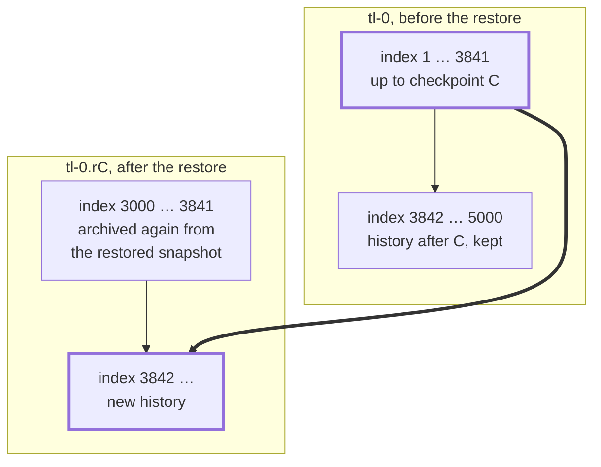

The bold boxes are the current path: `tl-0` up to C, then `tl-0.rC`.

- **Consumers follow the current path:** `tl-0` up to C, then `tl-0.rC`. The event plane serves
  exactly that path. A restore reads the one timeline that holds its restore point.
- **`tl-0` after C stays restorable.** A restore that names `tl-0` and a checkpoint after C undoes
  the first restore.
- **The new timeline stands on its own.** It archives again from the restored snapshot's index
  (3000 here), so restoring from it later never needs its parent. The range 3000 to 3841 then
  exists twice, once per timeline.
- **The id is deterministic:** every broker restoring the same partition to the same checkpoint
  picks the same new timeline.

**A fork is the same thing without a restore point.** A broker whose state was rolled back by other
means, for example by a classic restore from an old backup, finds commit entries in the bucket that
are newer than its own state. It does not overwrite them either: it continues on a fork
`tl-0.f<seq>`, named after the commit entry where it diverged.

### 2.8 Local disk and leader changes

- The journal is never compacted above F (the **compaction cap**). If the store is down, the local
  journal grows until the store is back, as with backups today **[run]**.
- A new leader continues from F. Objects of the old leader that never got a commit entry are not
  read **[run]**.

### 2.9 What layer 1 gives

|                             |         Continuous backup          |                    Log archive                    |
|-----------------------------|------------------------------------|---------------------------------------------------|
| A marker becomes restorable | when the next backup completes     | when the archive covers it, seconds later         |
| RPO bounded by              | backup interval + backup duration  | marker interval + cut interval + upload + commit  |
| Snapshots                   | a fresh one per backup             | on their own schedule                             |
| Copy in the bucket          | segments with overlap, plus snapshots | each entry once, compressed, plus snapshots    |

The archive's RPO follows from the design, and the manual runs showed objects in the bucket within
seconds, but it was not measured under production load. Restore points are still checkpoints:
with the archive, a marker interval of 5 to 15 seconds is cheap (one record per partition, no
upload).

## 3. Layer 2: clusters that already have backups

### 3.1 What exists today

|                     Backup                     |                                       What it is                                       |
|------------------------------------------------|-----------------------------------------------------------------------------------------|
| On-demand backup (`POST /actuator/backups`)    | a self-contained snapshot plus journal segments; lives until it is deleted              |
| Continuous backup                              | scheduled backups plus marker checkpoints, kept as contiguous ranges in `metadata/<partition>/metadata.json`, deleted by age |

|                           Restore                            |                 How the restore point is found                 |
|--------------------------------------------------------------|----------------------------------------------------------------|
| `restore --backupId=<id>`                                    | that backup                                                    |
| `restore --from=… --to=…` (continuous backup with RDBMS)     | from the RDBMS exported positions and the backup ranges: the checkpoint closest to `--to` |
| `restore` without a backup id (RDBMS)                        | the latest checkpoint the ranges cover                         |

### 3.2 The goal: old backups stay restorable, as they are

- **Every old backup stays a restore point.** After the switch, an operator can still restore to
  any old backup that retention has not deleted yet, with `--backupId` or with a time range, just as
  before. This holds for the new version and for the version before the upgrade, so "back up,
  upgrade, roll back if needed" keeps working for the upgrade that turns the archive on.
- **Never modify, move or migrate old backups.** A migration is a chance to break them, and they
  are what an operator falls back on during an upgrade. They keep their own retention.
- **Old restore code for old backups.** A restore to an old backup runs the unchanged old restore
  code on unchanged data.
- **Same rules for the user.** `--backupId`, `--from`, `--to` and "latest" are accepted or rejected
  exactly as with continuous backup, and resolve to the same restore point. Only the source of the
  data differs: old backups, the archive, or both (3.6).

### 3.3 The handover

Each partition's history gets one dividing line, the **handover checkpoint H**. Before H the old
backups are the source of truth, after H the archive. The archive starts before H, so the two
overlap, and H is a normal backup on the old side.

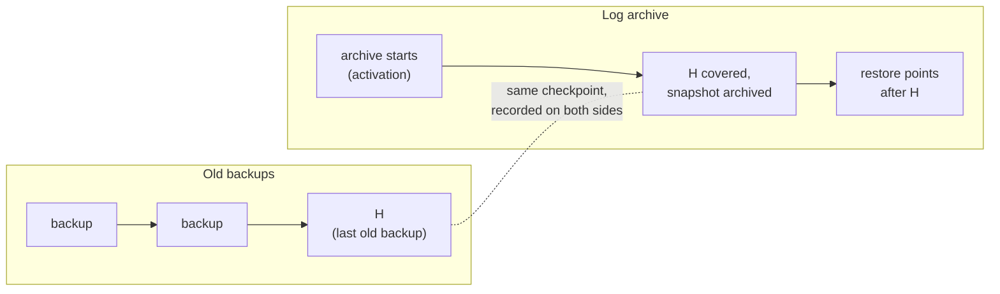

**Why every restore point after H can be restored from the archive alone.** A restore from the
archive to a checkpoint T needs two things on every partition: an archived snapshot taken before T,
and the archived log from that snapshot up to T, without gaps. The handover only happens once both
are guaranteed for every T after H:

1. **H waits for the archive.** The scheduler takes H only when, on every partition, the archive
   already covers the last old backup and holds at least one archived snapshot. That snapshot was
   taken before H, so it lies before every T after H. The archive is contiguous from its start, so
   the log from that snapshot to any later T is in it as well.
2. **Old backups stop last.** Old backups keep being taken until H is recorded on every partition.
   If H fails on one partition, the scheduler takes a new H later, and no partition is left without
   restore points in between.

Example for one partition: the last old backup B7 is at position 9,000. The archive started at
position 8,000, has reached 9,400 and has archived a snapshot at position 8,700. Both conditions
hold, so the next backup becomes H, at position 9,600. A restore to any T after H starts from the
snapshot at 8,700 and reads the archive from there to T. The old backups are not needed for it. A
restore to B7 or an earlier backup uses the old backups as before.

**Why a handover, and not simply running both for a while?** The alternative: enable the archive,
keep taking old backups for one retention window W, then switch them off. By then every restore
point inside the window exists in the archive.

|                                   |        Handover as soon as ready (PoC)        |          Run both for one window, then stop          |
|-----------------------------------|-----------------------------------------------|------------------------------------------------------|
| When old backups stop             | minutes after activation                      | W after activation (days)                            |
| Cost of the overlap               | small: a few old backups                      | one full window of both                              |
| Local compaction                  | held back by old backups only until H         | held back by old backups for W                       |
| Rollback to a version without the archive | until H; afterwards only to a backup before H | at any time during W, with fresh old backups |
| Restore across the switch         | needs the switch point; time ranges and the bridged restore cross it | the same, a window later: the old backups still end somewhere |
| Machinery                         | `HANDOVER` checkpoint, two phases, files on the old side | a timer, plus the same record of where old backups end |

What the comparison shows: waiting does not remove the switch point, it only moves it. Restore and
time ranges still need to know, per partition, where the old backups end and that the archive covers
everything after it, which is what H records. Waiting buys a longer, safer rollback at the cost of
paying for both copies for one window.

**Recommended [proposed]:** keep the handover and make its timing configurable: as soon as the
archive is ready (as in the PoC), or only after the archive has covered one full window. The second
is the safer default for an upgrade; the first suits clusters that want the savings at once.

### 3.4 The handover state machine

The backup scheduler drives it. Every decision is derived from a query of the partitions' state,
never from the scheduler's memory, so it survives the scheduler moving to another broker.

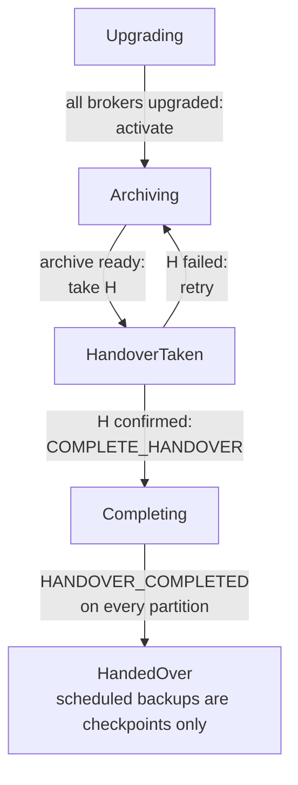

- While **Archiving**, old backups go on as before; the archive runs next to them.
- `COMPLETE_HANDOVER` is a log archive command. Its event, `HANDOVER_COMPLETED`, is a commit entry
  (the source of truth) and also writes a small file on the old side (a pointer). From then on the
  old backups no longer hold back local compaction.
- A partition added by a scale-up after the handover archives from its first record and records H
  without an old backup.
- Disabling the log archive after the handover is refused at startup.

### 3.5 In the object storage

```
<basePath>/
  …existing backups, unchanged…
  metadata/<partition>/metadata.json         unchanged, old format and content
  metadata/<partition>/handover/<H>.json     new: H, its position, the archive timeline
  log-archive/<timeline>/p<partition>/…      the archive (layer 1), with a HANDOVER commit entry
```

The handover file is keyed by H: after a restore to a point before H, the new branch takes old
backups again until its own handover, and the first record must stay.

### 3.6 What happens on restore

Restore works per partition and chooses by **where the restore point T exists**, not by comparing T
with H. A time range (`--from`/`--to`, or no backup id) is first resolved to one T with the rules of
continuous backup, over old backups and archive together; from there it takes the same paths.

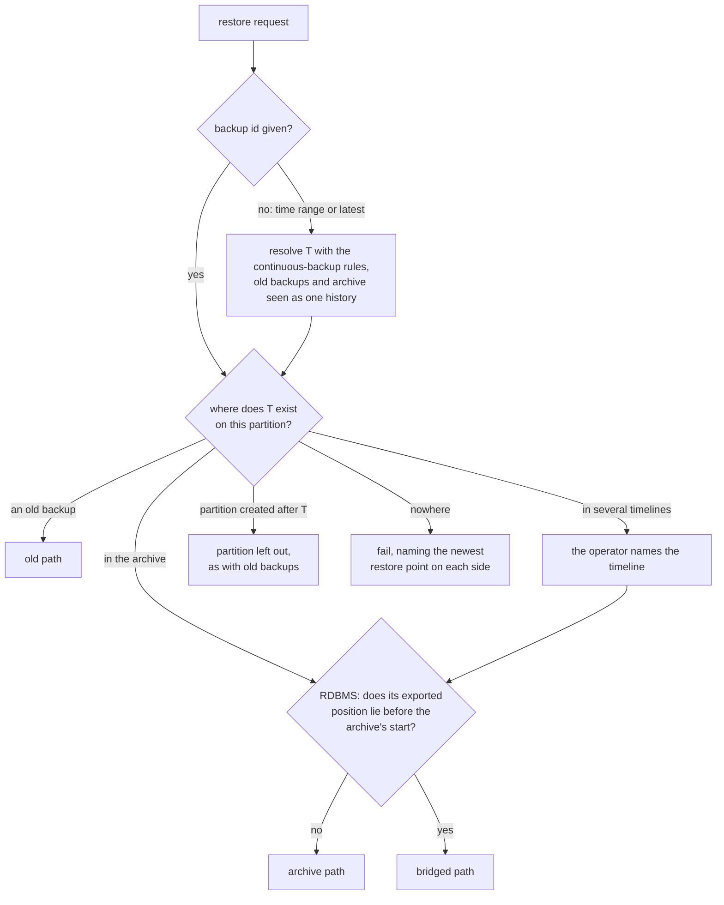

What each path reads:

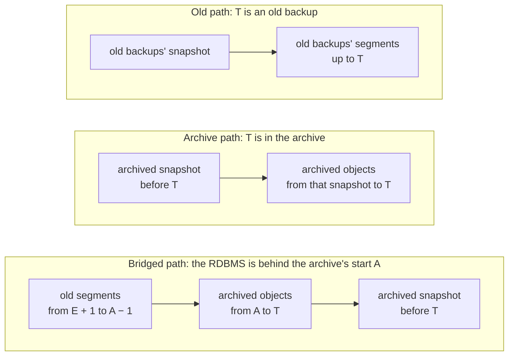

- **Old path.** The unchanged old restore code on unchanged old backups.
- **Archive path.** As in layer 1: an archived snapshot before T and the archived log up to T, from
  the timeline that holds T.
- **Bridged path.** A cluster with an RDBMS re-exports from the RDBMS's exported position E after a
  restore, so its journal must reach back to E + 1. Usually the archive does. If E lies before the
  archive's start A (the RDBMS lagged or was reset when the archive was enabled), the journal is
  built from two sources of the same history: the old segments up to A − 1 and the archive from A to
  T. The overlap must match entry for entry, byte for byte, or the restore fails. The snapshot comes
  from the archive.
- **Time ranges** give the same restore point and the same errors as with continuous backup **[run]**.

### 3.7 Backups after the handover

`POST /actuator/backups` and `GET /actuator/backups/{id}` keep working: a backup is a checkpoint,
reported `COMPLETED` once the archive covers it, usually seconds later. Listing shows old backups and
archive checkpoints together.

### 3.8 On-demand backups in the archive

Today an on-demand backup (`POST /actuator/backups`) is a self-contained copy: a snapshot plus the
journal segments up to its checkpoint. Unless a retention window is configured, nothing expires it;
it lives until someone deletes it, and operators rely on that, for example to keep a backup from before an upgrade
for months.

**In the PoC**, after the handover, an on-demand backup is only a checkpoint: nothing is uploaded,
and it is reported `COMPLETED` once the archive covers it, seconds later. A restore to it uses the
newest archived snapshot before it and the archived log up to it. That works **[run]**, but it
loses two properties operators rely on:

- **It lives only as long as the retention window.** Once the archive removes data older than the
  window (3.10), an on-demand backup older than the window goes with it.
- **It is not a copy of its own.** It cannot be moved to another bucket, and a version without the
  log archive cannot restore it.

**Recommended: make on-demand backups first-class in the archive [proposed].** This applies to
every cluster after its handover; 3.9 covers how clusters without a backup schedule get there.


1. **Kept until deleted, or by the window: configurable.** A setting decides what happens to
   on-demand backups. *Pinned*: the backup keeps its snapshot and the log from that snapshot to its
   checkpoint until it is deleted through the API, regardless of the window. *Windowed*: it follows
   the restore window like a scheduled backup. The default follows what the cluster did before the
   upgrade: pinned without a retention window, windowed with one (today's retention job deletes by
   age and ignores the backup type; it runs whenever a window and a cleanup schedule are
   configured, with or without continuous backup **[code]**). A per-backup override when it is taken covers
   "keep this one backup from before the upgrade". Taking, pinning and deleting are commit entries,
   so the pin is as durable as the backup. A pin keeps only its slice, not everything since, so
   the archive must be able to keep a slice in the middle of what it otherwise removes.
2. **A snapshot at the backup.** The archive uploads snapshots every 30 minutes, so a restore to an
   on-demand backup may replay up to 30 minutes of log. An on-demand backup should trigger a
   snapshot upload, so the backup is a snapshot plus a short log slice, as today.
3. **Deletion that works.** `DELETE /actuator/backups/{id}` writes a commit entry that ends the
   pin, or the protection by the window, and removes the backup from listing and restore. It works
   for pinned and windowed backups alike. In the PoC it reports success and does nothing for
   backups taken after the handover **[code]**.
4. **Export as an option.** On request, write the backup out in today's self-contained format,
   under its own prefix: a second copy, but portable and restorable without the archive, for
   example by the version before the upgrade.

### 3.9 Clusters that only take on-demand backups

These clusters should end up exactly as in 3.8: on-demand backups live in the archive, and a
self-contained copy is written only when the operator asks for an export. What differs is how they
get there.

**What the PoC does today [code]:** with the log archive enabled and no backup schedule, the
scheduler still activates the archive, so every partition starts archiving. But the handover is
decided on backup schedule ticks only, so without a schedule it never happens. The cluster stays in
the state before the handover for good:

- Old on-demand backups stay as they are and restore with the old code.
- New on-demand backups are still uploaded as self-contained backups, because that upload only
  stops after a handover, and the archive covers them as well. They exist twice. This is a side
  effect of the missing handover, not a design.
- Every checkpoint, including markers if `checkpointInterval` is set, is restorable from the
  archive seconds after it is taken. For these clusters this is the biggest gain: their RPO was the
  time since the last manual backup.

This was not run as its own scenario; the side-by-side runs had continuous backup on.

**Recommended [proposed]: the same handover, without a schedule.** Once the archive is ready on
every partition (it holds an archived snapshot), the scheduler takes the handover checkpoint H by
itself, as an on-demand backup of type `HANDOVER`. H is the last self-contained backup. From then
on the cluster behaves as in 3.8: on-demand backups are archive backups, pinned by default (a
cluster without a retention window kept them until deleted before), and exported only on request.

Until H, both copies exist, as in the PoC today. That is the same transition every cluster goes
through: before H the old backups are the truth, after H the archive. Disabling the log archive is
possible until H and refused after it.

### 3.10 The restore window after the upgrade

**Goal: the configuration just works.** An operator who configured backup retention before the
upgrade changes nothing. The existing settings, the retention window W (`backup.retention.window`)
and its cleanup schedule, keep their meaning: every restore point younger than W stays restorable,
older ones go. The log archive takes them over; it has no retention setting of its own.

|                     |              Before the upgrade               |                         After the upgrade                         |
|---------------------|-----------------------------------------------|-------------------------------------------------------------------|
| Retention window W  | backups older than W are deleted              | restore points older than W go, on both sides                     |
| Cleanup schedule    | when the retention job runs                   | when the retention job runs, for both sides                       |
| No retention set    | backups stay until deleted                    | restore points stay until deleted; nothing is removed             |
| On-demand backups   | deleted by W, or kept if no W is set          | the same by default; pinned or windowed per 3.8                   |

**Over time,** one window covers both sides. Each restore point is kept where it lives:

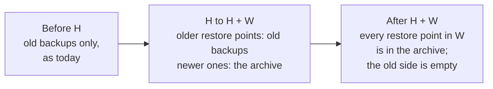

**How each side applies W:**

- **Old backups.** The retention job keeps deleting old backups that are older than W. Today it
  measures W back from the newest backup; after the handover no new old backups come, so it
  measures from now instead (or from the newest restore point on either side). Old backups then
  leave one by one, and one window after H only pinned on-demand backups remain.
- **The archive.** On each run, the archive's **restore floor** moves to the snapshot of the oldest
  backup checkpoint inside W. Every restore point in W, backups and markers alike, lies after that
  snapshot, so it stays restorable. Everything before the floor is no longer needed for restore and
  is removed: log objects and archived snapshots. Pinned on-demand backups keep their own slice
  (3.8).
- **Who removes it** is the subject of layer 3, because there the same data serves consumers as
  well. For this layer it is enough that the archive removes only what lies before the floor.

**Restore** does not change: `--backupId`, `--from` and `--to` select among the restore points
inside W on both sides, as with continuous backup today.

**Not there in the PoC.** The archive has its own setting, `logArchive.retentionWindow`, separate
from W; the old retention job keeps measuring from the last old backup, so the old backups from one
window before H stay for good; and the cluster on its own removes nothing from the archive
**[code]**.

## 4. Layer 3: the event plane

### 4.1 What the event plane adds

The event plane serves consumers the log of every partition. With layer 1 it does not need its own
copy:

- The cluster **announces** every commit entry to the event plane, in seq order, and resends until
  the event plane confirms it. Calls go one way only: the event plane never calls the cluster.
- The event plane keeps a **catalog** of objects, checkpoints and timelines, and answers "which
  objects hold the log after position P" across timelines (a restored timeline takes over its parent
  at the takeover point).
- Consumers read the bytes from the bucket themselves.
- If the event plane is down, the cluster goes on and the announcer catches up later **[run]**. The
  catalog can be rebuilt from the bucket **[run]**.

### 4.2 The question: who compacts and deletes?

With one copy for both purposes, two things change the bucket over time:

- **Compaction.** A cut every few seconds gives thousands of small objects per partition and day.
  Restore and consumers want fewer, bigger objects.
- **Retention.** Consumers may want months of history, restore only its window, and data that
  nobody needs should be deleted.

The danger: a bug in compaction or retention can destroy what a restore needs. Restore must not
depend on a running event plane, and nothing restore needs may be deleted.

### 4.3 One authority over compaction and retention

The approach: **one authority** is the only component that rewrites or deletes objects, anywhere.
In the PoC the authority is the event plane. The cluster only writes small objects and never deletes
anything.

- **Compaction keeps the entries.** A compacted object holds the same entries byte for byte, in the
  same segment format, only packed into fewer objects. Restore reads every level the same way.
  - **Level 1:** runs of small objects, once they add up to 16 MB or are 10 minutes old.
  - **Level 2:** one object per day, made from level 1 objects only. Once a UTC day has been over
    for an hour, the authority takes the day's level 1 objects and writes them into one object, in
    frames of about 32 MB, so a reader can still jump to a position with one ranged read. Days are
    rolled up oldest first, never across a timeline's takeover point, and a day that is already a
    single object stays as it is.

  Each level takes its input only from the level below, so level 1 and level 2 never compete for the
  same objects. A level 0 object therefore always goes through level 1 first; one that is already
  large enough, or the last one left of a day, becomes level 1 as it is, without being rewritten.
  The PoC differs here: its level 2 also takes level 0 objects.

  The authority runs this periodically, level 1 before level 2; the thresholds are its settings.
- **Verified before replacing.** A replacement is recorded only after the new object has been
  checked against its inputs. How much to check is a trade-off:

  |            Variant            |                       What is checked                        |                        Cost and risk                         |
  |-------------------------------|--------------------------------------------------------------|--------------------------------------------------------------|
  | Full (the PoC)                | every entry: index, term and bytes                           | one extra read and decompression of the new object; the inputs were just read to build it |
  | Checksums                     | every entry's index and the checksum it already carries      | the same read, less comparing; catches the same faults in practice |
  | Sample                        | a few frames or entries per object, or some objects          | cheaper on large objects; a rare fault can slip through      |
  | None, deletion delayed        | nothing up front; inputs are kept longer and checked before deletion | cheapest to write; replaced data lingers                |

  Since the inputs are already in hand when the object is written, the full check costs about one
  extra read of the new object, so it stays the default. A sample is the fallback if that proves
  too expensive for large daily objects. Restore checks every entry's checksum again in any case.
- **Retention** removes whole objects from the start of the log, only below the restore hold.
- **Deletion is delayed** by a grace period, so readers still using an object can finish. This also
  applies to orphans: objects nobody references, such as uploads of a former leader.

### 4.4 The restore hold

The cluster does not own objects; it declares what restore needs. The **restore hold** is the
restore floor of 3.10 as an index: everything from it on must stay. It is the index of the archived
snapshot of the oldest backup checkpoint inside the retention window.

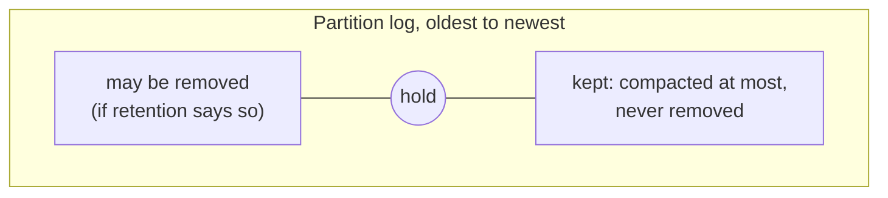

- The leader computes the hold and writes `MOVE_HOLD`. The processor accepts it only if the hold
  moves up and an archived snapshot exists exactly at that index **[code]**. Its event,
  `HOLD_MOVED`, is a commit entry like any other, so it is replicated, in the bucket and announced.
- The authority removes only below the hold. It compacts to level 1 anywhere, including above the
  hold, but rolls a day up to level 2 only once the whole day lies below it. Restore reads every
  object whole today, so a daily object above the hold would make restores slow and memory-hungry
  (open points: restoring from large objects).
- **The hold is the only coordination.** The cluster never waits for the authority and never asks
  it anything; the authority only follows the commit log.

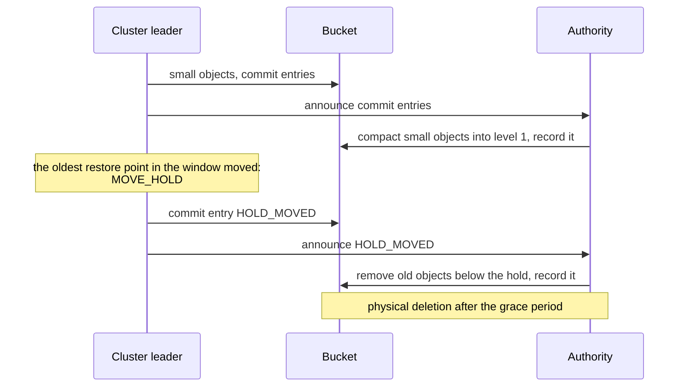

### 4.5 Two logs, one writer each

The authority records its changes in a log of its own in the bucket, next to the cluster's:

```
log-archive/<timeline>/p<partition>/
  commits/<seq>.json        written only by the cluster
  maintenance/<seq>.json    written only by the authority, numbered from 1, gap-free, create-only
  data/…-t<term>.seg        small objects of the cluster
  data/…-c<seq>.seg         objects the authority compacted
```

A maintenance entry is one of two kinds, and it names the commit entry it is based on:

- `COMPACTED a–b → X`: the current objects that exactly cover `a–b` are replaced by X (with its key
  and SHA-256).
- `REMOVED ≤ i`: every object up to index `i` is gone. Valid only if `i` is below the hold as of the
  commit it is based on.

Neither writes into the other's log, so there are no locks between the two, and the cluster's
commit entries stay a pure function of its own state.

An example of how the two logs fold together:

| Commit log (cluster) |   Maintenance log (authority)    |        Current objects         |
|----------------------|----------------------------------|--------------------------------|
| #2 ARCHIVED 1–60     |                                  | 1–60                           |
| #3 ARCHIVED 61–120   |                                  | 1–60, 61–120                   |
|                      | m1 COMPACTED 1–120 → X (on #3)   | X                              |
| #5, #6 ARCHIVED …240 |                                  | X, 121–180, 181–240            |
| #7 SNAPSHOT at 230   |                                  |                                |
|                      | m2 COMPACTED 121–240 → Y (on #6) | X, Y                           |
| #8 HOLD_MOVED to 230 |                                  |                                |
|                      | m3 REMOVED ≤ 120 (on #8)         | Y (valid: 120 is below 230)    |
| #9 ARCHIVED 241–300  |                                  | Y, 241–300                     |

A restore from the snapshot at 230 reads Y from the entry at 230 on, then 241–300. An entry such as
`REMOVED ≤ 250` would make the restore fail, because commit #8 says everything from 230 on must
stay.

### 4.6 Restore still needs only the bucket

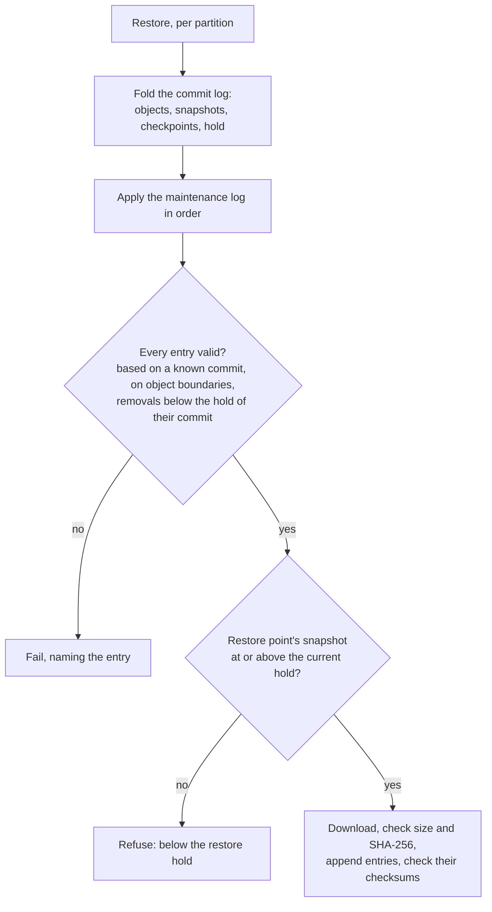

The restore code has no event plane client **[code]**, and a test restores such a timeline with no
event plane at all **[run]**. If the authority is down, nothing is compacted or removed, and restore
reads more, smaller objects. If the authority's database is lost, it rebuilds from the two logs
**[run]**.

### 4.7 The alternative: split ownership

Split ownership divides the history by time at a **released index R**. Above R, inside the restore
window, the cluster owns the objects: the leader merges small objects whenever the journal rolls
over to a new segment, and deletes what it has merged. Below R the event plane owns them. The
cluster moves R with a "released" commit entry. The PoC built this first; it runs side by side with
one authority, chosen per timeline.

**Split ownership:** two owners, divided by time.

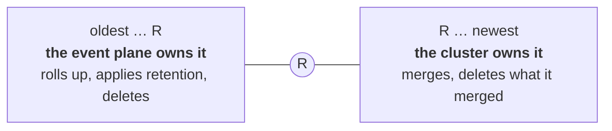

The cluster moves R forward with a "released" commit entry.

**One authority:** one owner; the cluster only declares what restore needs.

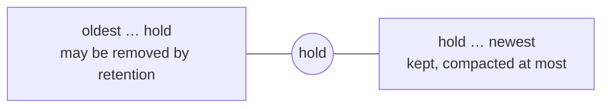

The authority compacts across the whole log and removes only below the hold; the cluster moves the
hold forward with a `HOLD_MOVED` commit entry.

In split ownership the boundary R is a handover: everything below it changes owner for good. In
one authority the hold is only a promise about what must stay; who compacts and deletes never
changes.

|                                 |               Split ownership               |            One authority            |
|---------------------------------|---------------------------------------------|-------------------------------------|
| Who compacts and deletes        | cluster above R, event plane below          | only the authority                  |
| How restore data is protected   | the cluster owns it until it releases it    | a hold the authority must honour    |
| Extra work in the cluster       | merger, cleaner, releaser, more local disk  | none                                |
| Coordination                    | release protocol, cleaner progress, event plane confirmations | the hold          |
| Consumer, legal or pinned holds | only below R                                | anywhere                            |
| What restore must trust         | only the cluster                            | that the authority honours the hold |

**Why one authority is preferred:**

- **One owner of every rewrite and delete.** Comparable systems (Thanos, Mimir, WarpStream) all
  have exactly one compactor and deleter per range. Split ownership has two, with a boundary that
  moves forever and needs its own protocol.
- **A leaner cluster:** no merging on the leader, no cleaner listing the bucket, and about one
  journal segment less local disk per partition.
- **Holds generalise.** Restore windows, consumer positions, legal holds and pinned backups are all
  "keep this range". With split ownership they only fit below R.

**What it costs:** restore correctness now also depends on the authority honouring the hold. A
deletion bug in the authority can delete data a restore needs. Restore detects it and fails loudly,
but cannot repair it. Verification before replacing, restore's own checks and the grace period
reduce that risk; they do not remove it.

**Making a wrong delete repairable [proposed].** Restore cannot stop the authority from deleting;
only the authority's correctness can. What the design can do is make sure a wrong delete is noticed
early and can be undone:

1. **The cluster checks the authority as it goes.** The cluster owns the hold, so its leader reads
   each new maintenance entry from the bucket and checks it the way restore would: a removal only
   below the hold of its base commit, a compaction only on object boundaries. It also reads a sample
   of compacted objects with its own reader. A violation raises an alert at once, not months later
   during a restore. The authority still never has to talk to the cluster.
2. **Deleted objects stay recoverable for a while.** The archive's bucket keeps deleted objects for
   a set time: S3 versioning with expiry of old versions, or the soft delete of GCS and Azure. That
   time must be longer than it takes to notice and react, for example a week. For the cluster of
   1.1, a week of deleted log objects (replaced by level 1, by level 2, and removed by retention)
   is about 1.8 TB, $42 a month; deleted snapshots would add about $62.
3. **A small blast radius.** An authority gets delete rights only on the buckets of the clusters it
   serves, and the fencing of 4.8 keeps a stale authority from acting.

With these, the guarantee is "a wrong delete is detected and can be repaired", which is what the
constraint at the top states. A stronger alternative: the authority only proposes deletions, and
the cluster carries them out after checking them against its hold. Then no wrong delete can happen,
but the cluster takes over work and coordination that one authority was meant to remove.

### 4.8 Not built: fencing and atomic commits

**Why the cluster does not need either.** The cluster's commit log has one writer at a time, the
Raft leader, and entry N is a pure function of the replicated state. Two leaders that both write
`commits/N.json`, an old one that has not noticed yet and the new one, write the same bytes. An
overwrite is harmless, so a plain PUT is enough.

**The authority is different.** Its maintenance entries are its own decisions, not a function of
replicated state. Two authorities can decide differently: one compacts 1 to 120, the other 1 to 90.

**The commit point.** A change by the authority takes three steps, in this order:

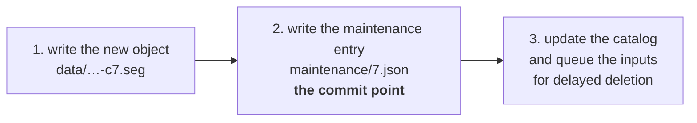

The maintenance entry in the bucket is what counts; the catalog is only the authority's working
copy. A crash at any point is safe:

|           Crash after           |                    What is left                     |                    What happens next                     |
|---------------------------------|-----------------------------------------------------|-----------------------------------------------------------|
| step 1                          | an object nobody references                         | deleted as an orphan after the grace period              |
| step 2                          | an entry the catalog does not know yet              | the next run first applies the entries from the bucket   |
| step 3                          | inputs queued for deletion                          | the queue lives in the catalog's database and is retried |

This only holds if **exactly one** entry can exist for each seq. That is the job of the two missing
pieces.

**Create-only writes.** Writing `maintenance/7.json` must fail if the file already exists. Then, of
two authorities that both try seq 7, one wins and the other learns it has lost, re-reads the log
and plans again. With a plain PUT on S3 both "succeed", the later one overwrites the earlier, and
each authority goes on with a different history: the loser deletes inputs of a compaction that is
no longer in the log, and a restore reading the log finds objects missing. S3, GCS and Azure all
offer such a conditional write (on S3: `If-None-Match: *`). In the PoC only the event plane's
filesystem store is create-only; it has no S3 store yet **[code]**.

**Fencing.** Create-only stops two entries for one seq, but not a stale authority from acting on an
old view between entries: for example deleting an "orphan" that is really the object of a
compaction the new authority has written but not yet recorded. Two rules close that:

- **One authority at a time,** by a lease. Each authority writes the epoch of its lease into its
  entries; an entry with a lower epoch than one before it is invalid, and an authority that cannot
  renew its lease stops before the lease runs out.
- **Orphans only after a grace period longer than any lease,** so an object a live authority is
  about to record is never old enough to be deleted.

Both rules are **[proposed]**. The PoC runs a single event plane instance and has neither a lease
nor epochs.

### 4.9 Without an event plane: the authority in the cluster

A cluster can run without an event plane. Its archive still needs compaction and retention
(3.10), so the cluster itself takes the authority's role **[proposed]**.

- **Same code, same rules.** Compaction, verification, retention below the hold, delayed deletion
  and orphan handling are one library. The event plane runs it with its catalog in a database; the
  cluster runs it embedded. The bucket looks the same either way, and restore cannot tell who
  compacted.
- **Where it runs.** On each partition's leader, as one more leader-only actor next to the archiver.
  It keeps no database: its view of the archive is the fold of the two logs that restore already
  does, rebuilt in memory when a new leader takes over.
- **One authority at a time comes almost for free.** Only the leader acts, and the Raft term serves
  as the epoch of 4.8. A deposed leader that has not noticed yet still needs the create-only write
  of the maintenance entry and the grace period for orphans.
- **Cost on the broker.** Compaction reads, encodes and uploads data on the broker, which competes
  with processing for CPU, memory, disk and network. How to bound that is open, especially for
  level 2 daily objects.
- **Holds.** Without an event plane there are no consumers, so the holds are the restore hold and
  pinned backups (3.8).
- **Moving the role.** Adding an event plane later, or removing it, moves the authority once and
  explicitly: a commit entry names the new authority and its epoch, the old one stops, and the new
  one continues the same maintenance log at the next seq. Never both at the same time.

### 4.10 Compatibility between versions

The cluster, the event plane and restore are released and upgraded independently, and restore may
run with an older or a newer version than the one that wrote the data. Four roles touch the same
bytes:

|               Role               |               Writes or reads                |                        Must be                         |
|----------------------------------|----------------------------------------------|--------------------------------------------------------|
| Cluster (archiver, publisher)    | writes objects and commit entries            | readable by every restore and authority still in use  |
| Authority (event plane or cluster) | reads everything; writes compacted objects and maintenance entries | **backward compatible**: writes only what the oldest relevant restore can read |
| Restore                          | reads everything                             | **forward compatible** within a format version         |
| Consumers (reader library)       | read objects                                 | forward compatible, like restore                       |

**Rules [proposed]:**

1. **Every file states its format version.** Already true in the PoC **[code]**.
2. **Extra information never breaks a reader.** A reader ignores fields and metadata it does not
   know.
3. **A change of meaning stops a reader.** Restore fails with a clear message on a format version or
   a maintenance entry type it does not know, instead of guessing. (The event plane may skip unknown
   commit entry types, since it only needs objects and checkpoints.)
4. **Nobody writes a format that not everyone can read yet.** The cluster records in its commit log
   the oldest format that a restore or a rollback may still need; the authority writes nothing
   newer.
5. **The authority leaves newer data alone.** Data in a format it does not know is neither compacted
   nor removed.
6. **Versions are tested against each other.** Restore of version N reads data that the authority
   of version N + 1 compacted; the authority of version N reads data that the cluster of version
   N + 1 wrote.

**Example.** The event plane is upgraded and could write the large-object format v2 (open points).
The clusters still record "oldest format needed: v1", so it keeps writing v1. Only once a cluster
records v2, after all its brokers are upgraded, does the event plane write v2 for that cluster.

The PoC has one version of everything, so only rules 1 and 2 are in place (its JSON readers
ignore unknown fields **[code]**). The missing term in
compacted objects (section 5) is the kind of fault rule 6 would catch.

## 5. What the PoC shows

**Built:** all three layers, plus split ownership as the alternative. The ownership model is set
per timeline (`logArchive.compactionMode`: `CLUSTER` for split ownership, `AUTHORITY` for one
authority).

**Automated tests:** 21 integration test classes in `zeebe/qa/integration-tests`
(`io.camunda.zeebe.it.logarchive`). They cover archiving, leader changes, restore, S3, running side
by side with continuous backup, the upgrade gate, the handover, time ranges, bridged RDBMS restore,
scale-up, the event plane, split ownership and the authority. The event plane repository has its
own tests for the catalog and the authority. Last recorded results, not re-run for this document:
the full set passed on 2026-10-21 before the authority was added; after it, the unit tests and the
two authority tests passed. One scale-up test flaked once and passed on rerun; that was not
investigated. Known red on purpose: tests that enumerate every record type (the ES/OS exporters
and the engine) fail on the new `LOG_ARCHIVE` type.

**Manual runs** on a local cluster of three brokers with a filesystem store:

|                                       Scenario                                       |                      Result                      |
|--------------------------------------------------------------------------------------|--------------------------------------------------|
| Existing and continuous backup unchanged                                             | pass                                             |
| Archive: happy path, leader kill, store outage, snapshots up to 20 MB                | pass                                             |
| Upgrade with handover, time ranges with RDBMS                                        | pass                                             |
| Event plane: announce, outage, rebuild, restore with takeover                        | pass (2026-10-20)                                |
| Split ownership: merge, release, rollup, retention, restore refused below the floor  | pass (2026-10-21)                                |
| One authority: hold, compaction, removal only below the hold, cluster deletes nothing, rebuild | pass (2026-10-21)                      |
| One authority: restore                                                               | refused below the hold; first failed, then fixed |

**Restoring a timeline the authority compacted.** The first try failed: the event plane writes
compacted objects without a term (they span several terms), but restore's object model required
one. Restore never needs an object's term, since every entry carries its own, so a missing term now
reads as unknown. After the fix, on 2026-10-23, a restore to a recent backup read an object the
event plane had compacted, through nothing but the bucket, and the new timeline became the current
one in the event plane **[run]**. The bug is the kind of contract gap a shared reader library would
catch.

## 6. Frequently asked questions

### Why not let the event plane keep its own copy?

Because it pays for storage and freshness twice (1.1), needs two implementations that can drift apart (1.2), and the second
copy would still lack what restore needs: snapshots and a restore point every few seconds. Two
copies do keep restore and consumers fully independent. One copy keeps them independent where it
matters: restore reads only the bucket and needs no event plane (4.6), and what restore needs is
protected by its hold (4.4).

### Can consumers' needs put restore at risk?

They share the bytes, not the decisions. Consumers can make data stay longer, never shorter: data
is removed only below every hold, and the restore hold is one of them. A long consumer retention
therefore never shortens the restore window, and a short restore window never cuts what consumers
keep. The remaining risk is a bug in the one component that deletes, which 4.7 makes detectable and
repairable.

### Wouldn't incremental snapshots change the picture?

Yes, for both sides. RocksDB never changes a data file once written, so a backup or the archive
could upload only the files that are new since the last snapshot. Most of today's snapshot cost
then disappears, on both sides. What remains is different (example cluster of 1.1, assuming
snapshot storage becomes small; how much state changes between snapshots is not known):

|                                                     |                     What remains                      | Per month  |      RPO      |
|-----------------------------------------------------|-------------------------------------------------------|------------|---------------|
| Incremental backups every 15 minutes + consumer copy | a whole 128 MB segment per backup (~$16), the consumer copy (~$66) | about $85  | 15 minutes    |
| Incremental backups every minute + consumer copy     | whole segments (~$240) and PUTs (~$14), the consumer copy | about $320 | 1 minute      |
| Log archive with incremental snapshots               | log storage (~$14), PUTs for new log every 2 seconds (~$104) | about $120 | a few seconds |

So with incremental snapshots everywhere:

- **At an RPO of 15 minutes, two copies are cheaper.** The archive then pays almost only for being
  fresh every 2 seconds.
- **At an RPO of a minute or less, the archive stays clearly cheaper.** Continuous backup still
  uploads a whole journal segment with every backup; avoiding that means uploading only new log,
  often, which is what the archive does.
- **Freshness is a dial.** New log every 10 seconds brings the archive to about $37; a consumer copy
  that is also only 10 seconds fresh brings two copies at 15 minutes to about $40.

Cost alone then no longer decides, except at a low RPO. What decides is an RPO of seconds, one copy
and one implementation instead of two, and one retention model. Incremental snapshots are open for
the archive as well (open points).

### What if consumers need the data in another shape?

The archive keeps one shape: the journal's entries, packed into bigger objects over time, which
both restore and consumers read. Anything else, such as filtered records or a columnar format for
analytics, is a derived dataset built next to the log. It never replaces the archive's objects, so
restore is never affected by it.

### What if restore and consumers need different places or protection?

One copy lives in one bucket, in one region, with one encryption setting. If consumers elsewhere
need the data, the event plane serves them from that bucket, or a copy for them is made from it
deliberately; it is never the copy restore depends on. Erasure requests and legal holds apply to the
one copy and therefore to both purposes; how they interact with the restore window is open.

### Is one copy a single point of failure?

No more than today's backup bucket, which already is the only place restore reads from. Protecting
the bucket (versioning or soft delete, replication to another region) protects both purposes at once.


### Do on-demand backups keep working after the upgrade?

The API stays the same: `POST /actuator/backups`, `GET /actuator/backups/{id}`, listing and
`--backupId` on restore. What happens behind it depends on when the backup is taken:

|                                   |      Taken before the upgrade      |   Taken after the upgrade, before H    |              Taken after H               |
|-----------------------------------|------------------------------------|----------------------------------------|------------------------------------------|
| What is stored                    | a self-contained backup, unchanged | a self-contained backup, as today, and the archive covers it | only the archive: a checkpoint, an archived snapshot before it and the log up to it |
| Reported `COMPLETED`              | as today                           | as today                               | seconds after it is taken                |
| Restorable by the new version     | yes                                | yes                                    | yes **[run]**                            |
| Restorable by a version without the archive | yes                      | yes                                    | no; needs an export (3.8)                |
| How long it lives                 | as configured today                | as configured today                    | PoC: only within the window; recommended: pinned or windowed as configured (3.8) |
| `DELETE` works                    | yes                                | yes                                    | PoC: reports success, does nothing (3.8) |

So backups from before the upgrade are untouched, and backups taken until the handover work exactly
as today. Backups taken after the handover behave differently in three ways: they are not a copy of
their own, their lifetime and deletion need the recommendations of 3.8, and a restore may replay up
to one snapshot interval of log unless the backup triggers a snapshot upload. Clusters that only
take on-demand backups follow 3.9.

### Can a compaction be reversed?

A compaction never changes the entries, only how they are packed, so reversing one is only needed
when the compacted object itself is wrong, for example because of a bug in the compactor. Then the
inputs are needed again. Whether they still exist decides what is possible:

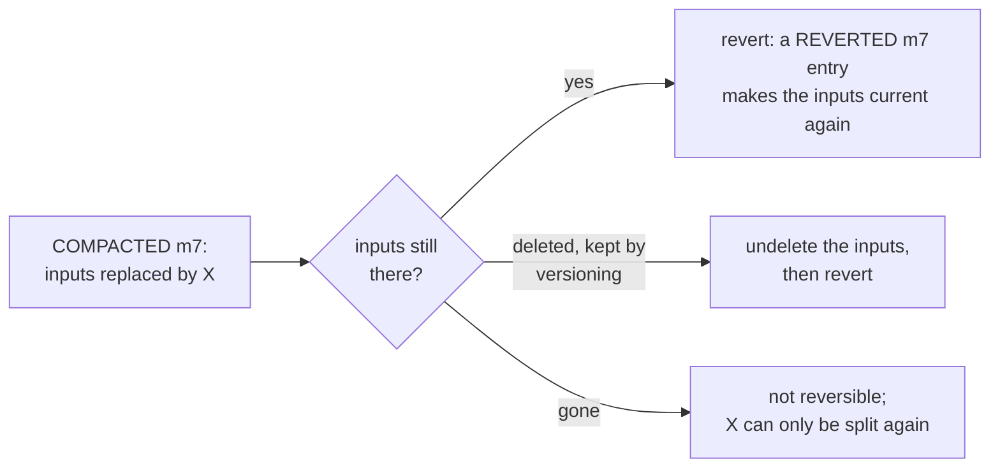

**Recommended [proposed]:**

- **A `REVERTED` maintenance entry**, valid only while every input of the compaction still exists.
  Restore and readers then use the inputs again. Restore checks that they exist.
- **A grace period per level.** Minutes for level 1, whose inputs are small and many; days for level
  2. Keeping a week of replaced level 2 inputs costs about one week of compressed log: 0.6 TB, $14 a
  month for the cluster of 1.1.
- **The bucket's own safety net.** S3 versioning with expiry of old versions, or the soft delete of
  GCS and Azure, keeps deleted objects recoverable for a set time, whatever the authority does.

The PoC has no revert entry; its grace period is 5 minutes for every level.

### Why a handover, and not simply running both for a while?

See 3.3: waiting moves the switch point but does not remove it; it buys a longer rollback for the
cost of one window of both copies.

## 7. Recommendation

**Build it.** One copy serves restore and replay. It costs far less than frequent backups, about
the same as backups every 15 minutes, and it is the only way to reach an RPO of seconds (1.1). The PoC shows that the critical
parts work: a restore needs nothing but the bucket, the handover leaves old backups untouched, and a
restore can read objects the event plane compacted.

**The one real risk is restore correctness.** A bug in restore, or in anything that changes what
restore reads, does not show until someone needs a restore. So the archive should find such bugs
itself, long before that:

1. **Restore points are checked continuously.** The cluster folds the commit log and the
   maintenance log and checks that every object a restore point in the window needs exists, with the
   right size and checksum. This is cheap and runs all the time. In addition, a real test restore
   runs regularly, for example once a day per partition, and its result is compared with the
   cluster's state at that checkpoint. A restore point counts as **verified** once it has passed. If
   a check fails, an alert goes out at once.
2. **There is one way to read the archive.** Restore, the authority's verification and the
   cluster's checks use the same fold and the same reader library. The number of restore paths stays
   small: the bridged path only where an RDBMS needs it, and split ownership is not part of the
   product.
3. **Mistakes can be repaired.** The bucket keeps deleted objects for a while (versioning or soft
   delete), and replaced inputs stay longer than it takes to notice a fault (4.7). By default the
   handover happens only once the archive covers a full window, so the old backups remain a
   fallback while the archive proves itself (3.3).
4. **Restore is tested against what was archived.** Tests run random sequences of archiving, leader
   changes, compactions, removals, restores and upgrades, and check that every restorable point
   rebuilds the same journal, byte for byte, and the same state. Restores across versions (4.10)
   and chaos runs on real stores complete the picture.

The PoC lacks points 1 and 4 the most. It shows that restore works in the scenarios that were
tried, but not yet that a broken restore point would be noticed before anyone needs it.

### Decisions for reviewers

1. **Handover timing:** as soon as the archive is ready, or only after it covers one full window
   (the safer default, 3.3)?
2. **On-demand backups after the handover:** pinned or windowed by default, with a per-backup
   override and an optional export (3.8)?
3. **One retention setting** for old backups and the archive, with the old side expiring from the
   handover on (3.10)?
4. **Protecting restore data from the authority:** the cluster checks every maintenance entry, and
   bucket versioning or soft delete is required (4.7)?
5. **Level 2 only from level 1 objects** (4.3)?
6. **An authority embedded in the cluster** for setups without an event plane, from the same library
   as the event plane's (4.9)?
7. **Consumer access to the bucket:** separate permissions for log objects and snapshots, or signed
   URLs handed out by the event plane (open points)?
8. **Split ownership** stays a PoC comparison and is not built into the product (4.7)?

## 8. Open points

- **Restoring from large objects.** Restore downloads each object whole into memory. That is fine
  for objects of tens of MB, but not for daily rollups of a busy partition, which is why those are
  only made below the hold. Planned: a first index and a checksum per frame, so restore reads only
  the frames it needs, one at a time **[proposed]**.
- **Timelines nobody writes to any more.** Only a leader moves its timeline's hold. After a restore
  the old timeline has no leader, so its data stays for good, and so does the part after the
  takeover. Nothing deletes archived snapshots. Recommended: **holds per restore point**, not per
  timeline. A restore point is protected while it is inside the window, whichever timeline it is on,
  so old timelines end by themselves, as Postgres timelines do through backup retention
  **[proposed]**.
- **On-demand backups** in the archive: pin, snapshot at the backup, deletion, export (3.8), and
  the path for clusters with on-demand backups only (3.9).
- **Upgrades and format changes** (4.10): the authority must never rewrite a held range into a
  format an older restore cannot read, so format changes need a version gate like the handover's.
- **Deleting and expiring backups** (from reading the code, not run): deleting a backup taken after
  the handover reports success but does nothing (3.8); one retention window for both sides is not
  built (3.10).
- **Fencing and conditional writes** for the authority (4.8).
- **A shared reader library**: a public contract that restore, the authority's verification and
  consumers all use.
- **Checkpoints for the maintenance log**: restore and rebuild read it from the start.
- **Consumer access to the bucket**: in the PoC consumers read objects with credentials that
  also reach the archived snapshots, which hold the full state. Options: separate permissions per
  prefix, or short-lived signed URLs from the event plane.
- **Snapshots**: every archived snapshot stays listed and stored, and they are full uploads.
  Retention and incremental snapshots are open.
- **An authority embedded in the cluster** for setups without an event plane (4.9): not built.
- **Deployment of the event plane**: one architecture for SaaS and self-managed. Residency and
  locality are solved by where the event plane and its compactors run.

## 9. How other systems do it

From research notes, not re-verified for this document.

|        System        |                                       What the design takes from it                                        |
|----------------------|---------------------------------------------------------------------------------------------------|
| Thanos               | only the compactor deletes, one per stream; deletion by mark and delay                            |
| Mimir / Cortex       | ingesters upload, the compactor owns the rest; a bucket index tells readers what is live          |
| WarpStream           | one copy in the user's bucket, one authority, delayed deletes, orphan scans; but readers need its control plane |
| Delta Lake           | numbered JSON commits with add and remove actions in the bucket, readable without a service: the model for the maintenance log |
| Postgres archiving   | idempotent, never-overwriting archive; timelines with parents; retention by the oldest needed backup |
| Kafka tiered storage | one owner copies and deletes; remote metadata lives in the cluster, so the bucket is not readable on its own |

## 10. Glossary

|            Term             |                                                    Meaning                                                    |
|-----------------------------|----------------------------------------------------------------------------------------------------------------|
| archived index F            | the last journal index that is archived; it only moves forward                                                |
| commit entry, commit log    | the cluster's record of every committed upload, `commits/<seq>.json`, numbered from 1 without gaps (2.2)       |
| summary, pointer            | a summary (`root/<seq>.json`) holds the archive's state after one commit entry; the pointer `_latest.json` names the newest summary (2.5) |
| index chunk                 | a sealed list of 1,000 objects, so a summary stays small (2.3)                                                |
| outbox                      | commit entries kept in the replicated state until they are in the bucket (2.3)                               |
| timeline, fork              | the archive of one history; a restore starts a new timeline `<source>.r<checkpoint>`, a rolled-back state a fork `<timeline>.f<seq>` (2.7) |
| takeover point              | where a timeline continues its parent (2.7)                                                                    |
| checkpoint, marker          | a point in the log a restore can go to; a marker is a checkpoint without a backup                            |
| restore point               | a checkpoint a restore can reach: an archived snapshot before it and the log up to it                        |
| handover checkpoint H       | the dividing line between old backups and the archive on a partition (3.3)                                    |
| bridged restore             | a restore that takes the old segments up to the archive's start and the archive after it (3.6)               |
| restore window W            | how long restore points are kept: the existing backup retention window (3.10)                                 |
| restore floor               | the snapshot of the oldest backup checkpoint inside W; nothing restore needs lies before it (3.10)            |
| restore hold                | the restore floor as an index that the authority must not remove from (4.4)                                  |
| pinned, windowed            | an on-demand backup kept until deleted, or kept for W (3.8)                                                    |
| authority                   | the one component that compacts and deletes archive objects: the event plane, or embedded in the cluster (4.3, 4.9) |
| maintenance entry, log      | the authority's record of every change, `maintenance/<seq>.json`: `COMPACTED` or `REMOVED` (4.5)              |
| level 0, 1, 2               | objects the cluster cut; level 1 compactions of them; daily level 2 rollups (4.3)                             |
| orphan                      | an object no commit or maintenance entry refers to; deleted after the grace period                           |
| grace period                | how long a replaced or removed object stays before it is deleted                                             |
| split ownership             | the alternative: the cluster owns the newer part of the log, the event plane the older part (4.7)            |

## 11. Where to find it in the code

Cluster, `camunda/camunda`, branch `poc/log-archive`:

|            Area            |                                                                                Where                                                                                 |
|----------------------------|-----------------------------------------------------------------------------------------------------------------------------------------------------------------------|
| Archiving on the leader    | [`LogArchiver`](../src/main/java/io/camunda/zeebe/backup/logarchive/leader/LogArchiver.java), [`SnapshotUploader`](../src/main/java/io/camunda/zeebe/backup/logarchive/leader/SnapshotUploader.java), [`LogArchivePublisher`](../src/main/java/io/camunda/zeebe/backup/logarchive/leader/LogArchivePublisher.java) |
| State machine              | [`LogArchiveRecordsProcessor`](../src/main/java/io/camunda/zeebe/backup/logarchive/processing/LogArchiveRecordsProcessor.java), [`DbLogArchiveState`](../src/main/java/io/camunda/zeebe/backup/logarchive/state/DbLogArchiveState.java) |
| Object format              | [`SegmentV1Encoder`](../src/main/java/io/camunda/zeebe/backup/logarchive/format/SegmentV1Encoder.java), [`SegmentV1Decoder`](../src/main/java/io/camunda/zeebe/backup/logarchive/format/SegmentV1Decoder.java) |
| Bucket JSON                | [`LogArchiveJson`](../src/main/java/io/camunda/zeebe/backup/logarchive/model/LogArchiveJson.java) and the model next to it                                          |
| Event plane announcing     | [`LogArchiveAnnouncer`](../src/main/java/io/camunda/zeebe/backup/logarchive/leader/LogArchiveAnnouncer.java)                                                         |
| Restore hold               | [`LogArchiveHoldMover`](../src/main/java/io/camunda/zeebe/backup/logarchive/leader/LogArchiveHoldMover.java)                                                         |
| Handover                   | [`HandoverDecision`](../src/main/java/io/camunda/zeebe/backup/schedule/HandoverDecision.java)                                                                        |
| Restore from the archive   | [`LogArchiveRestore`](../../restore/src/main/java/io/camunda/zeebe/restore/logarchive/LogArchiveRestore.java), [`LogArchiveView`](../../restore/src/main/java/io/camunda/zeebe/restore/logarchive/LogArchiveView.java), [`LogArchiveRestorePlanner`](../../restore/src/main/java/io/camunda/zeebe/restore/logarchive/LogArchiveRestorePlanner.java), [`MaintenanceFold`](../../restore/src/main/java/io/camunda/zeebe/restore/logarchive/MaintenanceFold.java) |
| Restore across the handover | [`HandoverRestoreResolver`](../../restore/src/main/java/io/camunda/zeebe/restore/logarchive/HandoverRestoreResolver.java), [`ContinuousBackupView`](../../restore/src/main/java/io/camunda/zeebe/restore/logarchive/ContinuousBackupView.java), [`HandoverClusterRestore`](../../restore-standalone/src/main/java/io/camunda/zeebe/restore/HandoverClusterRestore.java) |
| Broker wiring              | [`LogArchiveTransitionStep`](../../broker/src/main/java/io/camunda/zeebe/broker/system/partitions/impl/steps/LogArchiveTransitionStep.java), [`LogArchiveCfg`](../../broker/src/main/java/io/camunda/zeebe/broker/system/configuration/backup/LogArchiveCfg.java), compaction cap in [`DbPositionSupplier`](../../broker/src/main/java/io/camunda/zeebe/broker/logstreams/state/DbPositionSupplier.java) |
| Integration tests          | [`io.camunda.zeebe.it.logarchive`](../../qa/integration-tests/src/test/java/io/camunda/zeebe/it/logarchive)                                                        |

Event plane, `camunda/event-plane`, branch `poc/log-archive`, at `ea6c7ce`:

|          Area           |                                                                                                Where                                                                                                 |
|-------------------------|-------------------------------------------------------------------------------------------------------------------------------------------------------------------------------------------------------|
| Authority rules         | [`catalog/…/LogArchiveAuthority.java`](https://github.com/camunda/event-plane/blob/ea6c7cee445586214a7937acf58f4027b91a540c/catalog/src/main/java/io/camunda/eventplane/catalog/LogArchiveAuthority.java): what is due, holds, retention |
| Compaction and commit   | [`server/…/LogArchiveAuthority.java`](https://github.com/camunda/event-plane/blob/ea6c7cee445586214a7937acf58f4027b91a540c/server/src/main/java/io/camunda/eventplane/server/LogArchiveAuthority.java): write, verify, maintenance entry, orphans |
| Catalog and current path | [`catalog/…/LogArchive.java`](https://github.com/camunda/event-plane/blob/ea6c7cee445586214a7937acf58f4027b91a540c/catalog/src/main/java/io/camunda/eventplane/catalog/LogArchive.java)          |
| API and UI              | [`server/…/LogArchiveController.java`](https://github.com/camunda/event-plane/blob/ea6c7cee445586214a7937acf58f4027b91a540c/server/src/main/java/io/camunda/eventplane/server/LogArchiveController.java) |
