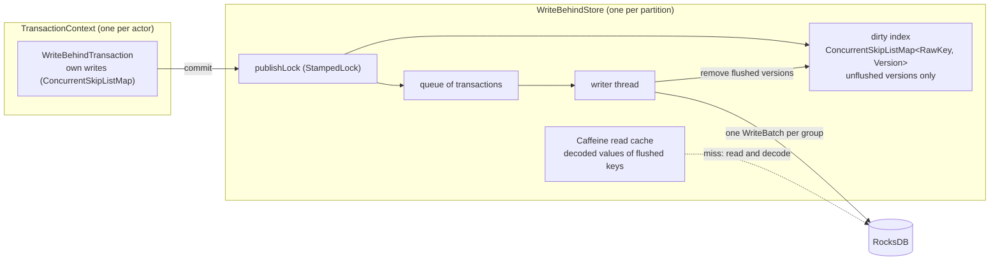

# Write-behind state DB for zb-db

Solution design for the `poc-single-storage-workshop-zbdb-cache` exploration. Status: implemented
as a proof of concept in `zeebe/zb-db/writebehind`. This document describes the code on branch
`cs/rdbms-cache-own-impl`. The next step, a key index for hot column families, is in
[key-index-implementation.md](key-index-implementation.md).

## 1. Goal

Committed state goes into memory first. RocksDB gets the changes later, from a background thread
("write-behind"). Hypotheses to test:

- Hot point reads come from the heap, not from JNI calls into memtables and the block cache.
- Values stay as objects. The engine thread does not encode or decode msgpack for state that is in
  memory.
- Short-lived state (keys that are inserted and deleted before a flush) never reaches RocksDB.
  That means less memtable churn, and fewer flushes and compactions.
- The queue absorbs RocksDB write stalls, up to its byte budget, so the processing thread does not
  see them.

Non-goals: a change to the `ZeebeDb` or `ColumnFamily` API, a change to the snapshot or
replication format, or use of memory as durable storage.

## 2. How zb-db works without write-behind

|   Concern    |                                                                                                          RocksDB implementation                                                                                                          |                                                   Where                                                    |
|--------------|------------------------------------------------------------------------------------------------------------------------------------------------------------------------------------------------------------------------------------------|------------------------------------------------------------------------------------------------------------|
| Layout       | One RocksDB column family. Each "virtual" column family is an 8-byte key prefix.                                                                                                                                                         | `ColumnFamilyContext#writeKey`                                                                             |
| Transactions | One transaction per `TransactionContext`, backed by a `WriteBatchWithIndex`. Commit runs `db.write(batch)`. Rollback runs `batch.clear()`.                                                                                              | `WriteBatchTransaction`, `DefaultTransactionContext`                                                       |
| Iteration    | `WBWI.newIteratorWithBase(db.newIterator(prefixReadOptions))`. Callers seek, then step forward or backward, and stop on a prefix mismatch.                                                                                               | `TransactionalColumnFamily#forEachInPrefix*`                                                               |
| Snapshots    | RocksDB `Checkpoint` of the live DB, taken while processing continues. The StateController picks the position. The checkpoint runs on the snapshot store's actor, on the broker's I/O-bound pool (2 threads by default).                | `ZeebeTransactionDb#createSnapshot`, `StateControllerImpl#takeSnapshot`, `FileBasedTransientSnapshot#take` |
| Durability   | WAL disabled. On (re)start, the runtime directory is deleted and restored from the latest snapshot, then the log is replayed.                                                                                                          | `RocksDbConfiguration#DEFAULT_WAL_DISABLED`, `StateControllerImpl#recoverInternal`                         |

### Facts that shape the design

1. **The runtime DB is disposable.** Recovery is the latest snapshot plus log replay. A crash that
   loses unflushed writes costs nothing, so write-behind is possible.
2. **A snapshot must be transaction-consistent.** The checkpoint must hold whole transactions, and
   everything up to the snapshot position. A checkpoint that captures half a transaction gives a
   corrupt state.
3. **Iteration is everywhere.** The engine iterates column families at 137 call sites in 47 state
   classes. 79 of them run on each command. [engine-state-iteration.md](engine-state-iteration.md)
   lists them. Ordered prefix scans are core: due timers, job deadlines, the children of an element
   instance. A hash cache cannot serve them.
4. **Several actors share the DB.** StreamProcessor, ExporterDirector, StateQueryService, backup
   state and migrations each create contexts. Each context is single-threaded, but the store must
   be thread-safe across contexts. In practice, only the stream processor writes the engine column
   families.
5. **Tests encode the contracts.**
   - Read-your-writes, including iteration over your own uncommitted writes.
   - Delete while iterating (`ColumnFamilyTest#shouldDeleteOnForeachPair`).
   - No snapshot isolation between transactions (`NoSnapshotIsolationTest`). A transaction can read
     commits made after it started, but never a part of another transaction.

## 3. Why not EhCache write-behind

The first draft of this design used EhCache 3 write-behind. EhCache batches per key and splits
batches without regard to transactions. RocksDB then never holds a transaction-consistent state on
its own. To take a snapshot, that design needed a commit barrier, write-through commits for large
transactions, and three locks. EhCache also drops a newer pending write for a key after an older
batch completes, and it deletes keys from the cache when the writer fails.

The implementation keeps **the transaction as the unit of write-behind** instead. One writer
thread applies whole transactions in commit order. RocksDB then always holds every transaction up
to some point and none after it, so a checkpoint at any moment is consistent. Caffeine is the read
cache. It is already managed in `parent/pom.xml`, so no new dependency was necessary.

## 4. Design

### 4.1 Modules

|          Module          |         Directory          |                                                         Holds                                                          |
|--------------------------|----------------------------|------------------------------------------------------------------------------------------------------------------------|
| `zeebe-db-api`           | `zeebe/zb-db/api`          | Interfaces, key and value types, `RawDbAccess` and `RawAccessibleDb`.                                                  |
| `zeebe-db-rocksdb`       | `zeebe/zb-db/rocksdb`      | The RocksDB implementation. `ZeebeTransactionDb` implements `RawAccessibleDb`.                                         |
| `zeebe-db-writebehind`   | `zeebe/zb-db/writebehind`  | The write-behind DB, package `io.camunda.zeebe.db.writebehind`. Depends on `zeebe-db-api` and Caffeine only.          |
| `zeebe-db-tests`         | `zeebe/zb-db/tests`        | Contract tests and differential tests, run against both implementations.                                              |

The write-behind DB wraps any `RawAccessibleDb`. It uses the wrapped DB only as storage, through
`RawDbAccess`: point get, `keyMayExist`, iterator, atomic batch and checkpoint.



### 4.2 Classes

|             Class               |                                                                                    Role                                                                                    |
|---------------------------------|----------------------------------------------------------------------------------------------------------------------------------------------------------------------------|
| `WriteBehindZeebeDbFactory`     | Wraps only `createDb(path)`, the runtime DB. `createDb(path, false)` and `openSnapshotOnlyDb` delegate.                                                                   |
| `WriteBehindZeebeDb`            | `ZeebeDb` over a `RawAccessibleDb`. Creates the column families and contexts. `createSnapshot` waits for the flush, then delegates.                                         |
| `WriteBehindColumnFamily`       | Typed column family. Same consistency checks as RocksDB's. Keys are encoded like RocksDB's (8-byte big-endian column family prefix, then the key). Values stay objects. |
| `WriteBehindTransaction`        | Own writes of one context. Read-your-writes, commit and rollback.                                                                                                          |
| `WriteBehindTransactionContext` | Same semantics as `DefaultTransactionContext`.                                                                                                                              |
| `WriteBehindStore`              | Committed state: dirty index, read cache, queue, writer thread, byte back-pressure, failure state.                                                                         |
| `MergingCursor`                 | Merges own writes, a copy of the dirty range and a RocksDB iterator.                                                                                                       |
| `RawKey`, `Version`, `Values`   | Key bytes with unsigned bytewise order. A value and its commit sequence. Copy, encode and decode helpers.                                                                 |

### 4.3 Values as objects

A profile showed msgpack encoding and decoding at about 17% of the engine's CPU, when the
write-behind layer worked with bytes. So values stay objects:

- A write stores a private copy (`DbValue#newInstance` and `copyTo`). The engine reuses one value
  instance per column family and changes it in place, so a reference is not safe.
- A read copies the stored object into the caller's instance.
- Only the writer thread encodes. A value is decoded only when it comes from RocksDB, and the
  decoded object goes into the cache.
- Column families with the same name can use different value classes (migrations do). A copy
  between two classes goes through the encoded form.

Keys stay bytes, because ordering, prefix scans and the merge with the RocksDB iterator need the
byte order. `RawKey#compareTo` uses `Arrays.compareUnsigned`, which is RocksDB's bytewise order.

The byte budgets use a fixed estimate per entry (`Version#weigh`: 64 bytes, plus the key, plus 256
bytes for a value). Measuring the real size means encoding the value.

### 4.4 Transactions and commit

- Own writes are a `ConcurrentSkipListMap<RawKey, Version>`. A skip list keeps iteration weakly
  consistent, so delete-while-iterating works.
- A delete is a tombstone (`Version` with a null value).
- `rollback` clears the own writes.
- A read-only commit takes no lock. It only checks that the store is usable.
- The own writes are cleared only after a successful commit. The stream processor retries a failed
  commit with the same writes.

`WriteBehindStore#commit`:

```text
wait while pendingBytes > maxPendingBytes        // byte back-pressure, outside the lock
publishLock.writeLock()
  seq = ++lastSeq
  for each key: dirty.put(key, Version(value, seq)); cache.invalidate(key)
  pendingBytes += weight
  queue.add(transaction)                         // queue order = publication order
  committedSeq = seq
publishLock.unlockWrite()
```

A transaction that is larger than `maxPendingBytes` still commits, after the queue is empty.

### 4.5 Point reads

```text
own writes -> dirty index -> cache
then, under publishLock's read side:
  dirty index again -> RocksDB get -> decode -> put into the cache
```

Under the read lock, no commit can publish the key and no flush can take it out of the dirty index. So if the key is not
in the dirty index, RocksDB has its latest value, and the cached copy stays up to date until a commit
invalidates it. `exists` follows the same path, but does not decode or cache.

### 4.6 Iteration

`WriteBehindStore#openView` takes, under the read lock, a RocksDB iterator and a copy of the dirty
index range for the scan prefix. `MergingCursor` merges:

1. the own writes (live, so writes during a scan are visible)
2. the dirty copy
3. the RocksDB iterator

On equal keys, the first source wins. A tombstone hides the key. Values from memory are copied.
Values from RocksDB are decoded only when the visitor reads them. The column family allows at most
two nested scans, as RocksDB's does.

Each scan opens a native RocksDB iterator and seeks it, even when the result is already in memory.
The key index (section 5) makes this iterator unnecessary for hot column families.

### 4.7 Writer

- One daemon thread takes the next transaction from the queue, plus every other queued one.
- It keeps the last version per key over the group, encodes the values, and writes one atomic
  `WriteBatch`.
- It skips a delete when `keyMayExist` returns false. A key that RocksDB never had needs no delete,
  which keeps short-lived state out of RocksDB.
- After the write, under the write lock, it drops each written version from the dirty index only
  if the entry is still that version. A newer version stays.
- It lowers `pendingBytes`, sets `flushedSeq`, and wakes all waiters.
- A recoverable `ZeebeDbException` is retried with exponential backoff (10 ms to 1 s), up to
  `maxWriteRetries`. Any other error, or the last failed retry, sets the store's failure. After
  that, commits, reads, scans and snapshots throw.

### 4.8 Snapshots

`WriteBehindZeebeDb#createSnapshot` waits until `flushedSeq` reaches the `committedSeq` of the
moment of the call, up to `flushTimeout`. Then it delegates the checkpoint. There is no commit
pause: the writer applies whole groups of transactions atomically, so the checkpoint is always
consistent and at or past the position that the caller observed.

The wait runs on the snapshot store's actor, on the broker's I/O-bound pool.

### 4.9 Lifecycle

- `WriteBehindZeebeDb#close` closes the store first, then the wrapped DB. The store stops new
  commits, lets the writer flush the queue, and waits up to `flushTimeout`. Then it interrupts the
  writer.
- Only the runtime DB is wrapped. Snapshot copy and recovery use RocksDB directly, because they
  work on closed DB directories.

### 4.10 Configuration

`WriteBehindConfiguration`, per partition:

|      Property      | Default |                                                     Notes                                                     |
|--------------------|---------|---------------------------------------------------------------------------------------------------------------|
| `maxPendingBytes`  | 32 MiB  | Estimated bytes in the dirty index before commits wait.                                                       |
| `cacheMaxBytes`    | 64 MiB  | Caffeine maximum weight. `0` disables the cache.                                                              |
| `maxWriteRetries`  | 10      | Retries of a recoverable write error before the store fails.                                                 |
| `flushTimeout`     | 30 s    | Limit for the snapshot wait and for close.                                                                    |

Wiring:

- **Broker:** `zeebe.broker.experimental.writeBehind.enabled` (default `false`), `maxPendingSize`
  and `cacheSize`. `ZeebePartitionFactory` wraps the partition's RocksDB factory when it is
  enabled. The setting is legacy-only while the feature is experimental. `LegacyWriteBehindTest`
  checks that it reaches the broker.
- **Engine tests:** the environment variable `ZEEBE_DB_WRITE_BEHIND_ENABLED=true` makes the engine's
  test `DefaultZeebeDbFactory` wrap RocksDB. With Gradle, add `--no-configuration-cache`.
- **Load test:** `WriteBehindLoadIT` in `zeebe/qa/integration-tests` compares the two DBs on one
  broker. Its Javadoc has the commands.

### 4.11 Memory

Per partition, the heap holds the read cache (up to `cacheMaxBytes`), the dirty index (up to about
`maxPendingBytes`, plus one transaction), the own writes of open transactions, and per-scan copies
of dirty ranges. RocksDB's native memory holds the same state too. For a fair benchmark, lower
RocksDB's `memoryLimit` by the heap budgets, and watch GC.

## 5. Next step: key index for hot column families

Section 4.6 opens a RocksDB iterator on every scan. For selected column families, the store will
keep every committed key in memory, in packed sorted chunks. A scan of such a column family reads
the keys from memory and opens no iterator. `exists` and `get` answer "absent" from memory. Column
families that are not selected keep the merged scan of section 4.6.

The plan is in [key-index-implementation.md](key-index-implementation.md).

## 6. Status

Done:

- Write-behind DB, values as objects, writer, snapshots, failure handling.
- Contract tests against both implementations, and `RocksDbVsWriteBehindDifferentialTest`
  (random operations with a tiny cache and byte budget).
- Engine test toggle, broker setting, load test.

Not done:

- Concurrency stress tests.
- Metrics.
- Health reporting: a writer failure is visible only at the next DB call.
- The key index (section 5).

## 7. Risks and open questions

1. **The snapshot wait blocks an I/O-pool thread.** `createSnapshot` waits for the flush on the
   snapshot store's actor. The ExporterDirector shares that pool (2 threads by default). A stalled
   writer can block it for up to `flushTimeout`.
2. **A writer failure is silent until the next DB call.** A partition with little traffic can run
   for a long time on state that RocksDB does not have. Report the failure to partition health.
3. **Size estimates are fixed.** One large value (a variable document of several MiB) counts as
   256 bytes. The byte budgets do not limit heap use for large values.
4. **Heap and GC pressure.** State moves to the heap, in addition to RocksDB's memory. Budgets are
   per partition, so multiply them by the partitions per broker.
5. **Is zb-db on the critical path?** With the WAL off, RocksDB writes stay in memory already. Only
   benchmarks answer this.
