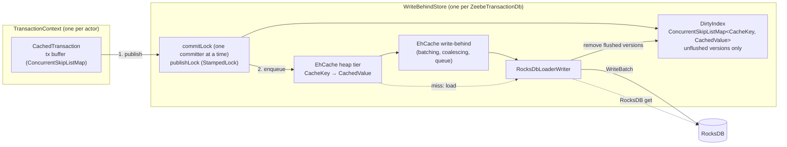

# Write-behind state cache for zb-db (EhCache 3)

Solution design and implementation plan. Status: draft for the
`poc-single-storage-workshop-zbdb-cache` exploration.

## 1. Goal

Committed state goes into an in-memory cache first. RocksDB is updated asynchronously
("write-behind") with batching and coalescing. Hypotheses to validate:

- Hot point reads are served from the heap instead of JNI + memtable/block-cache lookups.
- Short-lived state (keys inserted and deleted within the write window) never reaches RocksDB as
  a put. That means less memtable churn and fewer flushes and compactions.
- The write-behind queue absorbs RocksDB write stalls, up to its capacity, so the processing thread
  doesn't see them.

Non-goals: changing the `ZeebeDb`/`ColumnFamily` API, changing the snapshot or replication format,
or using the cache as durable storage.

## 2. How zb-db works today

|   Concern    |                                                                          Today                                                                           |                                                   Where                                                   |
|--------------|----------------------------------------------------------------------------------------------------------------------------------------------------------|-----------------------------------------------------------------------------------------------------------|
| Layout       | One RocksDB column family. Each "virtual" column family is an 8-byte key prefix.                                                                         | `ColumnFamilyContext#writeKey`                                                                            |
| Transactions | One `ZeebeTransaction` per `TransactionContext`, backed by a `WriteBatchWithIndex` (WBWI). Commit runs `db.write(batch)`; rollback runs `batch.clear()`. | `ZeebeTransaction`, `DefaultTransactionContext`                                                           |
| Point ops    | `put`/`get`/`delete` on the WBWI through `MethodHandle`s. `getFromBatchAndDB` gives read-your-writes.                                                    | `RocksDbInternal`                                                                                         |
| Iteration    | `WBWI.newIteratorWithBase(db.newIterator(prefixReadOptions))`. Callers use seek/next or seekForPrev/prev and stop on prefix mismatch.                    | `TransactionalColumnFamily#forEachInPrefix*`, `RawTransactionalColumnFamily`, `ForeignKeyChecker`         |
| Snapshots    | RocksDB `Checkpoint` of the live DB. The StateController actor takes it while processing continues.                                                      | `ZeebeTransactionDb#createSnapshot`, `StateControllerImpl#takeSnapshot`                                   |
| Durability   | WAL disabled, `avoid_flush_during_shutdown`. On (re)start, the runtime dir is deleted and restored from the latest snapshot, then the log is replayed.   | `RocksDbConfiguration#DEFAULT_WAL_DISABLED`, `ZeebeRocksDbFactory`, `StateControllerImpl#recoverInternal` |

### Facts that shape the design

1. **The runtime DB is already disposable.** Recovery is the latest snapshot plus log replay. A
   crash that loses unflushed writes costs nothing, so write-behind is viable at all.
2. **The snapshot is the only durability point, and it has a strict invariant.** The checkpoint
   must hold a transaction-consistent state that includes everything up to
   `lowerBoundSnapshotPosition`. Today every checkpoint meets this, because each transaction is a
   single atomic `db.write`. Two things can go wrong under write-behind:
   - RocksDB lags behind (its processed position is below the lower bound). The log can then be
     compacted past records that replay still needs.
   - The checkpoint captures half a transaction. The restored state is then corrupt.
3. **Iteration is everywhere.** The engine has about 219 iteration call sites in 35 state classes
   (`whileEqualPrefix`, `whileTrue`, `whileTrueReverse`, `forEach`, `isEmpty`, `count`), next to
   about 764 point-access sites. Ordered prefix scans are core: due timers, job deadlines, children
   of an element instance, variables of a scope. A hash cache can't serve them, and RocksDB alone is
   stale under write-behind.
4. **Several actors share the DB.** Contexts are created by StreamProcessor, ExporterDirector,
   StateQueryService, backup/checkpoint state, DbPositionSupplier and migrations. Each context is
   single-threaded, but the store must be thread-safe across contexts.
5. **Tests already encode the contracts.**
   - Read-your-writes, including iteration over your own uncommitted writes.
   - Delete-while-iterating (`ColumnFamilyTest#shouldDeleteOnForeachPair`, `#shouldDeleteWhileTrue`).
   - Explicitly *no* snapshot isolation between transactions
     (`ZeebeTransactionIsolationTest.NoSnapshotIsolationTest`): a transaction may read commits made
     after it started. That doesn't allow seeing *part* of another transaction. Today a commit is
     one atomic `WriteBatch`, so readers see all of it or none of it, and a RocksDB iterator reads a
     single point in time. The design keeps both properties.

## 3. What EhCache 3 write-behind gives, and what it doesn't

Verified against the ehcache3 `v3.11.1` and `v3.12.0` sources. 3.12.0 is the latest release, and
`BatchingLocalHeapWriteBehindQueue` is identical in both.

|        Property         |                                                                                                Behaviour                                                                                                 |                                                             Impact                                                             |
|-------------------------|----------------------------------------------------------------------------------------------------------------------------------------------------------------------------------------------------------|--------------------------------------------------------------------------------------------------------------------------------|
| Read of a pending write | `AbstractWriteBehind#load` returns the pending op for a key before it calls our loader.                                                                                                                  | Good: read-your-writes still works after eviction, apart from the next row.                                                    |
| Pending-op bookkeeping  | After a batch is written, `latest.remove(key)` runs unconditionally. It also drops a *newer* pending op for the same key in a later batch.                                                               | If the entry is evicted in that window, a read falls through to RocksDB and gets the old value. We need our own pending index. |
| Ordering                | `concurrencyLevel` stripes by `key.hashCode()`. Order is kept per key, not across keys. A batch splits into alternating `writeAll`/`deleteAll` calls, and batch boundaries don't match our transactions. | RocksDB never holds a transaction-consistent state on its own, so snapshots need a barrier.                                    |
| Writer failure          | No retry. EhCache logs a WARN and removes the batch's keys from the cache (`store.remove`).                                                                                                              | Committed state silently disappears from the live view. Our writer must never throw.                                           |
| Back-pressure           | A full queue blocks the committing thread in `BlockingQueue#put`. EhCache enqueues inside its per-key `compute` (`LocalLoaderWriterStore#put`), so that map bin stays locked while it waits.             | Blocks an actor thread, as RocksDB write stalls do today. Cache reads of other keys in the same map bin wait too.              |
| Load vs. put            | On a miss, `cache.get` runs the loader inside the heap store's per-key `compute` (`OnHeapStore#computeIfAbsent`). A concurrent `put` for that key waits, then wins.                                      | A load can't overwrite a newer committed value.                                                                                |
| Flush/drain             | No public API (`WriteBehind#getQueueSize` is internal).                                                                                                                                                  | We need our own "everything flushed" signal.                                                                                   |
| Iteration               | None: unordered, and only resident entries.                                                                                                                                                              | We need our own ordered overlay.                                                                                               |
| Dependencies            | `org.ehcache:ehcache` pulls in `javax.cache:cache-api` (compile) and `jaxb-runtime` (runtime). Apache-2.0 license.                                                                                       | Exclude JAXB, since we configure the cache in code.                                                                            |

**Consequence:** EhCache gives us a hot point-read cache and an async writer that batches,
coalesces and applies back-pressure. We still have to build the correctness pieces around it:
ordered reads of unflushed state, snapshot consistency and error handling.

## 4. Design

### 4.1 Overview



Read paths:

- **Point read:** tx buffer → DirtyIndex → EhCache → on a miss, RocksDB. The lookup is validated
  against concurrent publications.
- **Iteration:** merge the live tx buffer with a copy of the DirtyIndex range and a RocksDB iterator,
  both taken at the same instant. On equal keys, the first one in that order wins.

### 4.2 Data model

- `CacheKey` holds the full RocksDB key as an immutable `byte[]` (8-byte column family prefix plus
  the key). `equals`/`hashCode` use `Arrays.equals`/`Arrays.hashCode`. `compareTo` uses
  `Arrays.compareUnsigned`, which matches RocksDB's bytewise comparator, so the overlay sorts like
  RocksDB.
- `CachedValue` has two fields:
  - `byte @Nullable [] bytes` (`null` means tombstone)
  - `long seq` (global commit sequence; all writes of one transaction share it)
- **A delete is a tombstone put. We never call `cache.remove()`.** This has three benefits:
  - The writer gets the value, and so its `seq`, for deletes too. EhCache's `deleteAll` only hands us
    keys.
  - `exists()` gets negative caching.
  - Coalescing folds an insert plus a delete into a single op.
- The arrays in the cache and the DirtyIndex are shared and never handed out:
  - Commit copies them in, because the `ColumnFamilyContext` buffers get reused.
  - Every read copies them out: `get`, and an iterator's `key()`/`value()`. Callers can keep or
    mutate what they get without touching committed state. This matters because msgpack's
    `StringValue#read` and `BinaryValue#read` keep views into the source buffer.
  - It costs nothing extra: today every JNI `get` and iterator call already returns a fresh array.
  - Copying into a reusable per-context buffer instead would break `get(key, valueSupplier)`, which
    promises an instance the caller can keep.

### 4.3 Transactions: `CachedTransaction`

- A per-context `ConcurrentSkipListMap<CacheKey, Op>` replaces the WBWI as the transaction buffer.
  The WBWI can't be layered on top of the cache for two reasons:
  - `getFromBatch` can't tell "deleted in this batch" from "not in this batch".
  - `newIteratorWithBase` only accepts a native base iterator.
- A skip list (rather than a `TreeMap`) keeps iteration weakly consistent, so delete-while-iterating
  keeps working.
- `put`/`delete` copy the key and value bytes into the buffer.
- `get` probes the buffer with a reusable lookup key, then falls back to the store.
- `rollback` is `clear()`.
- `commit`:

  ```text
  commitLock.lock()                             // one committer at a time, start to finish
    failIfStoreFailed()
    seq = nextSeq()
    values = [(key, new CachedValue(op.bytes, seq)) for (key, op) in txBuffer]
    stamp = publishLock.writeLock()             // short; nothing inside it blocks
      for (key, v) in values: dirtyIndex.put(key, v)
    publishLock.unlockWrite(stamp)
    for (key, v) in values: cache.put(key, v)   // enqueue; may block on back-pressure
  commitLock.unlock()
  txBuffer.clear()
  ```
- `publishLock` is a `StampedLock`. Its write side covers the DirtyIndex update for the whole
  transaction, and readers validate against it (§4.4, §4.5). So a reader sees all of a transaction
  or none of it, as with a RocksDB `WriteBatch` today.
- `commitLock` serializes committers end to end, so the enqueue order matches the publication
  order. Without it, two contexts writing the same key could leave the cache on one version and the
  DirtyIndex on the other. Coalescing could then drop the newer version from the queue, so that it
  is never flushed. Serializing costs little, because the stream processor does almost all commits.
- Only two places change the DirtyIndex: publication (above) and cleanup after a flush (§4.6). Both
  hold `publishLock`'s write side. So no bookkeeping has to run as a side effect inside
  `ConcurrentSkipListMap#compute`, whose function may run more than once.
- Back-pressure blocks outside `publishLock`, so a full queue doesn't stall readers' validation.
  Cache reads of keys in the same map bin can still wait (§3).

### 4.4 Point reads

```text
stamp = publishLock.tryOptimisticRead()
v = txBuffer.get(key) ?: dirtyIndex.get(key) ?: cache.get(key)   // cache miss: load from RocksDB
if !publishLock.validate(stamp): retry (after a few tries, under the read lock)
return copy of v.bytes                                           // null for a tombstone or a miss
```

- The DirtyIndex comes before the cache, for two reasons:

  - The cache can briefly hold an older version, between publication and enqueue.
  - EhCache's `latest.remove(key)` can drop a pending op.

  The DirtyIndex holds every unflushed version, so checking it first covers both.

- On a cache miss, the loader reads RocksDB directly. Anything that isn't in the DirtyIndex has
  already been flushed, because a version only leaves the DirtyIndex after its RocksDB write.

- Validation makes the lookup atomic with respect to publications. Two reads can still straddle a
  commit and see an older K1 with a newer K2, as they can today. They can never see a newer K1 with
  an older K2 from the same transaction.

- EhCache may keep the key object when it loads an entry, so `cache.get` needs an immutable key
  copy. That's one more allocation per cache read; measure it.

### 4.5 Iteration: `MergingDbIterator`

A new `DbIterator` interface (`seek`, `seekForPrev`, `isValid`, `next`, `prev`, `key`, `value`,
`close`) replaces `RocksIterator` in `TransactionalColumnFamily`, `RawTransactionalColumnFamily` and
`ForeignKeyChecker`. Plain mode wraps a `RocksIterator`. Cached mode merges three sorted sources:

1. the tx buffer (`tailMap`, or `headMap(..).descendingMap()` for reverse)
2. a copy of the DirtyIndex range
3. a RocksDB iterator with the prefix read options

Rules for the merge:

- On equal keys, the tx buffer wins over the DirtyIndex copy, which wins over RocksDB.
- A tombstone hides the lower layers and is skipped itself.
- The DirtyIndex copy covers only the prefix being scanned (the caller passes it in). That also
  mimics `prefix_same_as_start`.
- Each iterator goes either forward (seek/next) or in reverse (seekForPrev/prev). Callers never
  switch direction, so assert it instead of implementing it.

**Point-in-time view.** At creation, the iterator pins RocksDB's view and copies the DirtyIndex
range in one step, under `publishLock`'s read side:

```text
stamp = publishLock.readLock()
  rocksIterator = db.newIterator(prefixReadOptions)   // pins RocksDB's current view
  overlay = copy of dirtyIndex.subMap(prefixStart, prefixEnd)
publishLock.unlockRead(stamp)
```

- No publication and no cleanup can run between the two steps.
- Every unflushed version is in the copy, and every flushed one is in RocksDB's view.
- A flush can land between the two steps. Its entries are then still in the DirtyIndex, because
  cleanup can't run yet, so they end up in the copy.

So the merge shows the committed state at one instant, like a RocksDB iterator today, even though
the writer's batches cut across transactions. Only the tx buffer stays live, which keeps
delete-while-iterating working.

After this step the iterator never reads the live DirtyIndex. So cleanup doesn't wait for open
iterators, and a long scan doesn't hold back memory.

The copy costs O(dirty entries in the scanned prefix):

- A prefix scan touches a handful of entries.
- A scan over a whole column family that stops early (due timers, job deadlines) copies every dirty
  entry of that column family. That's bounded by the queue size.

Measure this in Phase 3.

### 4.6 Writer: `RocksDbLoaderWriter`

- `writeAll(entries)` builds one RocksDB `WriteBatch` (a tombstone becomes `delete`, a value becomes
  `put`) and calls `db.write(writeOptions, batch)`. `deleteAll` is never called, because we never
  call `cache.remove`.
- **Cleanup** runs right after a successful write, under `publishLock`'s write side:
  - For each written entry, remove the DirtyIndex entry if its `seq` equals the written one. A newer
    version stays.
  - Matching on `seq` rather than object identity means it doesn't matter whether EhCache hands us
    the same object we passed to `put`.
  - Then signal a waiting snapshot (§4.7).
- It never throws to EhCache:
  - On a recoverable `RocksDBException` (`RocksDbInternal.RECOVERABLE_ERROR_CODES`), it retries
    with backoff, up to a limit. This stalls the queue, which turns into back-pressure.
  - On a non-recoverable error, or once retries are exhausted, it sets `store.failure`, logs an
    ERROR and reports the failure right away (next bullet). From then on, commits, reads and
    `createSnapshot` fail fast.
- **Failure reporting and recovery.** A partition with little traffic may not read or commit for a
  long time, so the failure can't wait for the next DB call to surface. Instead:
  - The DB implements `HealthMonitorable` from `zeebe-util`, which is already a zb-db dependency.
  - `ZeebeDbPartitionTransitionStep` registers it with the partition's component health monitor,
    the same way `StreamProcessorTransitionStep` registers the stream processor.
  - On failure, the writer reports a dead `HealthReport` through
    `FailureListener#onUnrecoverableFailure`.

  The outcome matches a failed state commit today (`ProcessingStateMachine#updateState` →
  `UncommittedStateException` → dead partition). The partition stops, and a broker restart rebuilds
  the runtime from the latest snapshot and replays the log. Losing the unflushed writes is fine
  (fact 1). Recovering in-process instead, by stepping down and reinstalling, would need a new
  recoverable path in `ZeebePartition` (§8).

- After the store is closed, it drops writes and never touches closed RocksDB handles.

- **Phase 6 optimization:** skip a tombstone when `rocksDB.keyMayExist(key)` returns `false`.

  - Coalescing alone still writes a tombstone for an insert followed by a delete, so this skip is
    where most of the churn reduction would come from.
  - `keyMayExist` only sees RocksDB, not the batch being built. With `coalescing = false`, one
    `writeAll` can hold a put and then a tombstone for the same key, and skipping that delete would
    bring the key back.
  - So the writer first reduces each `writeAll` to the last op per key, and only then applies the
    check. `keyMayExist` has no false negatives, so `false` then means the key was never written.

### 4.7 Snapshot barrier

`ZeebeTransactionDb#createSnapshot` becomes:

```text
deadline = now + snapshotDrainTimeout
if !commitLock.tryLock(until deadline): fail
try
  failIfStoreFailed()
  wait until dirtyIndex.isEmpty(), until deadline, else fail   // the writer signals after cleanup
  checkpoint.createCheckpoint(dir)
finally
  commitLock.unlock()
```

- **One deadline covers both taking the lock and draining.** A committer can hold `commitLock` while
  it's blocked on a full queue. If the writer is stalled, a plain `lock()` would hang the snapshot,
  and the StateController actor with it, before the drain timeout even started.
- Holding `commitLock` means no commit is in progress, including one that is still enqueuing, and
  none can start.
- **The DirtyIndex holds exactly the unflushed versions**, because cleanup removes a version in the
  same critical section that confirms its write. So "drained" simply means `dirtyIndex.isEmpty()`,
  and there's no separate counter to keep in sync.
- After the drain, RocksDB holds the state after the last committed transaction. That state is
  transaction-consistent and at or past `lowerBoundSnapshotPosition`.
- **Pause:** writers wait for about `maxWriteDelay` + the backlog write + the checkpoint, and never
  longer than `snapshotDrainTimeout`. With the WAL disabled, the checkpoint flushes the memtables.
  This happens once per snapshot, every 5 minutes by default.
- **Phase 6 refinement:** hold `commitLock` only during the drain. During the checkpoint, pause the
  *writer* instead, so that commits keep filling the queue.
- `compactAll()` drains first as well.

### 4.8 Lifecycle and bypass

- Each `ZeebeTransactionDb` (one per partition) gets its own `CacheManager` and write-behind thread
  pool.
- The `CacheManager` is added to `closables` *after* the RocksDB and options objects. `close()`
  walks that list in reverse, so the writer stops before RocksDB is closed. In the other order, the
  writer would call JNI on a freed handle.
- In runtime mode, close drops pending writes; the runtime directory is deleted afterwards anyway.
- Only the runtime DB uses write-behind: `createDb(path)` with `avoidFlush = true`, called from
  `StateControllerImpl#openDb`. These stay on the plain path:
  - `createDb(path, false)`. `RocksDBSnapshotCopy` copies a whole snapshot in a single transaction
    and then calls `compactAll()`. A heap tx buffer would hold the entire snapshot.
  - `openSnapshotOnlyDb`, and the sanity-check factory in `RecoveryPartitionManager`.

### 4.9 Configuration

Add a `WriteBehindConfiguration` record to `RocksDbConfiguration`, wired from `RocksdbCfg`, which
already sits under `zeebe.broker.experimental.rocksdb`.

|        Property        | Default |                                                       Notes                                                       |
|------------------------|---------|-------------------------------------------------------------------------------------------------------------------|
| `writeBehind.enabled`  | `false` |                                                                                                                   |
| `cacheMaxEntries`      | 100 000 | Per partition. The heap tier is sized by entry count; sizing by bytes needs per-entry size estimates.             |
| `batchSize`            | 1 000   |                                                                                                                   |
| `maxWriteDelay`        | 100 ms  | Longer gives more coalescing; shorter gives a shorter snapshot pause.                                             |
| `queueSize`            | 10 000  | Pending ops per stripe before back-pressure kicks in.                                                             |
| `concurrencyLevel`     | 1       | One RocksDB writer thread.                                                                                        |
| `coalescing`           | `true`  |                                                                                                                   |
| `snapshotDrainTimeout` | 30 s    | Covers taking the commit lock and draining. If exceeded, the snapshot fails and the snapshot director retries it. |

### 4.10 Metrics

Registered on the DB meter registry, so they go away when the DB closes:

- cache hits, misses and loads
- committed ops vs. written puts and deletes (coalescing ratio)
- skipped tombstones
- DirtyIndex size (the unflushed keys)
- batch size and write latency
- time blocked on back-pressure (shows up as commit latency) and commit-lock wait time
- optimistic read retries
- snapshot drain duration
- writer retries and failures

### 4.11 Memory

The design moves hot state from RocksDB's off-heap budget to the JVM heap. The heap now holds:

- the cache entries
- the DirtyIndex: only unflushed versions, since cleanup follows every write. That's roughly
  `concurrencyLevel × (queueSize + batchSize)` entries.
- per-iterator copies of DirtyIndex ranges: short-lived and bounded by the DirtyIndex
- the tx buffers

For a fair benchmark, lower RocksDB's `memoryLimit` by the same amount, and watch GC.

## 5. Alternatives considered

- **Cache only the column families that see point access.** Rejected: almost every column family is
  iterated somewhere. Splitting one transaction across two write paths would also still leave the
  snapshot problem.
- **EhCache write-behind alone, without our own overlay.** Incorrect: iteration is stale, the
  `latest.remove` race stays open, and there's no drain signal.
- **Our own ordered write-behind on Caffeine.** Caffeine is already managed in `parent/pom.xml` and
  used by the engine. The writer would apply whole transactions in commit order, so RocksDB is
  always a consistent prefix and snapshots need no commit pause. It adds no new dependency. It needs
  the same overlay and merge-iterator work. Keep it as the comparison point if EhCache's barrier
  pause or queue semantics get in the way.
- **Tune RocksDB instead** (bigger memtables or block cache). This is the baseline to beat: with
  the WAL off, a RocksDB write is already an in-memory memtable insert.

## 6. Implementation plan

### Phase 0: baseline and go/no-go signal (no code)

- Run `EngineLargeStatePerformanceTest` (engine), `LargeStateControllerPerformanceTest` (broker), and
  a realistic load test on `main`.
- Turn on `accessMetrics: FINE` and `enableStatistics` to get get/put/iterate latency per column
  family and RocksDB stall counters.
- **Exit:** the numbers are recorded. If zb-db is a small share of processing time, stop or rescope.

### Phase 1: structural refactor, no behaviour change (`refactor:` commits)

1. Add `DbIterator` and a `RocksIterator` adapter. Switch `TransactionalColumnFamily`,
   `RawTransactionalColumnFamily` (including the static `forEach*` helpers that `SnapshotOnlyDb`
   uses) and `ForeignKeyChecker` to it.
2. Turn `ZeebeTransaction` into an interface, with today's class as the WBWI implementation. The
   existing casts keep working.
3. Parameterize the zb-db tests over a DB factory provider (only the plain factory for now).

- **Exit:** `./mvnw verify -pl zeebe/zb-db -DskipTests=false -Dquickly` is green, and
  `EngineLargeStatePerformanceTest` stays within its tolerance.

### Phase 2: write-behind core for point ops (`feat:`)

- **Ask first:** add `org.ehcache:ehcache` to the `parent/pom.xml` dependency management and to
  `zeebe/zb-db/pom.xml`, excluding `jaxb-runtime`. Keep the Gradle build in parity.
- Create a new package `io.camunda.zeebe.db.impl.rocksdb.writebehind` with:
  - `CacheKey`, `CachedValue`
  - `DirtyIndex`
  - `RocksDbLoaderWriter`
  - `WriteBehindStore`
  - `WriteBehindConfiguration`
  - `CachedTransaction`
- In `ZeebeTransactionDb`: hold an optional store, have `createContext()` choose the transaction
  type, and fix the order of `closables`.
- Commit protocol with `commitLock` and `publishLock`, validated point reads, and copy-on-read.
- In `ZeebeRocksDbFactory`: enable write-behind only on the runtime `createDb` path.
- Until Phase 3, iterating on a cached DB throws `UnsupportedOperationException`.
- **Exit:** the point-op tests are green against the cached factory, plus new tests for
  eviction-while-pending, copy-on-read, a paused publication and concurrent same-key committers.

### Phase 3: merged iteration (`feat:`)

- Add `MergingDbIterator`. It takes the RocksDB view and the DirtyIndex range copy together, under
  `publishLock`'s read side.
- **Exit:** the full zb-db suite is green on both factories, including
  `ColumnFamilyRandomizedPropertyTest` with more tries, and the iterator stress test passes.

### Phase 4: snapshot barrier, lifecycle and failures (`feat:`)

- Add the snapshot barrier: `commitLock.tryLock` and the drain share one deadline, and "drained"
  means `dirtyIndex.isEmpty()`.
- Drain in `compactAll` too, and fix the close order.
- Add writer retry, the failure latch and fail-fast, and make the DB a `HealthMonitorable`.
- **Exit:** the snapshot-consistency, stalled-writer snapshot, failure-injection and
  close-with-pending tests are green.

### Phase 5: wiring and engine-level validation (`feat:` and `test:`)

- **Ask first** (configuration is a public contract): add the experimental `RocksdbCfg` properties
  and map them to `RocksDbConfiguration`.
- Register the DB with the partition's component health monitor in
  `ZeebeDbPartitionTransitionStep`.
- Add the metrics.
- Make the test-side `DefaultZeebeDbFactory` read a system property, for example
  `-Dzeebe.db.writeBehind.enabled=true`. About 20 test classes outside zb-db use this factory, so
  the `zeebe/engine` tests can run against the cached DB locally.
- Add broker ITs:
  - run process instances, take a snapshot, restart, and check the state is intact
  - have a follower install a snapshot that a cached leader took
- **Exit:** the engine suite is green with the toggle on, and the broker restart IT is green.

### Phase 6: benchmark, tune, decide

- Rerun the Phase 0 scenarios with write-behind on and RocksDB memory reduced by the cache budget.
- Sweep `maxWriteDelay` (10, 100 and 1000 ms) against `batchSize`, and record the snapshot pause.
- Optional optimizations:
  - skip tombstones via `keyMayExist`, after reducing each batch to the last op per key
  - pause the writer instead of commits during the checkpoint
  - an off-heap tier (needs serializers for `CacheKey` and `CachedValue`)
- **Exit:** a go/no-go write-up. If it's a go, an ADR under `zeebe/docs/adr/`.

## 7. Test plan (new tests, against the cached factory)

|                                                 Test                                                 |                                    Proves                                     |
|------------------------------------------------------------------------------------------------------|-------------------------------------------------------------------------------|
| Read after eviction with a pending write (cache size 1, `maxWriteDelay` 10 s)                        | Point reads never return a stale RocksDB value                                |
| Overwrite while the previous batch is in flight, plus eviction                                       | The DirtyIndex covers EhCache's `latest.remove` race                          |
| Mutate an array returned by `get` or by an iterator, then read again and drain                       | Callers can't change committed or persisted state                             |
| Pause a commit mid-publication (test hook); another thread reads two of its keys and scans its range | Readers see all of a transaction or none of it                                |
| Two contexts commit the same key concurrently in a loop                                              | Point reads, scans and RocksDB agree after the drain, and the drain completes |
| Iteration sees pending puts and hides pending deletes (forward, reverse, startAt, prefix)            | Merge-iterator semantics                                                      |
| Writer flushes concurrently while long scans run on another thread (stress)                          | Scans see one point in time; the DirtyIndex stays bounded by the queue        |
| Snapshot after N commits, opened with the plain factory                                              | The barrier drains everything                                                 |
| Snapshot loop against a concurrent committer, where each tx writes K keys plus a marker              | Snapshots are transaction-consistent                                          |
| Snapshot while a committer is blocked on a full queue (writer stalled)                               | The snapshot fails within `snapshotDrainTimeout` instead of hanging           |
| RocksDB write fails (test seam in the writer) while no reads or commits happen                       | The failure is reported at once; commits and reads fail fast after it         |
| Put, then delete, of a new key in one `writeAll`, with `coalescing` on and off                       | The `keyMayExist` skip never brings a key back                                |
| Close with pending writes; `createDb(path, false)`                                                   | No crash on close; bulk copy is unaffected                                    |

## 8. Risks and open questions

1. **Is zb-db on the critical path at all?** Phase 0 answers this. With the WAL off, RocksDB writes
   already stay in memory.
2. **Snapshot pause.** The stream processor and exporter director can't commit for about
   `maxWriteDelay` + the checkpoint duration, once per snapshot, and never longer than
   `snapshotDrainTimeout`.
3. **Blocked threads under back-pressure.** A full queue blocks the committer, and also cache reads
   of keys that share its map bin (§3). That's the same class of problem as RocksDB write stalls
   today, but now configurable and measured.
4. **Heap and GC pressure** from moving state on-heap, from copying on every read (as today), and
   from the DirtyIndex copies made per iterator.
5. **Serialized commits.** This is fine while the stream processor does almost all commits. Watch the
   commit-lock wait time for the exporter director.
6. **Writer failure stops the partition**, on followers too. In-process recovery would need a new
   step-down path in `ZeebePartition`. Decide whether the POC needs it.
7. **Approvals needed:** the new dependency and the experimental config keys (both "ask first" in
   `AGENTS.md`).

