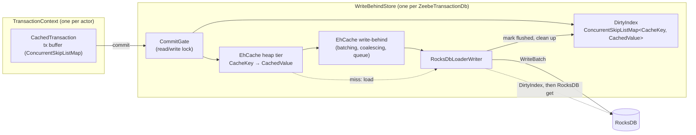

# Write-behind state cache for zb-db (EhCache 3)

Solution design and implementation plan. Status: draft for the
`poc-single-storage-workshop-zbdb-cache` exploration.

## 1. Goal

Committed state goes into an in-memory cache first. RocksDB is updated asynchronously
("write-behind") with batching and coalescing. Hypotheses to validate:

- Hot point reads are served from the heap instead of JNI + memtable/block-cache lookups.
- Short-lived state (keys inserted and deleted within the write window) never reaches RocksDB as
  a put. That means less memtable churn and fewer flushes and compactions.
- The write-behind queue absorbs RocksDB write stalls, up to its capacity, so the processing thread
  doesn't see them.

Non-goals: changing the `ZeebeDb`/`ColumnFamily` API, changing the snapshot or replication format,
or using the cache as durable storage.

## 2. How zb-db works today

|   Concern    |                                                                          Today                                                                           |                                                   Where                                                   |
|--------------|----------------------------------------------------------------------------------------------------------------------------------------------------------|-----------------------------------------------------------------------------------------------------------|
| Layout       | One RocksDB column family. Each "virtual" column family is an 8-byte key prefix.                                                                         | `ColumnFamilyContext#writeKey`                                                                            |
| Transactions | One `ZeebeTransaction` per `TransactionContext`, backed by a `WriteBatchWithIndex` (WBWI). Commit runs `db.write(batch)`; rollback runs `batch.clear()`. | `ZeebeTransaction`, `DefaultTransactionContext`                                                           |
| Point ops    | `put`/`get`/`delete` on the WBWI through `MethodHandle`s. `getFromBatchAndDB` gives read-your-writes.                                                    | `RocksDbInternal`                                                                                         |
| Iteration    | `WBWI.newIteratorWithBase(db.newIterator(prefixReadOptions))`. Callers use seek/next or seekForPrev/prev and stop on prefix mismatch.                    | `TransactionalColumnFamily#forEachInPrefix*`, `RawTransactionalColumnFamily`, `ForeignKeyChecker`         |
| Snapshots    | RocksDB `Checkpoint` of the live DB. The StateController actor takes it while processing continues.                                                      | `ZeebeTransactionDb#createSnapshot`, `StateControllerImpl#takeSnapshot`                                   |
| Durability   | WAL disabled, `avoid_flush_during_shutdown`. On (re)start, the runtime dir is deleted and restored from the latest snapshot, then the log is replayed.   | `RocksDbConfiguration#DEFAULT_WAL_DISABLED`, `ZeebeRocksDbFactory`, `StateControllerImpl#recoverInternal` |

### Facts that shape the design

1. **The runtime DB is already disposable.** Recovery is the latest snapshot plus log replay. A
   crash that loses unflushed writes costs nothing, so write-behind is viable at all.
2. **The snapshot is the only durability point, and it has a strict invariant.** The checkpoint
   must hold a transaction-consistent state that includes everything up to
   `lowerBoundSnapshotPosition`. Today every checkpoint meets this, because each transaction is a
   single atomic `db.write`. Two things can go wrong under write-behind:
   - RocksDB lags behind (its processed position is below the lower bound). The log can then be
     compacted past records that replay still needs.
   - The checkpoint captures half a transaction. The restored state is then corrupt.
3. **Iteration is everywhere.** The engine has about 219 iteration call sites in 35 state classes
   (`whileEqualPrefix`, `whileTrue`, `whileTrueReverse`, `forEach`, `isEmpty`, `count`), next to
   about 764 point-access sites. Ordered prefix scans are core: due timers, job deadlines, children
   of an element instance, variables of a scope. A hash cache can't serve them, and RocksDB alone is
   stale under write-behind.
4. **Several actors share the DB.** Contexts are created by StreamProcessor, ExporterDirector,
   StateQueryService, backup/checkpoint state, DbPositionSupplier and migrations. Each context is
   single-threaded, but the store must be thread-safe across contexts.
5. **Tests already encode the contracts.**
   - Read-your-writes, including iteration over your own uncommitted writes.
   - Delete-while-iterating (`ColumnFamilyTest#shouldDeleteOnForeachPair`, `#shouldDeleteWhileTrue`).
   - Explicitly *no* snapshot isolation between transactions
     (`ZeebeTransactionIsolationTest.NoSnapshotIsolationTest`). This contract is what allows a live,
     weakly consistent overlay.

## 3. What EhCache 3 write-behind gives, and what it doesn't

Verified against the ehcache3 `v3.11.1` and `v3.12.0` sources. 3.12.0 is the latest release, and
`BatchingLocalHeapWriteBehindQueue` is identical in both.

|        Property         |                                                                                                Behaviour                                                                                                 |                                                             Impact                                                             |
|-------------------------|----------------------------------------------------------------------------------------------------------------------------------------------------------------------------------------------------------|--------------------------------------------------------------------------------------------------------------------------------|
| Read of a pending write | `AbstractWriteBehind#load` returns the pending op for a key before it calls our loader.                                                                                                                  | Good: read-your-writes still works after eviction, apart from the next row.                                                    |
| Pending-op bookkeeping  | After a batch is written, `latest.remove(key)` runs unconditionally. It also drops a *newer* pending op for the same key in a later batch.                                                               | If the entry is evicted in that window, a read falls through to RocksDB and gets the old value. We need our own pending index. |
| Ordering                | `concurrencyLevel` stripes by `key.hashCode()`. Order is kept per key, not across keys. A batch splits into alternating `writeAll`/`deleteAll` calls, and batch boundaries don't match our transactions. | RocksDB never holds a transaction-consistent state on its own, so snapshots need a barrier.                                    |
| Writer failure          | No retry. EhCache logs a WARN and removes the batch's keys from the cache (`store.remove`).                                                                                                              | Committed state silently disappears from the live view. Our writer must never throw.                                           |
| Back-pressure           | A full queue blocks the committing thread in `BlockingQueue#put`.                                                                                                                                        | Blocks an actor thread. RocksDB write stalls do the same today.                                                                |
| Flush/drain             | No public API (`WriteBehind#getQueueSize` is internal).                                                                                                                                                  | We need our own "everything flushed" signal.                                                                                   |
| Iteration               | None: unordered, and only resident entries.                                                                                                                                                              | We need our own ordered overlay.                                                                                               |
| Dependencies            | `org.ehcache:ehcache` pulls in `javax.cache:cache-api` (compile) and `jaxb-runtime` (runtime). Apache-2.0 license.                                                                                       | Exclude JAXB, since we configure the cache in code.                                                                            |

**Consequence:** EhCache gives us a hot point-read cache and an async writer that batches,
coalesces and applies back-pressure. We still have to build the correctness pieces around it:
ordered reads of unflushed state, snapshot consistency and error handling.

## 4. Design

### 4.1 Overview



Read paths:

- **Point read:** tx buffer → EhCache. On a miss: EhCache's pending op → DirtyIndex → RocksDB.
- **Iteration:** merge the tx buffer, the DirtyIndex and a RocksDB iterator. On equal keys, the
  first one in that order wins.

### 4.2 Data model

- `CacheKey` holds the full RocksDB key as an immutable `byte[]` (8-byte column family prefix plus
  the key). `equals`/`hashCode` use `Arrays.equals`/`Arrays.hashCode`. `compareTo` uses
  `Arrays.compareUnsigned`, which matches RocksDB's bytewise comparator, so the overlay sorts like
  RocksDB.
- `CachedValue` has three fields:
  - `byte @Nullable [] bytes` (`null` means tombstone)
  - `long seq` (global commit sequence)
  - `volatile long flushedAt` (the RocksDB sequence number once written, `-1` before that)
- **A delete is a tombstone put. We never call `cache.remove()`.** This has three benefits:
  - The value keeps its object identity through the queue. EhCache's `deleteAll` only hands us keys.
  - `exists()` gets negative caching.
  - Coalescing folds an insert plus a delete into a single op.
- Values in the cache and overlay are shared and immutable. They're copied once at commit, because
  the `ColumnFamilyContext` buffers get reused. msgpack's `StringValue#read` and `BinaryValue#read`
  wrap views into the source buffer. That's safe only as long as nothing writes through those views.

### 4.3 Transactions: `CachedTransaction`

- A per-context `ConcurrentSkipListMap<CacheKey, Op>` replaces the WBWI as the transaction buffer.
  The WBWI can't be layered on top of the cache for two reasons:
  - `getFromBatch` can't tell "deleted in this batch" from "not in this batch".
  - `newIteratorWithBase` only accepts a native base iterator.
- A skip list (rather than a `TreeMap`) keeps iteration weakly consistent, so delete-while-iterating
  keeps working.
- `put`/`delete` copy the key and value bytes into the buffer.
- `get` probes the buffer with a reusable lookup key, then falls back to the store.
- `rollback` is `clear()`.
- `commit`:

  ```text
  gate.readLock
    failIfStoreFailed()
    seq = store.nextSeq()
    for (key, op) in txBuffer:            // key order
      v = new CachedValue(op.bytes, seq)
      dirtyIndex.put(key, v)              // first, so that a concurrent cache miss finds it
      cache.put(key, v)                   // enqueues write-behind; may block on back-pressure
  gate.readUnlock
  txBuffer.clear()
  ```

### 4.4 Point reads

The lookup order is:

1. tx buffer
2. `cache.get(key)`
3. On an EhCache miss: EhCache's own pending op
4. `RocksDbLoaderWriter#load`: DirtyIndex first, then `rocksDB.get`

A tombstone reads as absent.

Checking the DirtyIndex before RocksDB closes the stale-read window from EhCache's
`latest.remove(key)`. A DirtyIndex entry is removed only after its RocksDB write, so "index, then
RocksDB" can't miss a committed value.

EhCache may keep the key object when it loads an entry, so `cache.get` needs an immutable key copy.
That's one allocation per cache read; measure it.

### 4.5 Iteration: `MergingDbIterator`

A new `DbIterator` interface (`seek`, `seekForPrev`, `isValid`, `next`, `prev`, `key`, `value`,
`close`) replaces `RocksIterator` in `TransactionalColumnFamily`, `RawTransactionalColumnFamily` and
`ForeignKeyChecker`. Plain mode wraps a `RocksIterator`. Cached mode merges three sorted sources:

1. the tx buffer (`tailMap`, or `headMap(..).descendingMap()` for reverse)
2. the DirtyIndex (same)
3. a RocksDB iterator with the prefix read options

Rules for the merge:

- On equal keys, the tx buffer wins over the DirtyIndex, which wins over RocksDB.
- A tombstone hides the lower layers and is skipped itself.
- Overlay cursors are bounded to the 8-byte column family prefix of the seek key, to mimic
  `prefix_same_as_start`.
- Each iterator goes either forward (seek/next) or in reverse (seekForPrev/prev). Callers never
  switch direction, so assert it instead of implementing it.
- Iteration is weakly consistent. It may show commits that other contexts make during the
  iteration, which the no-snapshot-isolation contract allows.

**Race between flush and iterator.** A RocksDB iterator pins a sequence number when it's created.
Suppose the writer then flushes key K and drops it from the DirtyIndex: the iterator finds K in
neither layer. The fix is deferred cleanup:

- **Writer:** after a successful `db.write`, read `F = rocksDB.getLatestSequenceNumber()`. Set
  `flushedAt = F` on the exact `CachedValue` instance it wrote (an identity check leaves newer
  versions alone), and push that instance onto a cleanup queue.
- **Iterator:** register `S = getLatestSequenceNumber()` in an open-iterator registry *before*
  creating the RocksDB iterator, and deregister on close.
- **Cleanup** (on the writer thread, after each batch): for each queued entry with
  `flushedAt <= min(open S)`, or every entry if no iterator is open, call
  `dirtyIndex.remove(key, value)`.

Keeping a flushed entry longer than needed is always safe, because it holds the newest committed
value for its key. It only costs memory.

### 4.6 Writer: `RocksDbLoaderWriter`

- `writeAll(entries)` builds one RocksDB `WriteBatch` (a tombstone becomes `delete`, a value becomes
  `put`) and calls `db.write(writeOptions, batch)`. `deleteAll` is never called, because we never
  call `cache.remove`.
- It never throws to EhCache.
  - On a recoverable `RocksDBException` (`RocksDbInternal.RECOVERABLE_ERROR_CODES`), it retries
    with backoff. This stalls the queue, which turns into back-pressure.
  - On a non-recoverable error, or once retries are exhausted, it sets `store.failure` and logs an
    ERROR. Every later commit and read then throws, the stream processor fails, and the partition
    recovers from the snapshot. That recovery discards the runtime DB anyway.
- After the store is closed, it drops writes and never touches closed RocksDB handles.
- Phase 6 optimization: skip a tombstone when `rocksDB.keyMayExist(key)` returns `false`.
  Coalescing alone still writes a tombstone for an insert followed by a delete, so this skip is
  where most of the churn reduction would come from.

### 4.7 Snapshot barrier

`ZeebeTransactionDb#createSnapshot` becomes:

```text
gate.writeLock                    // blocks new commits and waits for in-flight ones
  awaitDrained(timeout)           // unflushedKeys == 0
  checkpoint.createCheckpoint(dir)
gate.writeUnlock
```

- `unflushedKeys` is an `AtomicLong` that counts keys whose DirtyIndex entry isn't flushed yet.
  - It goes up by 1 at commit, when a key moves from absent or flushed to unflushed (inside
    `compute`).
  - It goes down by 1 when the writer flushes the *current* version of a key. Versions that were
    coalesced away are never counted twice.
  - It doesn't depend on stripes or batching, so `concurrencyLevel > 1` stays correct.
- After the drain, RocksDB holds the state after the last committed transaction. That state is
  transaction-consistent and at or past `lowerBoundSnapshotPosition`.
- Writers pause for about `maxWriteDelay` + the backlog write + the checkpoint. With the WAL
  disabled, the checkpoint flushes the memtables. This happens once per snapshot, every 5 minutes
  by default.
- Phase 6 refinement: block commits only during the drain. During the checkpoint, pause the
  *writer* instead, so commits keep filling the queue.
- `compactAll()` drains first as well.

### 4.8 Lifecycle and bypass

- Each `ZeebeTransactionDb` (one per partition) gets its own `CacheManager` and write-behind thread
  pool.
- The `CacheManager` is added to `closables` *after* the RocksDB and options objects. `close()`
  walks that list in reverse, so the writer stops before RocksDB is closed. In the other order, the
  writer would call JNI on a freed handle.
- In runtime mode, close drops pending writes; the runtime directory is deleted afterwards anyway.
- Only the runtime DB uses write-behind: `createDb(path)` with `avoidFlush = true`, called from
  `StateControllerImpl#openDb`. These stay on the plain path:
  - `createDb(path, false)`. `RocksDBSnapshotCopy` copies a whole snapshot in a single transaction
    and then calls `compactAll()`. A heap tx buffer would hold the entire snapshot.
  - `openSnapshotOnlyDb`, and the sanity-check factory in `RecoveryPartitionManager`.

### 4.9 Configuration

Add a `WriteBehindConfiguration` record to `RocksDbConfiguration`, wired from `RocksdbCfg`, which
already sits under `zeebe.broker.experimental.rocksdb`.

|        Property        | Default |                                                 Notes                                                 |
|------------------------|---------|-------------------------------------------------------------------------------------------------------|
| `writeBehind.enabled`  | `false` |                                                                                                       |
| `cacheMaxEntries`      | 100 000 | Per partition. The heap tier is sized by entry count; sizing by bytes needs per-entry size estimates. |
| `batchSize`            | 1 000   |                                                                                                       |
| `maxWriteDelay`        | 100 ms  | Longer gives more coalescing; shorter gives a shorter snapshot pause.                                 |
| `queueSize`            | 10 000  | Pending ops per stripe before back-pressure kicks in.                                                 |
| `concurrencyLevel`     | 1       | One RocksDB writer thread.                                                                            |
| `coalescing`           | `true`  |                                                                                                       |
| `snapshotDrainTimeout` | 30 s    | If exceeded, the snapshot fails and the snapshot director retries it.                                 |

### 4.10 Metrics

Registered on the DB meter registry, so they go away when the DB closes:

- cache hits, misses and loads
- committed ops vs. written puts and deletes (coalescing ratio)
- skipped tombstones
- DirtyIndex size and unflushed keys
- batch size and write latency
- time blocked on back-pressure (shows up as commit latency)
- snapshot drain duration
- writer retries and failures

### 4.11 Memory

The design moves hot state from RocksDB's off-heap budget to the JVM heap. The heap now holds:

- the cache entries
- the DirtyIndex: roughly `concurrencyLevel × (queueSize + batchSize)` entries, plus entries waiting
  for cleanup
- the tx buffers

For a fair benchmark, lower RocksDB's `memoryLimit` by the same amount, and watch GC.

## 5. Alternatives considered

- **Cache only the column families that see point access.** Rejected: almost every column family is
  iterated somewhere. Splitting one transaction across two write paths would also still leave the
  snapshot problem.
- **EhCache write-behind alone, without our own overlay.** Incorrect: iteration is stale, the
  `latest.remove` race stays open, and there's no drain signal.
- **Our own ordered write-behind on Caffeine.** Caffeine is already managed in `parent/pom.xml` and
  used by the engine. The writer would apply whole transactions in commit order, so RocksDB is
  always a consistent prefix and snapshots need no commit pause. It adds no new dependency. It needs
  the same overlay and merge-iterator work. Keep it as the comparison point if EhCache's barrier
  pause or queue semantics get in the way.
- **Tune RocksDB instead** (bigger memtables or block cache). This is the baseline to beat: with
  the WAL off, a RocksDB write is already an in-memory memtable insert.

## 6. Implementation plan

### Phase 0: baseline and go/no-go signal (no code)

- Run `EngineLargeStatePerformanceTest` (engine), `LargeStateControllerPerformanceTest` (broker), and
  a realistic load test on `main`.
- Turn on `accessMetrics: FINE` and `enableStatistics` to get get/put/iterate latency per column
  family and RocksDB stall counters.
- **Exit:** the numbers are recorded. If zb-db is a small share of processing time, stop or rescope.

### Phase 1: structural refactor, no behaviour change (`refactor:` commits)

1. Add `DbIterator` and a `RocksIterator` adapter. Switch `TransactionalColumnFamily`,
   `RawTransactionalColumnFamily` (including the static `forEach*` helpers that `SnapshotOnlyDb`
   uses) and `ForeignKeyChecker` to it.
2. Turn `ZeebeTransaction` into an interface, with today's class as the WBWI implementation. The
   existing casts keep working.
3. Parameterize the zb-db tests over a DB factory provider (only the plain factory for now).

- **Exit:** `./mvnw verify -pl zeebe/zb-db -DskipTests=false -Dquickly` is green, and
  `EngineLargeStatePerformanceTest` stays within its tolerance.

### Phase 2: write-behind core for point ops (`feat:`)

- **Ask first:** add `org.ehcache:ehcache` to the `parent/pom.xml` dependency management and to
  `zeebe/zb-db/pom.xml`, excluding `jaxb-runtime`. Keep the Gradle build in parity.
- Create a new package `io.camunda.zeebe.db.impl.rocksdb.writebehind` with:
  - `CacheKey`, `CachedValue`
  - `DirtyIndex`
  - `RocksDbLoaderWriter`
  - `WriteBehindStore`
  - `WriteBehindConfiguration`
  - `CachedTransaction`
- In `ZeebeTransactionDb`: hold an optional store, have `createContext()` choose the transaction
  type, and fix the order of `closables`.
- In `ZeebeRocksDbFactory`: enable write-behind only on the runtime `createDb` path.
- Until Phase 3, iterating on a cached DB throws `UnsupportedOperationException`.
- **Exit:** the point-op tests are green against the cached factory, plus a new
  eviction-while-pending test.

### Phase 3: merged iteration (`feat:`)

- Add `MergingDbIterator`, the open-iterator registry and the deferred DirtyIndex cleanup.
- **Exit:** the full zb-db suite is green on both factories, including
  `ColumnFamilyRandomizedPropertyTest` with more tries, and a stress test for the flush-vs-iterator
  race passes.

### Phase 4: snapshot barrier, lifecycle and failures (`feat:`)

- Add the commit gate and the `unflushedKeys` counter, drain in `createSnapshot` and `compactAll`,
  fix the close order, and add writer retry and fail-fast.
- **Exit:** the snapshot-consistency, failure-injection and close-with-pending tests are green.

### Phase 5: wiring and engine-level validation (`feat:` and `test:`)

- **Ask first** (configuration is a public contract): add the experimental `RocksdbCfg` properties
  and map them to `RocksDbConfiguration`.
- Add the metrics.
- Make the test-side `DefaultZeebeDbFactory` read a system property, for example
  `-Dzeebe.db.writeBehind.enabled=true`. About 20 test classes outside zb-db use this factory, so
  the `zeebe/engine` tests can run against the cached DB locally.
- Add broker ITs:
  - run process instances, take a snapshot, restart, and check the state is intact
  - have a follower install a snapshot that a cached leader took
- **Exit:** the engine suite is green with the toggle on, and the broker restart IT is green.

### Phase 6: benchmark, tune, decide

- Rerun the Phase 0 scenarios with write-behind on and RocksDB memory reduced by the cache budget.
- Sweep `maxWriteDelay` (10, 100 and 1000 ms) against `batchSize`, and record the snapshot pause.
- Optional optimizations:
  - skip tombstones via `keyMayExist`
  - pause the writer instead of commits during the checkpoint
  - an off-heap tier (needs serializers for `CacheKey` and `CachedValue`)
- **Exit:** a go/no-go write-up. If it's a go, an ADR under `zeebe/docs/adr/`.

## 7. Test plan (new tests, against the cached factory)

|                                           Test                                            |                        Proves                        |
|-------------------------------------------------------------------------------------------|------------------------------------------------------|
| Read after eviction with a pending write (cache size 1, `maxWriteDelay` 10 s)             | Point reads never return a stale RocksDB value       |
| Overwrite while the previous batch is in flight, plus eviction                            | The DirtyIndex covers EhCache's `latest.remove` race |
| Iteration sees pending puts and hides pending deletes (forward, reverse, startAt, prefix) | Merge-iterator semantics                             |
| Writer flushes concurrently while another thread iterates (stress)                        | The flush-vs-iterator fix works                      |
| Snapshot after N commits, opened with the plain factory                                   | The barrier drains everything                        |
| Snapshot loop against a concurrent committer, where each tx writes K keys plus a marker   | Snapshots are transaction-consistent                 |
| RocksDB write fails (test seam in the writer)                                             | Fail-fast, no silent loss                            |
| Close with pending writes; `createDb(path, false)`                                        | No crash on close; bulk copy is unaffected           |

## 8. Risks and open questions

1. **Is zb-db on the critical path at all?** Phase 0 answers this. With the WAL off, RocksDB writes
   already stay in memory.
2. **Snapshot pause.** The stream processor and exporter director can't commit for about
   `maxWriteDelay` + the checkpoint duration, once per snapshot.
3. **Blocked actor threads under back-pressure.** This is the same class of problem as RocksDB
   write stalls today, but now configurable and measured.
4. **Heap and GC pressure** from moving state on-heap.
5. **Shared immutable value arrays.** Add a test-mode guard, for example a checksum at commit
   compared with one at flush.
6. **Value identity in `writeAll`.** The flush bookkeeping assumes EhCache hands `writeAll` the same
   object we passed to `put`. That's expected for a heap tier without a copier; confirm it with a
   spike test before Phase 2.
7. **Approvals needed:** the new dependency and the experimental config keys (both "ask first" in
   `AGENTS.md`).

