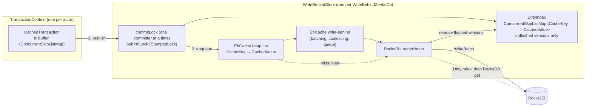

# Write-behind state cache for zb-db (EhCache 3)

Solution design and implementation plan. Status: draft for the
`poc-single-storage-workshop-zbdb-cache` exploration.

## 1. Goal

Committed state goes into an in-memory cache first. RocksDB is updated asynchronously
("write-behind") with batching and coalescing. Hypotheses to validate:

- Hot point reads are served from the heap instead of JNI + memtable/block-cache lookups.
- Short-lived state (keys inserted and deleted within the write window) never reaches RocksDB as
  a put. That means less memtable churn and fewer flushes and compactions.
- The write-behind queue absorbs RocksDB write stalls, up to its capacity, so the processing thread
  doesn't see them.

Non-goals: changing the `ZeebeDb`/`ColumnFamily` API, changing the snapshot or replication format,
or using the cache as durable storage.

## 2. How zb-db works today

|   Concern    |                                                                                                          Today                                                                                                           |                                                   Where                                                    |
|--------------|--------------------------------------------------------------------------------------------------------------------------------------------------------------------------------------------------------------------------|------------------------------------------------------------------------------------------------------------|
| Layout       | One RocksDB column family. Each "virtual" column family is an 8-byte key prefix.                                                                                                                                         | `ColumnFamilyContext#writeKey`                                                                             |
| Transactions | One `ZeebeTransaction` per `TransactionContext`, backed by a `WriteBatchWithIndex` (WBWI). Commit runs `db.write(batch)`; rollback runs `batch.clear()`.                                                                 | `ZeebeTransaction`, `DefaultTransactionContext`                                                            |
| Point ops    | `put`/`get`/`delete` on the WBWI through `MethodHandle`s. `getFromBatchAndDB` gives read-your-writes.                                                                                                                    | `RocksDbInternal`                                                                                          |
| Iteration    | `WBWI.newIteratorWithBase(db.newIterator(prefixReadOptions))`. Callers use seek/next or seekForPrev/prev and stop on prefix mismatch.                                                                                    | `TransactionalColumnFamily#forEachInPrefix*`, `RawTransactionalColumnFamily`, `ForeignKeyChecker`          |
| Snapshots    | RocksDB `Checkpoint` of the live DB, taken while processing continues. The StateController picks the position; the checkpoint runs on the snapshot store's actor, on the broker's I/O-bound pool (2 threads by default). | `ZeebeTransactionDb#createSnapshot`, `StateControllerImpl#takeSnapshot`, `FileBasedTransientSnapshot#take` |
| Durability   | WAL disabled, `avoid_flush_during_shutdown`. On (re)start, the runtime dir is deleted and restored from the latest snapshot, then the log is replayed.                                                                   | `RocksDbConfiguration#DEFAULT_WAL_DISABLED`, `ZeebeRocksDbFactory`, `StateControllerImpl#recoverInternal`  |

### Facts that shape the design

1. **The runtime DB is already disposable.** Recovery is the latest snapshot plus log replay. A
   crash that loses unflushed writes costs nothing, so write-behind is viable at all.
2. **The snapshot is the only durability point, and it has a strict invariant.** The checkpoint
   must hold a transaction-consistent state that includes everything up to
   `lowerBoundSnapshotPosition`. Today every checkpoint meets this, because each transaction is a
   single atomic `db.write`. Two things can go wrong under write-behind:
   - RocksDB lags behind (its processed position is below the lower bound). The log can then be
     compacted past records that replay still needs.
   - The checkpoint captures half a transaction. The restored state is then corrupt.
3. **Iteration is everywhere.** The engine iterates column families at 137 call sites in 47 state
   classes, next to 626 point reads and writes (`get`, `exists`, `insert`, `update`, `upsert`,
   `delete…`). 79 of the 137 run per command, 19 of those also during replay, and only 12 never run
   in production; [engine-state-iteration.md](engine-state-iteration.md) lists them all. Ordered
   prefix scans are core: due timers, job deadlines, children of an element instance, variables of
   a scope. A hash cache can't serve them, and RocksDB alone is stale under write-behind.
4. **Several actors share the DB.** Contexts are created by StreamProcessor, ExporterDirector,
   StateQueryService, backup/checkpoint state, DbPositionSupplier and migrations. Each context is
   single-threaded, but the store must be thread-safe across contexts.
5. **Tests already encode the contracts.**
   - Read-your-writes, including iteration over your own uncommitted writes.
   - Delete-while-iterating (`ColumnFamilyTest#shouldDeleteOnForeachPair`, `#shouldDeleteWhileTrue`).
   - Explicitly *no* snapshot isolation between transactions
     (`ZeebeTransactionIsolationTest.NoSnapshotIsolationTest`): a transaction may read commits made
     after it started. That doesn't allow seeing *part* of another transaction. Today a commit is
     one atomic `WriteBatch`, so readers see all of it or none of it, and a RocksDB iterator reads a
     single point in time. The design keeps both properties.

## 3. What EhCache 3 write-behind gives, and what it doesn't

Verified against the ehcache3 `v3.11.1` and `v3.12.0` sources. 3.12.0 is the latest release, and
`BatchingLocalHeapWriteBehindQueue` is identical in both.

|        Property         |                                                                                                Behaviour                                                                                                 |                                                             Impact                                                             |
|-------------------------|----------------------------------------------------------------------------------------------------------------------------------------------------------------------------------------------------------|--------------------------------------------------------------------------------------------------------------------------------|
| Read of a pending write | `AbstractWriteBehind#load` returns the pending op for a key before it calls our loader.                                                                                                                  | Good: read-your-writes still works after eviction, apart from the next row.                                                    |
| Pending-op bookkeeping  | After a batch is written, `latest.remove(key)` runs unconditionally. It also drops a *newer* pending op for the same key in a later batch.                                                               | If the entry is evicted in that window, a read falls through to RocksDB and gets the old value. We need our own pending index. |
| Ordering                | `concurrencyLevel` stripes by `key.hashCode()`. Order is kept per key, not across keys. A batch splits into alternating `writeAll`/`deleteAll` calls, and batch boundaries don't match our transactions. | RocksDB never holds a transaction-consistent state on its own, so snapshots need a barrier.                                    |
| Writer failure          | No retry. EhCache logs a WARN and removes the batch's keys from the cache (`store.remove`).                                                                                                              | Committed state silently disappears from the live view. Our writer must never throw.                                           |
| Back-pressure           | A full queue blocks the committing thread in `BlockingQueue#put`. EhCache enqueues inside its per-key `compute` (`LocalLoaderWriterStore#put`), so that map bin stays locked while it waits.             | Blocks an actor thread, as RocksDB write stalls do today. Cache reads of other keys in the same map bin wait too.              |
| Load vs. put            | On a miss, `cache.get` runs the loader inside the heap store's per-key `compute` (`OnHeapStore#computeIfAbsent`). A concurrent `put` for that key waits, then wins.                                      | A load can't overwrite a newer committed value.                                                                                |
| Flush/drain             | No public API (`WriteBehind#getQueueSize` is internal).                                                                                                                                                  | We need our own "everything flushed" signal.                                                                                   |
| Iteration               | None: unordered, and only resident entries.                                                                                                                                                              | We need our own ordered overlay.                                                                                               |
| Dependencies            | `org.ehcache:ehcache` pulls in `javax.cache:cache-api` (compile) and `jaxb-runtime` (runtime). Apache-2.0 license.                                                                                       | Exclude JAXB, since we configure the cache in code.                                                                            |

**Consequence:** EhCache gives us a hot point-read cache and an async writer that batches,
coalesces and applies back-pressure. We still have to build the correctness pieces around it:
ordered reads of unflushed state, snapshot consistency and error handling.

## 4. Design

### 4.1 Overview

`zeebe-db` is now a parent of two modules, an interface-only API and the RocksDB implementation
(Phase 0). The cache becomes a third module beside them:

|         Module         |       Directory       |                                                                                                           Holds                                                                                                           |
|------------------------|-----------------------|---------------------------------------------------------------------------------------------------------------------------------------------------------------------------------------------------------------------------|
| `zeebe-db-api`         | `zeebe/zb-db/api`     | Interfaces only: `ZeebeDb`, `ZeebeDbFactory`, `ColumnFamily`, `TransactionContext`, `ZeebeDbTransaction`, `DbKey`/`DbValue`, the visitors, `SnapshotCopy`, `ColumnFamilyMetrics`.                                         |
| `zeebe-db-rocksdb`     | `zeebe/zb-db/rocksdb` | Everything else: the RocksDB implementation (`impl.rocksdb`), the `Db*` key and value types, `ConsistencyChecksSettings`, `ZeebeDbException`. Phase 1 adds the `ZeebeTransaction` interface (§4.3) and `DbIterator` here. |
| `zeebe-db-cache` (new) | `zeebe/zb-db/cache`   | The write-behind cache (package `io.camunda.zeebe.db.cache`). Depends on both modules above and on EhCache.                                                                                                               |

The cache module wraps the RocksDB implementation rather than changing it:

- `WriteBehindZeebeDbFactory` wraps a `ZeebeRocksDbFactory`.
- `WriteBehindZeebeDb` implements `ZeebeDb` around a `ZeebeTransactionDb`:
  - `createContext()` returns a `DefaultTransactionContext` over a `CachedTransaction`.
  - `createColumnFamily` delegates to `ZeebeTransactionDb` with that context, so the typed column
    families, consistency checks and metrics are reused unchanged.
- The cache reaches RocksDB only through a small raw-access interface that `ZeebeTransactionDb`
  exposes: point get, atomic batch write, `keyMayExist`, iterator and checkpoint. RocksDB types
  never leave `zeebe-db-rocksdb`.



Read paths:

- **Point read:** tx buffer → DirtyIndex → EhCache → on a miss, the loader (DirtyIndex again, then
  RocksDB). The lookup is validated against concurrent publications.
- **Iteration:** merge the live tx buffer with a copy of the DirtyIndex range and a RocksDB iterator,
  both taken at the same instant. On equal keys, the first one in that order wins.

### 4.2 Data model

- `CacheKey` holds the full RocksDB key as an immutable `byte[]` (8-byte column family prefix plus
  the key). `equals`/`hashCode` use `Arrays.equals`/`Arrays.hashCode`. `compareTo` uses
  `Arrays.compareUnsigned`, which matches RocksDB's bytewise comparator, so the overlay sorts like
  RocksDB.
- `CachedValue` has two fields:
  - `byte @Nullable [] bytes` (`null` means tombstone)
  - `long seq` (global commit sequence; all writes of one transaction share it)
- **A delete is a tombstone put. We never call `cache.remove()`.** This has three benefits:
  - The writer gets the value, and so its `seq`, for deletes too. EhCache's `deleteAll` only hands us
    keys.
  - `exists()` gets negative caching.
  - Coalescing folds an insert plus a delete into a single op.
- The arrays in the cache and the DirtyIndex are shared and never handed out:
  - Commit copies them in, because the `ColumnFamilyContext` buffers get reused.
  - Every read copies them out: `get`, and an iterator's `key()`/`value()`. Callers can keep or
    mutate what they get without touching committed state. This matters because msgpack's
    `StringValue#read` and `BinaryValue#read` keep views into the source buffer.
  - It costs nothing extra: today every JNI `get` and iterator call already returns a fresh array.
  - Copying into a reusable per-context buffer instead would break `get(key, valueSupplier)`, which
    promises an instance the caller can keep.

### 4.3 Transactions: `CachedTransaction`

**Which interface.** The public `ZeebeDbTransaction` in `zeebe-db-api` stays as it is: `run`,
`commit` and `rollback`, which the stream processor calls. The byte-level operations go into a
separate `ZeebeTransaction` interface in `zeebe-db-rocksdb` that extends it:

- `put`, `get` and `delete` on raw keys
- `newIterator(prefix)`, returning a `DbIterator`
- the lifecycle hooks that `DefaultTransactionContext` calls (`resetTransaction`,
  `isInCurrentTransaction`, `commitInternal`, `rollbackInternal`)

Today's class becomes its `WriteBatchWithIndex` implementation, and `CachedTransaction` is the
second implementation. `TransactionalColumnFamily`, `RawTransactionalColumnFamily`,
`ForeignKeyChecker` and `DefaultTransactionContext` program against the interface, so neither
implementation changes them.

Two reasons for a separate interface:

- **Keep raw access off the public API.** Adding these methods to `ZeebeDbTransaction` would let
  engine and stream-platform code write raw bytes past the column families: no key prefix, no
  consistency checks, no metrics.
- **Drop the native handles.** Today's `put` and `get` take native RocksDB handles (the column
  family and the read options). The interface drops them, and the RocksDB implementation holds its
  handles itself.

The cached implementation:

- A per-context `ConcurrentSkipListMap<CacheKey, Op>` replaces the WBWI as the transaction buffer.
  The WBWI can't be layered on top of the cache for two reasons:
  - `getFromBatch` can't tell "deleted in this batch" from "not in this batch".
  - `newIteratorWithBase` only accepts a native base iterator.
- A skip list (rather than a `TreeMap`) keeps iteration weakly consistent, so delete-while-iterating
  keeps working.
- `put`/`delete` copy the key and value bytes into the buffer.
- `get` probes the buffer with a reusable lookup key, then falls back to the store.
- `rollback` is `clear()`.
- `commit`:

  ```text
  if txBuffer.isEmpty(): failIfStoreFailed(); return    // read-only: no lock
  commitLock.lock()                               // one committer at a time, start to finish
  try
    failIfStoreFailed()
    wait while pendingBytes > maxPendingBytes     // byte back-pressure; wakes on cleanup or failure
    if txBuffer exceeds writeThroughMaxKeys or writeThroughMaxBytes:
      commitWriteThrough(); txBuffer.clear(); return   // see below
    seq = nextSeq()
    values = [(key, new CachedValue(op.bytes, seq)) for (key, op) in txBuffer]
    stamp = publishLock.writeLock()               // short; nothing inside it blocks
      for (key, v) in values: dirtyIndex.put(key, v); pendingBytes += size(key, v)
    publishLock.unlockWrite(stamp)
    try
      for (key, v) in values: cache.put(key, v)   // enqueue; may block on back-pressure
    catch e: failStore(e); throw e                // published versions can't drain any more
    failIfStoreFailed()                           // the writer may have failed while we waited
    txBuffer.clear()                              // only after success
  finally
    commitLock.unlock()
  ```
- **Read-only transactions take no lock.** `DefaultTransactionContext` commits every standalone
  operation, reads included. Without the fast path, a read on another actor would wait behind a
  committer that is blocked on a full queue. One such read is the exporter-position read that the
  StateController makes before each snapshot.
- **The buffer is cleared only after success.** The stream processor retries a commit that throws
  a recoverable `ZeebeDbException` (`RecoverableRetryStrategy`). Today's commit keeps its batch until
  the write succeeds, so the retry writes the same changes; clearing in `finally` would let the retry
  "succeed" on an empty buffer. A store failure throws a non-recoverable exception, so it isn't
  retried.
- `publishLock` is a `StampedLock`. Its write side covers the DirtyIndex update for the whole
  transaction, and readers validate against it (§4.4, §4.5). So a reader sees all of a transaction
  or none of it, as with a RocksDB `WriteBatch` today.
- `commitLock` serializes committers end to end, so the enqueue order matches the publication
  order. Without it, two contexts writing the same key could leave the cache on one version and the
  DirtyIndex on the other. Coalescing could then drop the newer version from the queue, so that it
  is never flushed. Serializing costs little, because the stream processor does almost all commits.
- Only two places change the DirtyIndex: publication (above) and cleanup after a flush (§4.6). Both
  hold `publishLock`'s write side. So no bookkeeping has to run as a side effect inside
  `ConcurrentSkipListMap#compute`, whose function may run more than once.
- Back-pressure blocks outside `publishLock`, so a full queue doesn't stall readers' validation.
  Cache reads of keys in the same map bin can still wait (§3).
- **Byte back-pressure.** The queue and the cache count entries, not bytes, and one value can be
  megabytes (a variable document, for example). So the store also tracks `pendingBytes`, the key and
  value bytes in the DirtyIndex. A commit waits while it exceeds `maxPendingBytes`, before it
  publishes anything. Cleanup lowers it and wakes the waiter.
- **Enqueue failure.** `cache.put` can throw, for example a `RejectedExecutionException` once the
  write-behind executor has shut down. The versions already published can then never drain, so
  the store fails through the same path as a writer failure (§4.6): it reports to partition health,
  and later commits, reads and snapshots fail fast. `finally` releases `commitLock`.
- **Oversized transactions commit write-through**, so that one transaction can't swell the
  DirtyIndex and the queue past their budget (§4.11). A transaction above `writeThroughMaxKeys` keys
  or `writeThroughMaxBytes` bytes, still under `commitLock`:
  1. waits, up to `drainTimeout`, until the DirtyIndex is empty. A timeout throws a recoverable
     `ZeebeDbException`, and a store failure aborts the wait at once (§4.6).
  2. under `publishLock`'s write side: sets `lastWriteThroughSeq` to a new seq, writes its buffer
     to RocksDB as one `WriteBatch`, then empties the cache with `Cache#clear`. That call doesn't
     reach the loader-writer.

  Details:
  - **Errors map as they do today.** A failed `WriteBatch` applies nothing, and the cache isn't
  cleared yet. So a recoverable RocksDB error becomes a `ZeebeDbException`, and the processor
  retries with the buffer intact.
  - **Readers wait for it.** Holding `publishLock`'s write side across the whole RocksDB write,
  including any write stall, plus the clear is what makes the transaction visible all at once.
  Optimistic reads fail validation meanwhile, and the read-lock fallback and iterator creation
  wait. This is the only place where a large write blocks readers; its duration is measured
  (§4.10).
  - **EhCache can still serve a version that the write-through replaced.** Cleanup empties the
  DirtyIndex inside `writeAll`, but EhCache drops the batch's keys from its pending-op map
  (`latest`) only after `writeAll` returns. A cache miss in that window loads the old pending
  version without calling our loader. So a point read doesn't trust a cached value whose `seq` is
  below `lastWriteThroughSeq`, and reads RocksDB instead (§4.4). Cache entries that our loader
  installs can't be older than the write-through: the clear runs after the RocksDB write, and a
  load holds its key's bin from the RocksDB read until it installs the value.
  - **It's the only place that calls the cache under `publishLock`.** That's safe because holding
  `commitLock` keeps out every committer, and committers are the only threads that can block
  inside the cache.
  - **The main case is the migration step.** `MigrationTransitionStep` runs every migration in one
  transaction, and a migration can rewrite whole column families.

### 4.4 Point reads

```text
stamp = publishLock.tryOptimisticRead()
v = txBuffer.get(key) ?: dirtyIndex.get(key) ?: cache.get(key)   // cache miss: the loader runs
if v came from the cache and v.seq < lastWriteThroughSeq: v = rocksDB.get(key)   // §4.3
if publishLock.validate(stamp): return copy of v.bytes

// after a few failed tries: read under the lock, without the cache
stamp = publishLock.readLock()
  v = txBuffer.get(key) ?: dirtyIndex.get(key) ?: rocksDB.get(key)
publishLock.unlockRead(stamp)
return copy of v.bytes                                           // null for a tombstone or a miss
```

- The DirtyIndex comes before the cache, for two reasons:

  - The cache can briefly hold an older version, between publication and enqueue.
  - EhCache's `latest.remove(key)` can drop a pending op.

  The DirtyIndex holds every unflushed version, so checking it first covers both.

- **The loader checks the DirtyIndex again, then reads RocksDB.** Checking RocksDB alone isn't
  enough. Take this sequence:

  1. A reader misses the DirtyIndex just before a commit publishes.
  2. The entry is evicted, and EhCache has dropped its pending op.
  3. The reader misses the cache, and the loader reads the old value from RocksDB.

  Validation retries the read, but the old value would stay cached. It would then be served once
  the new version flushes and leaves the DirtyIndex. The load runs inside EhCache's per-key
  `compute`, so a DirtyIndex check there installs either the newest committed version or a value
  that the pending enqueue overwrites. The loader stamps what it reads from RocksDB with the latest
  commit `seq`.

- **No reader calls the cache while holding `publishLock`.** A committer blocked on a full queue
  holds the cache's map bin (§3), and the writer needs `publishLock`'s write side for cleanup
  before it can take the next batch. A reader that held the read lock while waiting for that bin
  would close the cycle. So the read-lock fallback goes to RocksDB directly. That's correct
  because, while publication and cleanup are excluded, anything not in the DirtyIndex has been
  flushed.

- Validation makes the lookup atomic with respect to publications. Two reads can still straddle a
  commit and see an older K1 with a newer K2, as they can today. They can never see a newer K1 with
  an older K2 from the same transaction.

- EhCache may keep the key object when it loads an entry, so `cache.get` needs an immutable key
  copy. That's one more allocation per cache read; measure it.

### 4.5 Iteration: `MergingDbIterator`

A new `DbIterator` interface (`seek`, `seekForPrev`, `isValid`, `next`, `prev`, `key`, `value`,
`close`) replaces `RocksIterator` in `TransactionalColumnFamily`, `RawTransactionalColumnFamily` and
`ForeignKeyChecker`. It also keeps the buffer-filling `key(byte[])` and `value(byte[])` overloads,
which `RawTransactionalColumnFamily#forEachPreallocated` uses to copy a snapshot without allocating
per entry. `SnapshotOnlyDb#copySnapshot` wraps its native iterator in the plain adapter, which
delegates those overloads straight to `RocksIterator`. Plain mode wraps a `RocksIterator`. Cached
mode merges three sorted sources:

1. the tx buffer (`tailMap`, or `headMap(..).descendingMap()` for reverse)
2. a copy of the DirtyIndex range
3. a RocksDB iterator with the prefix read options

Rules for the merge:

- On equal keys, the tx buffer wins over the DirtyIndex copy, which wins over RocksDB.
- A tombstone hides the lower layers and is skipped itself.
- The DirtyIndex copy covers only the prefix being scanned (the caller passes it in). That also
  mimics `prefix_same_as_start`.
- Each iterator goes either forward (seek/next) or in reverse (seekForPrev/prev). Callers never
  switch direction, so assert it instead of implementing it.

**Point-in-time view.** At creation, the iterator pins RocksDB's view and copies the DirtyIndex
range in one step, under `publishLock`'s read side:

```text
stamp = publishLock.readLock()
  rocksIterator = db.newIterator(prefixReadOptions)   // pins RocksDB's current view
  overlay = copy of dirtyIndex.subMap(prefixStart, prefixEnd)
publishLock.unlockRead(stamp)
```

- No publication and no cleanup can run between the two steps.
- Every unflushed version is in the copy, and every flushed one is in RocksDB's view.
- A flush can land between the two steps. Its entries are then still in the DirtyIndex, because
  cleanup can't run yet, so they end up in the copy.

So the merge shows the committed state at one instant, like a RocksDB iterator today, even though
the writer's batches cut across transactions. Only the tx buffer stays live, which keeps
delete-while-iterating working.

After this step the iterator never reads the live DirtyIndex. So cleanup doesn't wait for open
iterators, and a long scan doesn't hold back memory.

The copy costs O(dirty entries in the scanned prefix):

- A prefix scan touches a handful of entries.
- A scan over a whole column family that stops early (due timers, job deadlines) copies every dirty
  entry of that column family. That's bounded by the DirtyIndex budget (§4.11).

Measure this in Phase 3.

### 4.6 Writer: `RocksDbLoaderWriter`

- `writeAll(entries)` builds one RocksDB `WriteBatch` (a tombstone becomes `delete`, a value becomes
  `put`) and calls `db.write(writeOptions, batch)`. `deleteAll` is never called, because we never
  call `cache.remove`.
- **Cleanup** runs right after a successful write, under `publishLock`'s write side:
  - It visits every entry of the `writeAll`, whether written or skipped by the `keyMayExist`
    optimization below. For each, it removes the DirtyIndex entry if its `seq` equals the one in
    the batch. A newer version stays.
  - When every entry is skipped, there's nothing to write, but cleanup still runs.
  - Matching on `seq` rather than object identity means it doesn't matter whether EhCache hands us
    the same object we passed to `put`.
  - It lowers `pendingBytes`, then wakes everything waiting on the writer (§4.3, §4.7).
- It never throws to EhCache:
  - On a recoverable `RocksDBException` (`RocksDbInternal.RECOVERABLE_ERROR_CODES`), it retries
    with backoff, up to a limit. This stalls the queue, which turns into back-pressure.
  - On a non-recoverable error, or once retries are exhausted, it sets `store.failure`, logs an
    ERROR and reports the failure right away (next bullet). From then on, commits, reads and
    snapshots fail fast with a non-recoverable exception.
  - The failure also wakes every waiter at once: the snapshot drain, a write-through's drain, and
    commits waiting on `pendingBytes`. Each re-checks `store.failure` and aborts instead of waiting
    for its timeout.
  - After a failure, the writer keeps taking queued batches but doesn't write them. A committer
    blocked on a full queue then returns, sees the failure and throws.
- **Failure reporting and recovery.** A partition with little traffic may not read or commit for a
  long time, so the failure can't wait for the next DB call to surface. Instead:
  - `WriteBehindZeebeDb` implements `HealthMonitorable` from `zeebe-util`.
  - `ZeebeDbPartitionTransitionStep` registers the DB with the partition's component health monitor
    when it is `HealthMonitorable`, the same way `StreamProcessorTransitionStep` registers the
    stream processor.
  - On failure, the writer reports a dead `HealthReport` through
    `FailureListener#onUnrecoverableFailure`.

  The outcome matches a failed state commit today (`ProcessingStateMachine#updateState` →
  `UncommittedStateException` → dead partition). The partition stops, and a broker restart rebuilds
  the runtime from the latest snapshot and replays the log. Losing the unflushed writes is fine
  (fact 1). Recovering in-process instead, by stepping down and reinstalling, would need a new
  recoverable path in `ZeebePartition` (§8).

- After the store is closed, it drops writes and never touches closed RocksDB handles.

- **Phase 6 optimization:** skip a tombstone when `rocksDB.keyMayExist(key)` returns `false`.

  - Coalescing alone still writes a tombstone for an insert followed by a delete, so this skip is
    where most of the churn reduction would come from.
  - `keyMayExist` only sees RocksDB, not the batch being built. With `coalescing = false`, one
    `writeAll` can hold a put and then a tombstone for the same key, and skipping that delete would
    bring the key back.
  - So the writer first reduces each `writeAll` to the last op per key, and only then applies the
    check. `keyMayExist` has no false negatives, so `false` then means the key was never written.
  - Skipped tombstones still go through cleanup (above). Otherwise they would never leave the
    DirtyIndex, and every snapshot drain would time out.

### 4.7 Snapshot barrier

The barrier is taken before the snapshot store runs the checkpoint, and off the I/O pool.
`prepareSnapshot()` is a new method on `ZeebeDb` in `zeebe-db-api`. Its default completes at once,
so the plain RocksDB DB needs no change; `WriteBehindZeebeDb` overrides it:

```text
// StateControllerImpl#takeSnapshot, before handing over to the snapshot store
zeebeDb.prepareSnapshot()                    // a future; no actor thread waits for the barrier
  .onComplete(ok -> transientSnapshot.take(dir -> zeebeDb.createSnapshot(dir)))

// prepareSnapshot, on the store's own barrier thread
deadline = now + drainTimeout
if !commitLock.tryLock(until deadline): fail the future
try
  wait until dirtyIndex.isEmpty() or the store fails, until deadline, else fail the future
  failIfStoreFailed()
  pauseWriter()                              // writeAll waits before it touches RocksDB
finally
  commitLock.unlock()                        // commits resume and fill the queue
complete the future

// createSnapshot, on the snapshot store's actor, as today
try checkpoint.createCheckpoint(dir) finally resumeWriter()
```

- **One deadline covers both taking the lock and draining.** A committer can hold `commitLock` while
  it's blocked on a full queue. With a stalled writer, a plain `lock()` would wait forever before
  the drain timeout even started.
- **No thread from the I/O pool waits for the barrier.** The checkpoint callback runs on the
  snapshot store's actor, which is on the broker's I/O-bound pool (2 threads by default). The
  ExporterDirector, which commits exporter positions, runs on the same pool. If the callback waited
  for the barrier while an exporter waited on `commitLock`, both threads would block, and snapshots,
  exports and backups would stall for every partition on the broker. So the barrier runs on the
  store's own thread, and the I/O thread only runs the checkpoint, as it does today.
- **Commits wait only for the drain.** During the checkpoint the writer is paused instead: commits
  keep publishing and filling the queue, but RocksDB doesn't change, so the checkpoint captures the
  drained state. If the snapshot is abandoned after the barrier, the controller resumes the writer.
- **A store failure** wakes the barrier, which fails the snapshot at once (§4.6).
- Holding `commitLock` means no commit is in progress, including one that is still enqueuing, and
  none can start. Read-only transactions don't take it (§4.3), so the StateController's
  exporter-position read doesn't wait behind a stalled committer.
- **The DirtyIndex holds exactly the unflushed versions**, because cleanup removes a version in the
  same critical section that confirms its write. So "drained" simply means `dirtyIndex.isEmpty()`,
  and there's no separate counter to keep in sync.
- After the drain, RocksDB holds the state after the last committed transaction. That state is
  transaction-consistent and at or past `lowerBoundSnapshotPosition`.
- **Pause:**
  - Commits wait for about `maxWriteDelay` plus the backlog write, and never longer than
    `drainTimeout`. An exporter commit that waits does hold an I/O thread for that long.
  - The checkpoint pauses only the writer, and has no timeout, as today. If it runs long, the
    queue fills and back-pressure reaches the committers.
  - With the WAL disabled, the checkpoint also flushes the memtables.
  - This happens once per snapshot, every 5 minutes by default.
- A write-through (§4.3) can land during the checkpoint. Its `WriteBatch` is atomic, so the
  checkpoint holds either all of that transaction or none of it.
- `compactAll()` drains first as well.

### 4.8 Lifecycle and bypass

- Each `WriteBehindZeebeDb` (one per partition) gets its own `CacheManager` and write-behind thread
  pool.
- `WriteBehindZeebeDb#close()` closes the `CacheManager` first, so the writer stops, and only then
  closes the wrapped `ZeebeTransactionDb`. In the other order, the writer would call JNI on a freed
  handle.
- In runtime mode, close drops pending writes; the runtime directory is deleted afterwards anyway.
- Only the runtime DB is wrapped. `WriteBehindZeebeDbFactory#createDb(path)` (used by
  `StateControllerImpl#openDb`) returns a `WriteBehindZeebeDb`. Everything else stays on the plain
  RocksDB path, because it either delegates or never sees the wrapping factory:
  - `createDb(path, false)` delegates. `RocksDBSnapshotCopy` copies a whole snapshot in a single
    transaction and then calls `compactAll()`; a heap tx buffer would hold the entire snapshot.
  - `openSnapshotOnlyDb` delegates.
  - `RocksDBSnapshotCopy` and the sanity-check factory in `RecoveryPartitionManager` are built
    with `ZeebeRocksDbFactory` directly.

### 4.9 Configuration

Add a `WriteBehindConfiguration` record in `zeebe-db-cache`, wired from `RocksdbCfg`, which already
sits under `zeebe.broker.experimental.rocksdb`. `RocksDbConfiguration` stays as it is.

All sizes are per partition, so the broker-wide cost is these values times the partitions a broker
hosts. Byte limits are what bound memory; the entry counts only shape batching.

|        Property        | Default |                                                                                                       Notes                                                                                                        |
|------------------------|---------|--------------------------------------------------------------------------------------------------------------------------------------------------------------------------------------------------------------------|
| `writeBehind.enabled`  | `false` |                                                                                                                                                                                                                    |
| `cacheMaxBytes`        | 64 MB   | Resident cache. EhCache's heap tier sized in `MemoryUnit.MB`, which estimates each entry's size on insert; measure that cost.                                                                                      |
| `maxPendingBytes`      | 32 MB   | Key and value bytes in the DirtyIndex before commits wait (§4.3).                                                                                                                                                  |
| `batchSize`            | 1 000   |                                                                                                                                                                                                                    |
| `maxWriteDelay`        | 100 ms  | Longer gives more coalescing; shorter gives a shorter snapshot pause.                                                                                                                                              |
| `queueSize`            | 10 000  | Pending ops per stripe before back-pressure kicks in.                                                                                                                                                              |
| `concurrencyLevel`     | 1       | One RocksDB writer thread.                                                                                                                                                                                         |
| `coalescing`           | `true`  |                                                                                                                                                                                                                    |
| `writeThroughMaxKeys`  | 10 000  | Transactions with more keys commit write-through (§4.3).                                                                                                                                                           |
| `writeThroughMaxBytes` | 16 MB   | Transactions with more key and value bytes commit write-through (§4.3).                                                                                                                                            |
| `drainTimeout`         | 30 s    | Bounds the snapshot barrier (taking the commit lock and draining, not the checkpoint) and a write-through's drain. If exceeded, the snapshot fails and is retried, and a write-through throws a recoverable error. |

### 4.10 Metrics

Registered on the DB meter registry, so they go away when the DB closes:

- cache hits, misses and loads
- committed ops vs. written puts and deletes (coalescing ratio)
- skipped tombstones
- DirtyIndex size (the unflushed keys), `pendingBytes`, and the cache's estimated bytes
- batch size and write latency
- time blocked on back-pressure (shows up as commit latency), time waiting on `pendingBytes`, and
  commit-lock wait time
- optimistic read retries, and cached values bypassed because of a write-through
- write-through commits and their duration (readers wait for it)
- snapshot drain duration (commits wait for it) and checkpoint duration (the writer waits for it)
- writer retries and failures

### 4.11 Memory

The design moves hot state from RocksDB's off-heap budget to the JVM heap. Per partition, the heap
now holds:

- the cache: up to `cacheMaxBytes`
- the DirtyIndex: only unflushed versions, since cleanup follows every write. It's bounded by
  `maxPendingBytes`, which a commit checks before it publishes. So the one transaction that is
  publishing can push it past the limit by at most its own size. Above `writeThroughMaxBytes` (or
  `writeThroughMaxKeys`), a transaction bypasses the DirtyIndex altogether (§4.3).
- per-iterator copies of DirtyIndex ranges: short-lived and bounded by the DirtyIndex
- the tx buffers. The WBWI kept these in native memory. A transaction is buffered in full until it
  commits, whatever path it then takes.

Multiply by the partitions per broker. For a fair benchmark, lower RocksDB's `memoryLimit` by the
same amount, and watch GC.

## 5. Alternatives considered

- **Cache only the column families that see point access.** Rejected: almost every column family is
  iterated somewhere. Splitting one transaction across two write paths would also still leave the
  snapshot problem.
- **EhCache write-behind alone, without our own overlay.** Incorrect: iteration is stale, the
  `latest.remove` race stays open, and there's no drain signal.
- **Our own ordered write-behind on Caffeine.** Caffeine is already managed in `parent/pom.xml` and
  used by the engine. The writer would apply whole transactions in commit order, so RocksDB is
  always a consistent prefix and snapshots need no commit pause. It adds no new dependency. It needs
  the same overlay and merge-iterator work. Keep it as the comparison point if EhCache's barrier
  pause or queue semantics get in the way.
- **Tune RocksDB instead** (bigger memtables or block cache). This is the baseline to beat: with
  the WAL off, a RocksDB write is already an in-memory memtable insert.

## 6. Implementation plan

### Phase 0: split zb-db into API and RocksDB modules (done)

This has landed (`refactor: split zb-db into api and rocksdb modules`). `zeebe-db` is now a parent of
two modules, with package names unchanged (§4.1):

- **`zeebe-db-api`** (`zeebe/zb-db/api`) holds only interfaces.
- **`zeebe-db-rocksdb`** (`zeebe/zb-db/rocksdb`) holds everything else, including the `Db*` key and
  value types and `ContainsForeignKeys`, whose `DbForeignKey` return type is a concrete record.
- **Consumers** depend on `zeebe-db-rocksdb`, plus `zeebe-db-api` where they use the interfaces.

The cache module adds a third child to `zeebe-db` (Phase 2).

### Phase 1: structural refactor in `zeebe-db-rocksdb`, no behaviour change (done)

This has landed. Where the code settled differently from the steps below:

- `ZeebeTransaction` is the interface; today's class is `WriteBatchTransaction`. `newIterator`
  takes the scanned prefix (the WBWI implementation ignores it).
- The raw-access interface is `RawDbAccess`, reached through `ZeebeTransactionDb#rawAccess()`. Its
  batch is a `RawBatch`, and recoverable errors surface as `ZeebeDbException`.
- The contract tests are abstract `*ContractTest` classes with an abstract `createFactory()`. The
  RocksDB suite subclasses them under the old names, and the test-jar carries the abstract ones.

1. Add `DbIterator`, including the buffer-filling `key(byte[])`/`value(byte[])` overloads, and a
   `RocksIterator` adapter. Switch `TransactionalColumnFamily`, `RawTransactionalColumnFamily`
   (including the static `forEach*` helpers) and `ForeignKeyChecker` to it. `SnapshotOnlyDb`
   wraps its native iterator in the adapter.
2. Extract the `ZeebeTransaction` interface (§4.3) without the native handles, and make today's
   class its `WriteBatchWithIndex` implementation. `DefaultTransactionContext` and the column
   families use the interface, and `DefaultTransactionContext` gets a public constructor so the
   cache module can build one. `ZeebeDbTransaction` in `zeebe-db-api` doesn't change.
3. Add the raw-access interface on `ZeebeTransactionDb` that the cache module will use (§4.1).
4. Turn the column family and transaction tests into contract tests over a `ZeebeDbFactory`, and
   publish them in a test-jar, so that the cache module runs the same suite.

- **Exit:** `./mvnw verify -pl zeebe/zb-db/rocksdb -DskipTests=false -Dquickly` is green, and
  `EngineLargeStatePerformanceTest` stays within its tolerance.

### Phase 2: write-behind core for point ops (`feat:`)

- **Ask first:** add `org.ehcache:ehcache` to the `parent/pom.xml` dependency management, excluding
  `jaxb-runtime`.
- Create `zeebe/zb-db/cache` (artifact `zeebe-db-cache`) as a third child of `zeebe-db`.
  - It depends on `zeebe-db-api`, `zeebe-db-rocksdb` and EhCache.
  - Register it in `zeebe/zb-db/pom.xml` and `settings.gradle.kts` the way `api` and `rocksdb` are,
    and keep Maven and Gradle in parity.
- In package `io.camunda.zeebe.db.cache`, add:
  - `CacheKey`, `CachedValue`
  - `DirtyIndex`
  - `RocksDbLoaderWriter`
  - `WriteBehindStore`
  - `WriteBehindConfiguration`
  - `CachedTransaction`
  - `WriteBehindZeebeDb` and `WriteBehindZeebeDbFactory`. Only the factory's `createDb(path)`
    wraps; everything else delegates (§4.8).
- Commit protocol with `commitLock` and `publishLock`: the read-only fast path, byte back-pressure,
  clearing the buffer only after success, and enqueue-failure handling. Validated point reads with
  a cache-free fallback, a loader that checks the DirtyIndex, and copy-on-read.
- In `ZeebeRocksDbFactory`: enable write-behind only on the runtime `createDb` path.
- Until Phase 3, iterating on a cached DB throws `UnsupportedOperationException`.
- **Exit:** the point-op tests are green against the cached factory, plus the new point-read and
  commit tests from §7.

### Phase 3: merged iteration (`feat:`)

- Add `MergingDbIterator`. It takes the RocksDB view and the DirtyIndex range copy together, under
  `publishLock`'s read side.
- **Exit:** the Phase 1 contract suite is green against both factories, including
  `ColumnFamilyRandomizedPropertyTest` with more tries, and the iterator stress test passes.

### Phase 4: snapshot barrier, lifecycle and failures (`feat:`)

- Add the snapshot barrier: `ZeebeDb#prepareSnapshot()` takes `commitLock` and drains on the
  store's own thread under one deadline, then pauses the writer for the checkpoint.
  `StateControllerImpl#takeSnapshot` waits for it before handing over to the snapshot store.
- Drain in `compactAll` too, and close the cache before the wrapped DB.
- Commit transactions above `writeThroughMaxKeys` or `writeThroughMaxBytes` write-through, with
  the `lastWriteThroughSeq` check on cached reads.
- Add writer retry, the failure latch that wakes every waiter, fail-fast, and draining without
  writing after a failure. Make `WriteBehindZeebeDb` a `HealthMonitorable`.
- **Exit:** the snapshot, write-through and failure tests from §7 are green, plus the
  close-with-pending test.

### Phase 5: wiring and engine-level validation (`feat:` and `test:`)

- **Ask first** (configuration is a public contract): add the experimental `RocksdbCfg` properties
  and map them to `WriteBehindConfiguration`.
- In `ZeebePartitionFactory`, wrap the partition's `ZeebeRocksDbFactory` in a
  `WriteBehindZeebeDbFactory` when write-behind is enabled. The broker gets a dependency on
  `zeebe-db-cache`.
- Register the DB with the partition's component health monitor in
  `ZeebeDbPartitionTransitionStep`.
- Add the metrics.
- Make the engine's test copy of `DefaultZeebeDbFactory` (used by 10 engine test classes) wrap
  its factory when a system property is set, for example `-Dzeebe.db.writeBehind.enabled=true`.
  The engine gets a test dependency on `zeebe-db-cache`, so the `zeebe/engine` tests can run
  against the cached DB locally.
- Add broker ITs:
  - run process instances, take a snapshot, restart, and check the state is intact
  - have a follower install a snapshot that a cached leader took
- **Exit:** the engine suite is green with the toggle on, and the broker restart IT is green.

### Phase 6: benchmark, tune, decide

- Run `EngineLargeStatePerformanceTest` (engine), `LargeStateControllerPerformanceTest` (broker) and
  a realistic load test twice: with write-behind off as the baseline, and on. With it on, lower
  RocksDB memory by the cache budget. Turn on `accessMetrics: FINE` and `enableStatistics` to get
  per-column-family latency and RocksDB stall counters.
- Sweep `maxWriteDelay` (10, 100 and 1000 ms) against `batchSize`, and record the snapshot pause.
- Run a large-value scenario (variables of about 1 MiB) on a broker with several partitions, and
  check that heap use stays within the byte budgets.
- Optional optimizations:
  - skip tombstones via `keyMayExist`, after reducing each batch to the last op per key
  - an off-heap tier (needs serializers for `CacheKey` and `CachedValue`)
- **Exit:** a go/no-go write-up. If it's a go, an ADR under `zeebe/docs/adr/`.

## 7. Test plan (new tests, against the cached factory)

|                                                                                    Test                                                                                    |                                                      Proves                                                      |
|----------------------------------------------------------------------------------------------------------------------------------------------------------------------------|------------------------------------------------------------------------------------------------------------------|
| Read after eviction with a pending write (cache size 1, `maxWriteDelay` 10 s)                                                                                              | Point reads never return a stale RocksDB value                                                                   |
| Overwrite while the previous batch is in flight, plus eviction                                                                                                             | The DirtyIndex covers EhCache's `latest.remove` race                                                             |
| A reader misses the DirtyIndex, a commit publishes, the entry is evicted and EhCache drops its pending op, the reader loads; then drain and read again                     | No stale value stays cached                                                                                      |
| Force the read-lock fallback, stall the writer until the queue is full, block a committer in `cache.put`, then read a clean key in the same map bin; let the writer resume | Reads don't deadlock with back-pressure                                                                          |
| `cache.put` throws during a commit (test seam)                                                                                                                             | The store fails, `commitLock` is released, and snapshots fail fast                                               |
| Mutate an array returned by `get` or by an iterator, then read again and drain                                                                                             | Callers can't change committed or persisted state                                                                |
| Pause a commit mid-publication (test hook); another thread reads two of its keys and scans its range                                                                       | Readers see all of a transaction or none of it                                                                   |
| Two contexts commit the same key concurrently in a loop                                                                                                                    | Point reads, scans and RocksDB agree after the drain, and the drain completes                                    |
| A transaction with more keys than the queue holds, and one above `writeThroughMaxKeys`                                                                                     | Both commit and drain; the write-through leaves no older version cached                                          |
| A write-through while a batch's callback is paused after cleanup, before EhCache drops its pending op; then a cache miss on one of the batch's keys                        | The read returns the write-through's version, not the replaced one                                               |
| A write-through fails with a recoverable RocksDB error, and the processor retries the commit                                                                               | The retry applies the writes; nothing commits on an empty buffer                                                 |
| Commits of large values (about 1 MiB each) beyond `maxPendingBytes`                                                                                                        | Commits wait instead of growing the heap past the budget                                                         |
| Iteration sees pending puts and hides pending deletes (forward, reverse, startAt, prefix)                                                                                  | Merge-iterator semantics                                                                                         |
| `RocksDBSnapshotCopy` through the `DbIterator` adapter                                                                                                                     | `forEachPreallocated` still copies into reused arrays                                                            |
| Writer flushes concurrently while long scans run on another thread (stress)                                                                                                | Scans see one point in time; the DirtyIndex stays within its budget (§4.11)                                      |
| Snapshot after N commits, opened with the plain factory                                                                                                                    | The barrier drains everything                                                                                    |
| Snapshot loop against a concurrent committer, where each tx writes K keys plus a marker                                                                                    | Snapshots are transaction-consistent                                                                             |
| Through `StateControllerImpl#takeTransientSnapshot`, with the writer stalled, a committer blocked on a full queue and an exporter committing                               | The position reads don't wait; the snapshot fails within `drainTimeout`; no I/O-pool thread waits on the barrier |
| The writer fails after a snapshot barrier and a write-through have started waiting on the drain                                                                            | Both abort at once instead of waiting for `drainTimeout`                                                         |
| RocksDB write fails (test seam in the writer) while no reads or commits happen                                                                                             | The failure is reported at once; commits and reads fail fast after it                                            |
| Put, then delete, of a new key in one `writeAll`, with `coalescing` on and off; also a batch where every tombstone is skipped                                              | The `keyMayExist` skip never brings a key back, and the drain still completes                                    |
| Close with pending writes; `createDb(path, false)`                                                                                                                         | No crash on close; bulk copy is unaffected                                                                       |

## 8. Risks and open questions

1. **Is zb-db on the critical path at all?** With the WAL off, RocksDB writes already stay in
   memory. There's no up-front baseline any more, so only Phase 6 answers this, after the cache is
   built.
2. **Snapshot pause.** The stream processor and exporter director can't commit for about
   `maxWriteDelay` plus the backlog write, once per snapshot, and never longer than `drainTimeout`.
   During the checkpoint only the writer is paused. A checkpoint that runs long fills the queue and
   back-pressure reaches the committers; today a slow checkpoint doesn't affect processing at all.
3. **Blocked threads under back-pressure.** A full queue blocks the committer, and also cache reads
   of keys that share its map bin (§3). That's the same class of problem as RocksDB write stalls
   today, but now configurable and measured.
4. **The broker's shared I/O pool.** The ExporterDirector and the snapshot store run on the I/O-bound
   pool (2 threads by default), shared by every partition on the broker. The barrier stays off that
   pool (§4.7), but an exporter commit still waits out a drain on an I/O thread, up to
   `drainTimeout`. Watch export and snapshot latency across partitions while snapshots run.
5. **Heap and GC pressure.** State moves on-heap, every read copies (as today), and each iterator
   copies its DirtyIndex range. The byte budgets (§4.9, §4.11) are per partition, so multiply them by
   the partitions per broker. Large transactions are buffered in full on the heap until they commit;
   the WBWI used native memory for this. The migration step, which runs every migration in one
   transaction, is the largest.
6. **A write-through blocks readers** for the length of its RocksDB write (§4.3). It's rare, mostly
   the migration step before processing starts, but it's measured.
7. **Serialized commits.** This is fine while the stream processor does almost all commits. Watch the
   commit-lock wait time for the exporter director.
8. **Writer failure stops the partition**, on followers too. In-process recovery would need a new
   step-down path in `ZeebePartition`. Decide whether the POC needs it.
9. **Approvals needed:** the new dependency and the experimental config keys (both "ask first" in
   `AGENTS.md`).

