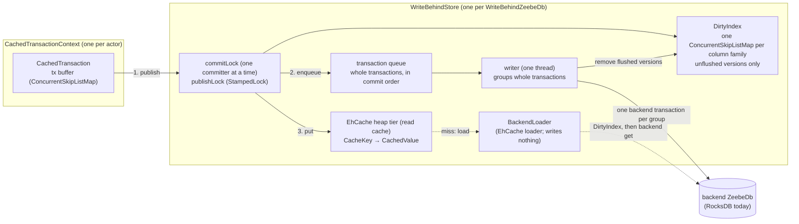

# Write-behind state cache for zb-db

Solution design and implementation plan. Status: draft for the
`poc-single-storage-workshop-zbdb-cache` exploration.

## 1. Goal

Committed state goes into an in-memory cache first. The backing store is updated asynchronously
("write-behind"), in groups of whole transactions with the keys they share coalesced. The backing
store is RocksDB today, and may be an RDBMS later, so the cache must work with any `ZeebeDb` and
depend on `zeebe-db-api` only.
Hypotheses to validate, with RocksDB as the backend:

- Hot point reads are served from the heap instead of JNI + memtable/block-cache lookups.
- Short-lived state (keys inserted and deleted within the write window) never reaches RocksDB as
  a put. That means less memtable churn and fewer flushes and compactions.
- The write-behind queue absorbs RocksDB write stalls, up to `maxPendingBytes`, so the processing
  thread doesn't see them.

Non-goals: changing how callers use `ZeebeDb`/`ColumnFamily`, changing the snapshot or replication
format, or using the cache as durable storage.

## 2. How zb-db works today

|   Concern    |                                                                                                          Today                                                                                                           |                                                   Where                                                    |
|--------------|--------------------------------------------------------------------------------------------------------------------------------------------------------------------------------------------------------------------------|------------------------------------------------------------------------------------------------------------|
| Layout       | One RocksDB column family. Each "virtual" column family is an 8-byte key prefix.                                                                                                                                         | `ColumnFamilyContext#writeKey`                                                                             |
| Transactions | One `ZeebeTransaction` per `TransactionContext`, backed by a `WriteBatchWithIndex` (WBWI). Commit runs `db.write(batch)`; rollback runs `batch.clear()`.                                                                 | `ZeebeTransaction`, `DefaultTransactionContext`                                                            |
| Point ops    | `put`/`get`/`delete` on the WBWI through `MethodHandle`s. `getFromBatchAndDB` gives read-your-writes.                                                                                                                    | `RocksDbInternal`                                                                                          |
| Iteration    | `WBWI.newIteratorWithBase(db.newIterator(prefixReadOptions))`. Callers use seek/next or seekForPrev/prev and stop on prefix mismatch.                                                                                    | `TransactionalColumnFamily#forEachInPrefix*`, `RawTransactionalColumnFamily`, `ForeignKeyChecker`          |
| Snapshots    | RocksDB `Checkpoint` of the live DB, taken while processing continues. The StateController picks the position; the checkpoint runs on the snapshot store's actor, on the broker's I/O-bound pool (2 threads by default). | `ZeebeTransactionDb#createSnapshot`, `StateControllerImpl#takeSnapshot`, `FileBasedTransientSnapshot#take` |
| Durability   | WAL disabled, `avoid_flush_during_shutdown`. On (re)start, the runtime dir is deleted and restored from the latest snapshot, then the log is replayed.                                                                   | `RocksDbConfiguration#DEFAULT_WAL_DISABLED`, `ZeebeRocksDbFactory`, `StateControllerImpl#recoverInternal`  |

### Facts that shape the design

1. **The runtime DB is already disposable.** Recovery is the latest snapshot plus log replay. A
   crash that loses unflushed writes costs nothing, so write-behind is viable at all.
2. **The snapshot is the only durability point, and it has a strict invariant.** The checkpoint
   must hold a transaction-consistent state that includes everything up to
   `lowerBoundSnapshotPosition`. Today every checkpoint meets this, because each transaction is a
   single atomic `db.write`. Two things can go wrong under write-behind:
   - RocksDB lags behind (its processed position is below the lower bound). The log can then be
     compacted past records that replay still needs.
   - The checkpoint captures half a transaction. The restored state is then corrupt.

   The design avoids both: the writer applies whole transactions in commit order (§4.6), and a
   snapshot waits for the writer to catch up before the checkpoint (§4.7).

3. **Iteration is everywhere.** The engine iterates column families at 137 call sites in 47 state
   classes, next to 626 point reads and writes (`get`, `exists`, `insert`, `update`, `upsert`,
   `delete…`). 79 of the 137 run per command, 19 of those also during replay, and only 12 never run
   in production; [engine-state-iteration.md](engine-state-iteration.md) lists them all. Ordered
   prefix scans are core: due timers, job deadlines, children of an element instance, variables of
   a scope. A hash cache can't serve them, and RocksDB alone is stale under write-behind.

4. **Several actors share the DB.** Contexts are created by StreamProcessor, ExporterDirector,
   StateQueryService, backup/checkpoint state, DbPositionSupplier and migrations. Each context is
   single-threaded, but the store must be thread-safe across contexts.

5. **Tests already encode the contracts.**

   - Read-your-writes, including iteration over your own uncommitted writes.
   - Delete-while-iterating (`ColumnFamilyContractTest#shouldDeleteOnForeachPair`,
     `#shouldDeleteWhileTrue`).
   - Explicitly *no* snapshot isolation between transactions
     (`ZeebeTransactionIsolationContractTest.NoSnapshotIsolationTest`): a transaction may read
     commits made after it started. That doesn't allow seeing *part* of another transaction. Today
     a commit is one atomic `WriteBatch`, so readers see all of it or none of it, and a RocksDB
     iterator reads a single point in time. The design keeps both properties.

## 3. EhCache 3: the read cache, not the writer

The first version of this plan used EhCache's write-behind as the writer. Verified against the
ehcache3 `v3.11.1` and `v3.12.0` sources (3.12.0 is the latest release, and
`BatchingLocalHeapWriteBehindQueue` is identical in both), it works per key and can't keep a
transaction together:

|        Property        |                                                                                                Behaviour                                                                                                |                                Why it rules EhCache out as the writer                                |
|------------------------|---------------------------------------------------------------------------------------------------------------------------------------------------------------------------------------------------------|------------------------------------------------------------------------------------------------------|
| Ordering               | `concurrencyLevel` stripes by `key.hashCode()`. Order is kept per key, not across keys. Batches are cut every `batchSize` ops and coalesced per key, and their boundaries don't match our transactions. | The backend never holds whole transactions, so a snapshot of it needs a barrier that pauses commits. |
| Pending-op bookkeeping | After a batch is written, `latest.remove(key)` runs unconditionally. It also drops a *newer* pending op for the same key in a later batch.                                                              | An evicted entry would load the old value from the backend.                                          |
| Writer failure         | No retry. EhCache logs a WARN and removes the batch's keys from the cache (`store.remove`).                                                                                                             | Committed state would silently disappear from the live view.                                         |
| Back-pressure          | A full queue blocks the committing thread in `BlockingQueue#put`, inside EhCache's per-key `compute`, so that map bin stays locked while it waits.                                                      | Readers of other keys in the same bin would wait too.                                                |
| Flush/drain            | No public API (`WriteBehind#getQueueSize` is internal).                                                                                                                                                 | A snapshot couldn't ask the writer to hurry.                                                         |

So the writer is ours (§4.6), and EhCache is only the read cache. What the design relies on:

|    Property     |                                                                              Behaviour                                                                              |                          Impact                           |
|-----------------|---------------------------------------------------------------------------------------------------------------------------------------------------------------------|-----------------------------------------------------------|
| Load vs. put    | On a miss, `cache.get` runs the loader inside the heap store's per-key `compute` (`OnHeapStore#computeIfAbsent`). A concurrent `put` for that key waits, then wins. | A load can't overwrite a newer committed value (§4.4).    |
| Loader-writer   | Without write-behind, `cache.put` calls the loader-writer's `write` synchronously.                                                                                  | Our `write` and `delete` do nothing; the writer persists. |
| Byte-sized heap | The heap tier sized in bytes measures every entry on insert. It can't measure a record; it then doesn't keep the entry.                                             | `CacheKey` and `CachedValue` are plain classes (§4.2).    |
| Iteration       | None: unordered, and only resident entries.                                                                                                                         | We need our own ordered overlay (§4.5).                   |
| Dependencies    | `org.ehcache:ehcache` pulls in `javax.cache:cache-api` (compile) and `jaxb-runtime` (runtime). Apache-2.0 license.                                                  | JAXB is excluded, since we configure the cache in code.   |

## 4. Design

### 4.1 Overview

The cache is a `ZeebeDb` that wraps another `ZeebeDb`, through the public API only. It doesn't know
which backend it wraps: RocksDB today, possibly an RDBMS later.

|         Module         |       Directory       |                                                                Holds                                                                |
|------------------------|-----------------------|-------------------------------------------------------------------------------------------------------------------------------------|
| `zeebe-db-api`         | `zeebe/zb-db/api`     | The interfaces and the backend-neutral types (below).                                                                               |
| `zeebe-db-rocksdb`     | `zeebe/zb-db/rocksdb` | The RocksDB implementation (`impl.rocksdb`).                                                                                        |
| `zeebe-db-cache` (new) | `zeebe/zb-db/cache`   | The write-behind cache (package `io.camunda.zeebe.db.cache`). Depends on `zeebe-db-api` and EhCache only.                           |
| `zeebe-db-tests`       | `zeebe/zb-db/tests`   | Test-only. Runs the contract tests against every implementation, and binds the cache to RocksDB for that. The only place they meet. |

**Backend-neutral types in `zeebe-db-api`.** None of these uses RocksDB, and the cache needs them,
as would any other implementation:

- `ZeebeDbException` and `ZeebeDbInconsistentException`, so that the cache fails the way RocksDB
  does
- the key and value types in `io.camunda.zeebe.db.impl` (`DbLong`, `DbString`, `DbCompositeKey`,
  `DbForeignKey` and the rest) with `ZeebeDbConstants`, so that the engine's main code compiles
  against the API alone
- `ContainsForeignKeys` and `ConsistencyChecksSettings`, for the cache's consistency checks

The column family metrics, `AccessMetricsConfiguration` and `DefaultColumnFamily` stay in
`zeebe-db-rocksdb`: only RocksDB and tests use them.

**How the cache reaches the backend.** Only through `ZeebeDb`, `TransactionContext` and
`ColumnFamily`:

- `WriteBehindZeebeDbFactory` wraps any `ZeebeDbFactory`. `WriteBehindZeebeDb` wraps the
  `ZeebeDb` it creates.
- The engine gets the cache's own `CachedColumnFamily`, `CachedTransactionContext` and
  `CachedTransaction`. They serialize keys and values with `DbKey#write`/`DbValue#write`, and wrap
  results back into the caller's instances.
- Toward the backend, the cache uses **pass-through column families**: for each column family, it
  creates a backend `ColumnFamily<RawKey, RawValue>`. `RawKey` and `RawValue` are cache-internal
  `DbKey`/`DbValue` implementations that write and read raw bytes unchanged. Through them:
  - the writer applies a group of whole transactions as one backend transaction
    (`runInTransaction` with `upsert` and `deleteIfExists`)
  - a cache miss loads with `get`
  - iteration uses the backend's `whileEqualPrefix`, `whileTrue` and `whileTrueReverse`
- Snapshots go through `ZeebeDb#createSnapshot`, once the writer has caught up (§4.7).

**Two contracts the cache relies on**, which the contract tests pin down for every backend:

- **Iteration order.** A column family iterates in the unsigned byte order of the serialized key.
  The cache merges its overlay with the backend's iteration, so the two orders must match. RocksDB
  does this; an RDBMS would need a binary key column with byte-wise ordering.
- **Atomic, consistent backend.** A backend transaction commits all of its writes or none, and
  `createSnapshot` captures one consistent point, even while the writer keeps writing.



Read paths:

- **Point read:** tx buffer → DirtyIndex → EhCache → on a miss, the loader (DirtyIndex again, then
  the backend). The lookup is validated against concurrent publications.
- **Iteration:** merge the live tx buffer and a copy of the DirtyIndex range with the backend's own
  iteration, taken at the same instant. On equal keys, the first one in that order wins.

### 4.2 Data model

- `CacheKey` holds the column family and the serialized key, as an immutable `byte[]` written by
  `DbKey#write`. `equals`/`hashCode` use both. Within a column family, keys compare with
  `Arrays.compareUnsigned`, the order that the backend iterates in (§4.1), so the overlay sorts like
  the backend.
- The DirtyIndex is one sorted map per column family, so a scan copies from a single map.
- `CachedValue` has two fields:
  - `byte @Nullable [] bytes` (`null` means tombstone)
  - `long seq` (global commit sequence; all writes of one transaction share it, and cleanup
    matches on it)
- `CacheKey` and `CachedValue` are plain final classes, not records: EhCache's byte-sized heap
  can't measure a record, and then doesn't keep the entry (§3).
- **A delete is a tombstone put. We never call `cache.remove()`.** This has three benefits:
  - The queue and the DirtyIndex treat deletes like any other version, with a `seq`.
  - `exists()` gets negative caching.
  - Coalescing within a group folds an insert plus a delete into a single op.
- The arrays in the cache and the DirtyIndex are shared and never handed out:
  - Commit copies them in, because the cache serializes keys and values into reused buffers.
  - Every read copies them out: `get`, and an iterator's `key()`/`value()`. Callers can keep or
    mutate what they get without touching committed state. This matters because msgpack's
    `StringValue#read` and `BinaryValue#read` keep views into the source buffer.
  - With RocksDB it costs nothing extra: every JNI `get` and iterator call already returns a fresh
    array.
  - Copying into a reusable per-context buffer instead would break `get(key, valueSupplier)`, which
    promises an instance the caller can keep.

### 4.3 Transactions: `CachedTransaction`

The cache implements the API's `TransactionContext` and `ZeebeDbTransaction` itself.
`CachedTransactionContext` follows the same rules as RocksDB's `DefaultTransactionContext`: nested
`runInTransaction` calls share one transaction, the outermost call commits, and an error rolls back.
Each context also holds a backend `TransactionContext` of its own, for the loads and scans it makes
(§4.4, §4.5).

The cached implementation:

- A per-context `ConcurrentSkipListMap<CacheKey, Op>` is the transaction buffer. The backend's own
  transaction can't be the buffer, because its reads see the backend, which lags behind the cache.
- **Consistency checks run in the cache.** The `insert`, `update` and `deleteExisting`
  preconditions and the foreign-key checks (`ConsistencyChecksSettings`, `ContainsForeignKeys`) read
  the cached view, through the same path as `get` and scans, and a failed check throws the same
  `ZeebeDbInconsistentException` as RocksDB. The backend lags behind, so its checks would give wrong
  answers. They also don't fire: the pass-through column families only use `upsert` and
  `deleteIfExists`, and `RawKey` carries no foreign keys.
- A skip list (rather than a `TreeMap`) keeps iteration weakly consistent, so delete-while-iterating
  keeps working.
- `put`/`delete` copy the key and value bytes into the buffer.
- `get` probes the buffer with a reusable lookup key, then falls back to the store.
- `rollback` is `clear()`.
- `commit`:

  ```text
  if txBuffer.isEmpty(): failIfStoreFailed(); return    // read-only: no lock
  commitLock.lock()                               // one committer at a time, start to finish
  try
    failIfStoreFailed()
    wait while queuedBytes > maxPendingBytes      // byte back-pressure; wakes on a flush or failure
    seq = nextSeq()
    versions = [(key, new CachedValue(op.bytes, seq)) for (key, op) in txBuffer]
    stamp = publishLock.writeLock()               // short; nothing inside it blocks
      for (key, v) in versions: dirtyIndex.put(key, v)
    publishLock.unlockWrite(stamp)
    for (key, v) in versions: cache.put(key, v)   // the read cache; a plain heap put
    queue.add(transaction(seq, versions))         // the writer takes it from here (§4.6)
    txBuffer.clear()                              // only after success
  finally
    commitLock.unlock()
  ```
- **Read-only transactions take no lock.** `DefaultTransactionContext` commits every standalone
  operation, reads included. Without the fast path, a read on another actor would wait behind a
  committer that is waiting on `maxPendingBytes`. One such read is the exporter-position read that
  the StateController makes before each snapshot.
- **The buffer is cleared only after success.** The stream processor retries a commit that throws
  a recoverable `ZeebeDbException` (`RecoverableRetryStrategy`). RocksDB's commit keeps its batch
  until the write succeeds, so the retry writes the same changes; clearing in `finally` would let
  the retry "succeed" on an empty buffer. A store failure throws a non-recoverable exception, so it
  isn't retried.
- **The cache gets the versions before the queue does.** Once the writer has written a version and
  cleaned it out of the DirtyIndex, a read of that key goes to the cache. If the commit only put
  its versions after queueing them, the writer could clean up first, and a reader could see a
  newer version of one key next to an older version of another from the same transaction.
- `publishLock` is a `StampedLock`. Its write side covers the DirtyIndex update for the whole
  transaction, and readers validate against it (§4.4, §4.5). So a reader sees all of a transaction
  or none of it, as with an atomic backend commit today.
- `commitLock` serializes committers end to end. So the queue holds transactions in `seq` order,
  which the writer relies on (§4.6). It also keeps the cache's puts in publication order: two
  contexts writing the same key can't leave the cache on the older version. Serializing costs
  little, because the stream processor does almost all commits.
- Only two places change the DirtyIndex: publication (above) and cleanup after a flush (§4.6). Both
  hold `publishLock`'s write side. So no bookkeeping has to run as a side effect inside
  `ConcurrentSkipListMap#compute`, whose function may run more than once.
- **Byte back-pressure.** `queuedBytes` counts the key and value bytes of the queued transactions,
  including versions that a later transaction already replaced, because the queue holds them until
  they're written. A commit waits while it exceeds `maxPendingBytes`, before it publishes anything,
  and outside `publishLock`, so readers never wait for it. A flush lowers it and wakes the waiter.
  The transaction that is publishing can push it past the limit by at most its own size.
- **A failing `cache.put` fails the store** (§4.6): its versions are published and queued, but the
  read cache could be left on an older version. Later commits and snapshots then fail fast.
- **Large transactions take the same path.** The writer applies each one as a group of its own
  (§4.6). Their bytes are already on the heap in the tx buffer before the commit, so bypassing the
  DirtyIndex and the queue wouldn't lower peak memory. The main case is the migration step:
  `MigrationTransitionStep` runs every migration in one transaction, and a migration can rewrite
  whole column families.

### 4.4 Point reads

```text
stamp = publishLock.tryOptimisticRead()
v = txBuffer.get(key) ?: dirtyIndex.get(key) ?: cache.get(key)   // cache miss: the loader runs
if publishLock.validate(stamp): return copy of v.bytes

// after a few failed tries: read under the lock, without the cache
stamp = publishLock.readLock()
  v = txBuffer.get(key) ?: dirtyIndex.get(key) ?: backendGet(key)
publishLock.unlockRead(stamp)
return copy of v.bytes                                           // null for a tombstone or a miss
```

- The DirtyIndex comes before the cache, because the cache can briefly hold an older version,
  between publication and the commit's `cache.put`. The DirtyIndex holds every unflushed version.

- **`backendGet` uses the calling context's pass-through column family.** Contexts are
  single-threaded, so each reads the backend through its own backend `TransactionContext` (§4.3).
  EhCache runs the loader on the thread that called `cache.get`, so the cached column family hands
  its backend column family to the loader through a thread-local for the duration of that call.

- **The loader checks the DirtyIndex again, then reads the backend.** Checking the backend alone
  isn't enough. Take this sequence:

  1. A reader misses the DirtyIndex just before a commit publishes.
  2. The commit puts its version into the cache, and the entry is evicted.
  3. The reader misses the cache, and the loader reads the old value from the backend.

  Validation retries the read, but the old value would stay cached. It would then be served once
  the new version flushes and leaves the DirtyIndex. The load runs inside EhCache's per-key
  `compute`, so a DirtyIndex check there installs either the newest committed version or a value
  that the commit's `cache.put` overwrites.

- **The read-lock fallback skips the cache.** It goes to the backend directly, which keeps the
  lock's hold short and free of waits on the cache's map bins. That's correct because, while
  publication and cleanup are excluded, anything not in the DirtyIndex has been flushed.

- Validation makes the lookup atomic with respect to publications. Two reads can still straddle a
  commit and see an older K1 with a newer K2, as they can today. They can never see a newer K1 with
  an older K2 from the same transaction.

- EhCache may keep the key object when it loads an entry, so `cache.get` needs an immutable key
  copy. That's one more allocation per cache read; measure it.

### 4.5 Iteration: merging with the backend's scan

The backend only iterates through `ColumnFamily`'s visitor methods, so it pushes entries to a
callback; it doesn't hand out an iterator. `CachedColumnFamily` merges two pull sources into that
push:

1. the live tx buffer range (`tailMap`, or `headMap(..).descendingMap()` for reverse)
2. a copy of the DirtyIndex range

and the backend's scan of the same range, through the pass-through column family
(`whileEqualPrefix`, `whileTrue` or `whileTrueReverse`, with the same start key).

For each entry the backend visits:

1. emit the overlay entries that come before it, skipping tombstones
2. if the overlay has the same key, emit the overlay's version, or nothing for a tombstone;
   otherwise emit the backend's entry
3. stop the backend scan as soon as the caller's visitor returns `false`

When the backend scan ends, emit the rest of the overlay range. Rules:

- On equal keys, the tx buffer wins over the DirtyIndex copy, which wins over the backend.
- The DirtyIndex copy covers only the prefix being scanned.
- Like RocksDB, a forward scan stops at the first visible key after the start that isn't in the
  prefix. If the start key lies outside the prefix, the backend is scanned without the prefix,
  because a prefix scan would hide the key that stops RocksDB.
- Key-only scans use the backend's key-only visitors in the same way; `count`, `isEmpty` and
  `exists` reuse the merge.

**Point-in-time view.** The overlay copy and the backend's view must come from one instant:

```text
stamp = publishLock.readLock()
overlay = copy of dirtyIndex[columnFamily].subMap(prefixStart, prefixEnd)
backendColumnFamily.whileEqualPrefix(prefix, startAt, entry -> {
  if stamp is held: publishLock.unlockRead(stamp)   // the backend has fixed its view by now
  ...merge as above...
})
if stamp is still held: publishLock.unlockRead(stamp)   // the scan found nothing
```

- The read lock keeps publication and cleanup out from the copy until the backend has fixed its
  view. A backend fixes its view before its first callback: RocksDB creates its iterator first, and
  an RDBMS runs its query first.
- Every unflushed version is in the copy. Every version flushed and cleaned up before the copy is
  in the backend's view, since the view comes later.
- A flush can land between the copy and the backend's view. Its entries are then in both, and the
  copy wins with the same or a newer version.
- No transaction is published in that window, so none can be partly flushed into the backend's
  view while missing from the copy.

So the merge shows the committed state at one instant, like a RocksDB iterator today, even though
the writer's batches cut across transactions. Only the tx buffer stays live, which keeps
delete-while-iterating working. After the first callback the scan never reads the live DirtyIndex,
so cleanup doesn't wait for open scans, and a long scan doesn't hold back memory.

Costs:

- **Publications wait for the backend's first entry.** With RocksDB that's one seek; with an RDBMS
  it's a query round trip. Measure it (§4.10).
- **The copy** costs O(dirty entries in the scanned prefix). A prefix scan touches a handful of
  entries. A scan over a whole column family that stops early (due timers, job deadlines) copies
  every dirty entry of that column family, which is bounded by the DirtyIndex budget (§4.11).

### 4.6 Writer: whole transactions in commit order

Commits append whole transactions to a queue, in `seq` order (§4.3). One writer thread, on a
backend `TransactionContext` that only it uses, applies them:

- **Groups of whole transactions.** It takes consecutive transactions from the queue and applies
  them as one backend transaction: `runInTransaction` with `upsert` for a value and
  `deleteIfExists` for a tombstone, on the pass-through column family of each key.
  - **Coalescing within a group:** a key that several transactions in the group wrote is written
    once, with its newest version. The group commits atomically, so the versions in between would
    never be visible in the backend anyway.
  - **A group closes** when it reaches `batchSize` distinct keys, when its oldest transaction has
    waited `maxWriteDelay`, or when a snapshot asks the writer to flush (§4.7).
  - **A transaction is never split.** One with more than `batchSize` keys is written alone.
  - Since each group commits atomically and ends on a transaction boundary, the backend always
    holds a prefix of the committed transactions. Snapshots rely on that (§4.7).
- **Cleanup** runs right after a successful write, under `publishLock`'s write side:
  - For each key of the group, it removes the DirtyIndex entry if its `seq` equals the version
    written. A newer version, from a transaction after the group, stays.
  - It lowers `queuedBytes`, records the group's last `seq` as flushed, then wakes everything
    waiting on the writer: commits waiting on `maxPendingBytes`, and a snapshot catching up.
- **Failures:**
  - On a recoverable error, which the backend reports as a `ZeebeDbException` (or any
    `RecoverableException`), it retries the same group with backoff, up to a limit. Retrying is
    safe: the group is atomic and rewrites exactly the same versions. The queue stalls meanwhile,
    which turns into back-pressure.
  - On a non-recoverable error, once retries are exhausted, or when a `cache.put` fails (§4.3), the
    store fails. The failure latch logs an ERROR, reports the failure (next bullet), and wakes
    every waiter, which then aborts instead of waiting for its timeout. From then on, commits and
    snapshots fail fast with a non-recoverable exception. Reads keep working, read-only commits
    included: the DirtyIndex and the backend still hold the exact committed state, and processing
    meets the failure at its next commit anyway.
- **Failure reporting and recovery.** A partition with little traffic may not commit for a long
  time, so the failure can't wait for the next commit to surface. Instead:
  - `WriteBehindZeebeDb` implements `HealthMonitorable` from `zeebe-util`.
  - `ZeebeDbPartitionTransitionStep` registers the DB with the partition's component health monitor
    when it is `HealthMonitorable`, the same way `StreamProcessorTransitionStep` registers the
    stream processor.
  - On failure, the writer reports a dead `HealthReport` through
    `FailureListener#onUnrecoverableFailure`.

  The outcome matches a failed state commit today (`ProcessingStateMachine#updateState` →
  `UncommittedStateException` → dead partition). The partition stops, and a broker restart rebuilds
  the runtime from the latest snapshot and replays the log. Losing the unflushed writes is fine
  (fact 1). Recovering in-process instead, by stepping down and reinstalling, would need a new
  recoverable path in `ZeebePartition` (§8).

- **Dropped: skipping tombstones for keys the backend never had.** Coalescing alone still writes a
  tombstone for an insert followed by a delete in different groups. RocksDB could tell cheaply that
  a key was never written (`keyMayExist`), but the API has no such call, and checking with `exists`
  costs a read per tombstone. If Phase 7 shows the tombstones matter, the API can gain an optional
  `ColumnFamily#mayExist` (§8).

### 4.7 Snapshots: catching up, without a barrier

Every position a snapshot is filed under is read, and committed, before `createSnapshot` starts:
the processed position from the stream processor (`AsyncSnapshotDirector`), and the exported and
backup positions (`StateControllerImpl#tryFindNextSnapshotId`). So `WriteBehindZeebeDb` only has to
make sure that the backend holds at least those transactions:

```text
// WriteBehindZeebeDb#createSnapshot, on the snapshot store's actor, as today
target = lastCommittedSeq
writer.flushNow()                          // don't wait out maxWriteDelay
wait until flushedSeq >= target, or the store fails, until snapshotCatchUpTimeout; else throw
backend.createSnapshot(dir)                // the writer keeps writing
```

- **Nothing waits for a snapshot.** It takes no lock, commits go on, and so does the writer.
- **The checkpoint holds whole transactions.** RocksDB's checkpoint is online: it flushes the
  memtables (the WAL is off) and hard-links the files, while later writes go to new memtables that
  aren't in it. Each backend transaction is in or out entirely, and groups end on transaction
  boundaries (§4.6). So the checkpoint holds a prefix of whole transactions, at or past every
  position the snapshot is filed under. That's the same guarantee as today, where processing also
  goes on between reading the position and the checkpoint.
- **Recovery is unchanged.** It restores the snapshot and replays the log from the processed
  position stored in it. The snapshot lags the cache by about the writer's backlog, and replay
  covers the difference.
- **The wait runs on the snapshot store's actor**, on the broker's I/O-bound pool, and lasts about
  the backlog write. A stalled writer times it out: that snapshot fails, and the next interval tries
  again. A store failure aborts it at once.
- **It needs one backend property:** `createSnapshot` captures one consistent point while the
  writer keeps writing (§4.1).

### 4.8 Lifecycle and bypass

- Each `WriteBehindZeebeDb` (one per partition) gets its own `CacheManager` and writer thread.
- `WriteBehindZeebeDb#close()` stops the writer and waits for its in-flight backend transaction,
  drops the queued transactions, closes the `CacheManager`, and only then closes the backend. In the
  other order, the writer would use a closed backend; with RocksDB, that means JNI calls on a freed
  handle.
- Dropping queued writes is fine: in runtime mode, recovery deletes the runtime directory and
  restores it from the latest snapshot (`StateControllerImpl#recoverInternal`).
- Only the runtime DB is wrapped. `WriteBehindZeebeDbFactory#createDb(path)` (used by
  `StateControllerImpl#openDb`) returns a `WriteBehindZeebeDb`. Everything else stays on the plain
  backend, because it either delegates or never sees the wrapping factory:
  - `createDb(path, false)` and `openSnapshotOnlyDb` delegate.
  - `RocksDBSnapshotCopy`, which copies a whole snapshot in one transaction, and the sanity-check
    factory in `RecoveryPartitionManager` are built with `ZeebeRocksDbFactory` directly.

### 4.9 Configuration

`WriteBehindConfiguration` is a record in `zeebe-db-cache`. Its settings are part of the unified
configuration, under `camunda.data.primary-storage.write-behind-cache`. That's next to `rocks-db`
rather than inside it, because the cache isn't RocksDB-specific. They aren't experimental settings:
`BrokerBasedPropertiesOverride` maps them to the broker's `data.writeBehindCache`
(`WriteBehindCacheCfg`), which builds the `WriteBehindConfiguration`. They can be overridden per
physical tenant, like the per-partition `rocks-db` settings.

All sizes are per partition, so the broker-wide cost is these values times the partitions a broker
hosts. Byte limits are what bound memory; `batchSize` only shapes the writer's groups.

|  Property (under `write-behind-cache`)  | Default |                                                                Notes                                                                 |
|----------------------------------------|---------|--------------------------------------------------------------------------------------------------------------------------------------|
| `enabled`                              | `false` | Whether to wrap the partition's DB at all. Not part of `WriteBehindConfiguration`.                                                   |
| `cache-size` (`cacheMaxBytes`)         | 64 MB   | The read cache. EhCache's heap tier sized in bytes, which measures each entry on insert; measure that cost.                          |
| `max-pending-size` (`maxPendingBytes`) | 32 MB   | Key and value bytes of queued transactions before commits wait (§4.3).                                                               |
| `batch-size`                           | 1 000   | Distinct keys per backend transaction. A larger transaction is written alone (§4.6).                                                 |
| `max-write-delay`                      | 100 ms  | How long the oldest queued transaction waits for its group to fill. Longer gives more coalescing; shorter keeps the backend fresher. |
| `snapshot-catch-up-timeout`            | 30 s    | Bounds a snapshot's wait for the writer (§4.7). If it's exceeded, the snapshot fails and is retried.                                 |

### 4.10 Metrics

`WriteBehindMetrics` registers them on the backend's meter registry, which carries the partition's
tags and goes away when the backend closes. They're documented in `WriteBehindMetricsDoc`, and all
start with `zeebe.db.write.behind.`:

- **Reads:** `cache.gets` and `cache.loads` (every miss is a load, so loads over gets is the miss
  rate), `unflushed.reads` answered by the DirtyIndex, and `read.retries` and `read.locked` for
  optimistic reads that a publication invalidated. The store and the loader count gets and loads
  themselves, because EhCache counts a get that its loader answered as a hit.
- **Read cache:** `cache.evictions` and `cache.size` in bytes, from the statistics of EhCache's heap
  tier.
- **Commits:** `committed.keys`, `commit.lock.wait`, and `commit.backpressure.wait`, which only
  records commits that waited on `maxPendingBytes`.
- **Not yet in the backend:** the gauges `unflushed.keys` (DirtyIndex size),
  `pending.transactions` and `pending.size` (`queuedBytes`).
- **Writer:** `written.keys` by operation (upsert or delete; compared with `committed.keys`, it shows
  the coalescing), `write.transactions` and `write.keys` per backend transaction, `write.latency`
  including retries, `write.retries`, and `failures`.
- **Scans:** `scan.hold`, how long a scan holds publications back (§4.5).
- **Snapshots:** `snapshot.catch.up` and `snapshot.checkpoint`.

### 4.11 Memory

With RocksDB, the design moves hot state from RocksDB's off-heap budget to the JVM heap. Per
partition, the heap now holds:

- the cache: up to `cacheMaxBytes`
- the queue and the DirtyIndex, which share the same arrays. The queue holds every queued version,
  including ones a later transaction replaced; the DirtyIndex holds the newest version of each
  unflushed key. The queue's bytes are bounded by `maxPendingBytes`, which a commit checks before it
  publishes, so the transaction that is publishing can push it past the limit by at most its own
  size.
- per-iterator copies of DirtyIndex ranges: short-lived and bounded by the DirtyIndex
- the tx buffers. RocksDB's `WriteBatchWithIndex` kept these in native memory. A transaction is
  buffered in full until it commits.

Multiply by the partitions per broker. For a fair benchmark, lower RocksDB's `memoryLimit` by the
same amount, and watch GC.

## 5. Alternatives considered

- **Build the cache on RocksDB's internals**: reuse
  `TransactionalColumnFamily` over a `ZeebeTransaction`, a `DbIterator` and `RawDbAccess`. Rejected:
  the cache would depend on `zeebe-db-rocksdb` and couldn't sit in front of another backend.
- **A byte-level backend SPI in `zeebe-db-api`.** Move `ZeebeTransaction`, `DbIterator` and
  `RawDbAccess` into the API, and the typed layer into a shared module that every backend uses.
  Rejected: it only fits backends stored as an ordered key-value table, and the cache would also
  depend on the shared module. Wrapping `ZeebeDb` works with any backend.
- **Cache only the column families that see point access.** Rejected: almost every column family is
  iterated somewhere. Splitting one transaction across two write paths would also still leave the
  snapshot problem.
- **EhCache write-behind alone, without our own overlay.** Incorrect: iteration is stale, the
  `latest.remove` race stays open, and there's no drain signal.
- **EhCache's write-behind as the writer, with a snapshot barrier** (the first version of this
  plan). EhCache batches, coalesces and stripes per key (§3), so the backend never holds whole
  transactions. A snapshot then needs a barrier that drains the queue under the commit lock, which
  pauses commits for up to `maxWriteDelay` plus the backlog on every snapshot, and a new
  `ZeebeDb#prepareSnapshot()` that the StateController calls off the I/O pool. Large transactions
  needed a write-through path, and reads needed workarounds for EhCache's pending-op race.
  Rejected: the ordered writer (§4.6) needs none of it.
- **A barrier that writes the DirtyIndex before the checkpoint.** Instead of draining, copy the
  DirtyIndex under the commit lock, write it to the backend while the writer is paused, then take
  the checkpoint. Commits pause only for the copy, but the writer pauses for the whole checkpoint,
  and EhCache would still cut transactions apart. Rejected for the same reason.
- **Snapshot an older backend, filed under the backend's own positions.** The broker would read the
  positions from the backend rather than the processor. Rejected: it needs broker changes, and
  waiting for the writer to catch up (§4.7) gives the same result without any.
- **Caffeine as the read cache.** Caffeine is already managed in `parent/pom.xml` and used by the
  engine. Now that the writer is ours, EhCache is only the read cache, and Caffeine could take that
  role, with a weigher of our own. Keep it in mind if EhCache's sizing cost gets in the way.
- **Tune RocksDB instead** (bigger memtables or block cache). This is the baseline to beat: with
  the WAL off, a RocksDB write is already an in-memory memtable insert.

## 6. Implementation plan

### Phase 0: split zb-db into API and RocksDB modules (done)

This has landed (`refactor: split zb-db into api and rocksdb modules`). `zeebe-db` is now a parent of
two modules, with package names unchanged (§4.1):

- **`zeebe-db-api`** (`zeebe/zb-db/api`) holds only interfaces.
- **`zeebe-db-rocksdb`** (`zeebe/zb-db/rocksdb`) holds everything else, including the `Db*` key and
  value types and `ContainsForeignKeys`, whose `DbForeignKey` return type is a concrete record.
- **Consumers** depend on `zeebe-db-rocksdb`, plus `zeebe-db-api` where they use the interfaces.

The cache module adds a third child to `zeebe-db` (Phase 2).

### Phase 1: structural refactor in `zeebe-db-rocksdb`, no behaviour change (done)

This has landed. Since the cache now wraps any `ZeebeDb` through the API (§4.1), it no longer
builds on `ZeebeTransaction`, `DbIterator` or `RawDbAccess`. The first two remain useful structure
inside `zeebe-db-rocksdb`. `RawDbAccess` was added for the cache and has no other user.

Where the code settled differently from the steps below:

- `ZeebeTransaction` is the interface; today's class is `WriteBatchTransaction`. `newIterator`
  takes the scanned prefix (the WBWI implementation ignores it).
- The raw-access interface is `RawDbAccess`, reached through `ZeebeTransactionDb#rawAccess()`. Its
  batch is a `RawBatch`, and recoverable errors surface as `ZeebeDbException`.
- The contract tests are abstract `*ContractTest` classes with an abstract `createFactory()`. They
  live in their own module, `zeebe-db-tests` (`zeebe/zb-db/tests`), which runs the one suite against
  every implementation through `RocksDb*Test` subclasses. Phase 2 adds `zeebe-db-cache` as a
  dependency and one subclass per contract class for the cache. Tests that need RocksDB internals
  stay in `zeebe-db-rocksdb`.

1. Add `DbIterator`, including the buffer-filling `key(byte[])`/`value(byte[])` overloads, and a
   `RocksIterator` adapter. Switch `TransactionalColumnFamily`, `RawTransactionalColumnFamily`
   (including the static `forEach*` helpers) and `ForeignKeyChecker` to it. `SnapshotOnlyDb`
   wraps its native iterator in the adapter.
2. Extract the `ZeebeTransaction` interface without the native handles, and make today's
   class its `WriteBatchWithIndex` implementation. `DefaultTransactionContext` and the column
   families use the interface, and `DefaultTransactionContext` gets a public constructor so the
   cache module can build one. `ZeebeDbTransaction` in `zeebe-db-api` doesn't change.
3. Add the raw-access interface on `ZeebeTransactionDb` that the cache module will use (§4.1).
4. Turn the column family and transaction tests into contract tests over a `ZeebeDbFactory`, in a
   separate `zeebe-db-tests` module that depends on every implementation, so that one module runs
   the same suite against each.

- **Exit:** `./mvnw verify -pl zeebe/zb-db/rocksdb,zeebe/zb-db/tests -DskipTests=false -Dquickly` is
  green, and
  `EngineLargeStatePerformanceTest` stays within its tolerance.

### Phase 2: write-behind core for point ops (done)

This has landed, with EhCache's write-behind as the writer; Phase 4 replaces it. Where the code
settled differently from the steps below:

- The exceptions, then the backend-neutral types, moved into `zeebe-db-api` (§4.1). The cached
  factory takes the same `ConsistencyChecksSettings` as the backend.
- `CachedValue` is a plain class: EhCache's byte-sized heap can't measure records (§3).
- Building only on the API is a design rule, not a build rule.
- The cache module's tests run against an in-memory backend built from Mockito answers, since the
  cache module can't use RocksDB. It can pause its transactions and scans, which the concurrency
  tests use.
- `zeebe-db-cache` and `zeebe-db-tests` run in CI's `CORE_FEATURES` unit-test job.
- `createSnapshot` throws until Phase 5.
- **Ask first:** add `org.ehcache:ehcache` to the `parent/pom.xml` dependency management, excluding
  `jaxb-runtime`.
- Create `zeebe/zb-db/cache` (artifact `zeebe-db-cache`) as a third child of `zeebe-db`.
  - Its only compile dependencies are `zeebe-db-api` and EhCache.
  - Register it in `zeebe/zb-db/pom.xml` and `settings.gradle.kts` the way `api` and `rocksdb` are,
    and keep Maven and Gradle in parity.
  - Add it as a dependency of `zeebe-db-tests`, with one subclass per contract test that returns
    the cached factory around `RocksDbTestFactory.create()`, with the cache's own consistency checks
    on as well. Add a differential test with the cache as the candidate and plain RocksDB as the
    reference, next to `RocksDbVsRocksDbDifferentialTest`.
- In package `io.camunda.zeebe.db.cache`, add:
  - `CacheKey`, `CachedValue`, and the pass-through `RawKey`/`RawValue`
  - `DirtyIndex`
  - `BackendLoaderWriter`
  - `WriteBehindStore`
  - `WriteBehindConfiguration`
  - `CachedTransactionContext`, `CachedTransaction` and `CachedColumnFamily`, with the consistency
    checks
  - `WriteBehindZeebeDb` and `WriteBehindZeebeDbFactory`, which wraps any `ZeebeDbFactory`. Only
    its `createDb(path)` wraps; everything else delegates (§4.8).
- Commit protocol with `commitLock` and `publishLock`: the read-only fast path, byte back-pressure,
  clearing the buffer only after success, and enqueue-failure handling. Validated point reads with
  a cache-free fallback, a loader that checks the DirtyIndex, and copy-on-read.
- Until Phase 3, iterating on a cached DB throws `UnsupportedOperationException`.
- **Exit:** the point-op contract tests are green against the cached factory, plus the new
  point-read and commit tests from §7.

### Phase 3: merged iteration (done)

This has landed. Where the code settled differently:

- A start key outside the prefix scans the backend without the prefix (§4.5).
- The differential test found that RocksDB's `count` and `countEqualPrefix` left a transaction open
  when called outside one. That's fixed in `zeebe-db-rocksdb`, with contract tests.
- The nested-prefix contract test stays ignored for the cache: the cache only reaches RocksDB's
  limit of two nested prefix scans while the backend's own scans are still open.
- How long scans hold publications back is measured since Phase 6 (§4.10).
- Merge the overlay into the backend's scans in `CachedColumnFamily` (§4.5), holding
  `publishLock`'s read side from the copy until the backend's first callback.
- **Exit:** the whole contract suite is green against both factories. So are the randomized
  `ColumnFamilyRandomizedPropertyContractTest`, with more tries, and the differential test, which
  only run with `-Pinclude-random-tests`. The iteration stress test passes.

### Phase 4: ordered transaction writer (done)

- Replace EhCache's write-behind with the queue and writer of §4.6. `BackendLoaderWriter` becomes a
  loader: its `write` and `delete` do nothing, and `writeAll` moves to the writer.
- Commits enqueue whole transactions, wait on `queuedBytes`, and put each version into the read
  cache (§4.3).
- `WriteBehindConfiguration` drops `queueSize`, `concurrencyLevel`, `coalescing`,
  `writeThroughMaxKeys`, `writeThroughMaxBytes` and `drainTimeout`, and gains
  `snapshotCatchUpTimeout` (§4.9).
- **Exit:** the cache module's tests and the whole contract suite are green, including the
  randomized and differential tests, plus the writer tests from §7.

### Phase 5: snapshots, failures and close (done)

- `WriteBehindZeebeDb#createSnapshot` catches up, then checkpoints (§4.7).
- Writer retries, the failure latch, fail-fast commits and snapshots, reads that keep working, and
  `HealthMonitorable` (§4.6).
- Close the writer and the cache before the backend (§4.8).
- **Exit:** the snapshot, failure and close tests from §7 are green.

### Phase 6: wiring and engine-level validation (done)

This has landed. Where the code settled differently:

- The settings are unified configuration rather than experimental broker settings (§4.9), and can
  be overridden per physical tenant.
- With `-Dzeebe.db.writeBehind.enabled=true`, the whole engine suite (8,993 tests) is green against
  the cache. One test in `EngineErrorHandlingTest` checked a response as soon as its record was in
  the log. The response only goes out after the commit, which the cache makes a little longer, so
  the test now waits for it.
- Both broker ITs are in `WriteBehindCacheIT`, with a writer that holds everything back for an
  hour and never fills a batch, so only the snapshot catch-up gets the state into RocksDB.
  - The restart IT compacts the log behind the snapshot. Otherwise recovery replays the whole log,
    which hides a snapshot that misses the cached state.
  - In the follower IT, a broker joins the partition, since raft sends a snapshot to a member
    without entries, and then takes it over.

- Add the cache's settings to the unified configuration, under
  `camunda.data.primary-storage.write-behind-cache`, and map them to the broker's
  `data.writeBehindCache`, which builds the `WriteBehindConfiguration` (§4.9).
- In `ZeebePartitionFactory`, wrap the partition's `ZeebeDbFactory` in a
  `WriteBehindZeebeDbFactory` when write-behind is enabled. The broker gets a dependency on
  `zeebe-db-cache`; it's the place that picks both the backend and whether to cache it.
- Register the DB with the partition's component health monitor in
  `ZeebeDbPartitionTransitionStep`.
- Add the metrics (§4.10).
- Make the engine's test copy of `DefaultZeebeDbFactory` (used by 10 engine test classes) wrap
  its factory when a system property is set, for example `-Dzeebe.db.writeBehind.enabled=true`.
  The engine gets a test dependency on `zeebe-db-cache`, so the `zeebe/engine` tests can run
  against the cached DB locally.
- Add broker ITs:
  - run process instances, take a snapshot, restart, and check the state is intact
  - have a follower install a snapshot that a cached leader took
- **Exit:** the engine suite is green with the toggle on, and the broker restart IT is green.

### Phase 7: benchmark, tune, decide

The local results and a recommendation are in
[write-behind-cache-results.md](write-behind-cache-results.md). The realistic load test hasn't been
run yet.

- Run `EngineLargeStatePerformanceTest` (engine), `LargeStateControllerPerformanceTest` (broker) and
  a realistic load test twice: with write-behind off as the baseline, and on. With it on, lower
  RocksDB memory by the cache budget. Turn on `accessMetrics: FINE` and `enableStatistics` to get
  per-column-family latency and RocksDB stall counters.
- Sweep `maxWriteDelay` (10, 100 and 1000 ms) against `batchSize`, and record the snapshot
  catch-up time.
- Run a large-value scenario (variables of about 1 MiB) on a broker with several partitions, and
  check that heap use stays within the byte budgets.
- Optional optimizations:
  - an off-heap tier (needs serializers for `CacheKey` and `CachedValue`)
  - if tombstones for never-written keys turn out to matter, an optional `ColumnFamily#mayExist` in
    the API (§4.6)
- **Exit:** a go/no-go write-up. If it's a go, an ADR under `zeebe/docs/adr/`.

## 7. Test plan (new tests, against the cached factory)

These come on top of the contract suite and the differential test in `zeebe-db-tests`, which run
against the cache wrapped around RocksDB.

|                                                                  Test                                                                   |                                                                     Proves                                                                      |
|-----------------------------------------------------------------------------------------------------------------------------------------|-------------------------------------------------------------------------------------------------------------------------------------------------|
| Read after eviction with a pending write                                                                                                | Point reads never return a stale backend value                                                                                                  |
| Overwrite while the writer applies the older version, plus eviction                                                                     | Reads return the newer version, and the backend ends on it                                                                                      |
| A reader misses the DirtyIndex, a commit publishes and puts, the entry is evicted, the reader loads; then flush and read again (stress) | No stale value stays cached                                                                                                                     |
| Mutate an array returned by `get` or by an iterator, then read again and flush                                                          | Callers can't change committed or persisted state                                                                                               |
| A reader reads two keys of a transaction while it's published (stress)                                                                  | Readers see all of a transaction or none of it                                                                                                  |
| Two contexts commit the same key concurrently in a loop                                                                                 | Point reads and the backend agree after the flush                                                                                               |
| A read-only commit while a committer waits on `maxPendingBytes`; reads under the lock meanwhile                                         | Neither waits for the committer                                                                                                                 |
| Commits of large values (about 1 MiB each) beyond `maxPendingBytes`                                                                     | Commits wait instead of growing the heap past the budget                                                                                        |
| Iteration sees pending puts and hides pending deletes (forward, reverse, startAt, prefix, key-only)                                     | The merge with the backend's scan (§4.5)                                                                                                        |
| Writer flushes concurrently while scans run on another thread (stress)                                                                  | Scans see one point in time; the unflushed bytes stay within their budget (§4.11)                                                               |
| A test backend that pauses before its first scan callback, while another context commits                                                | The merged scan sees that transaction whole or not at all, and publications resume after the first callback                                     |
| Transactions of different sizes, with keys that several of them write                                                                   | The writer never splits a transaction, writes each key once per group with its newest version, and writes a transaction above `batchSize` alone |
| A test backend that records each backend transaction                                                                                    | Every backend transaction ends on a transaction boundary                                                                                        |
| Snapshots in a loop against a concurrent committer, where each transaction writes K keys plus a marker                                  | Every snapshot holds whole transactions, at or past the positions it is filed under                                                             |
| A snapshot right after N commits, opened with the plain factory                                                                         | The catch-up includes every commit made before the snapshot                                                                                     |
| A snapshot while the writer is stalled                                                                                                  | The snapshot fails within `snapshotCatchUpTimeout`, and commits don't wait                                                                      |
| A backend write fails with a recoverable error, then succeeds                                                                           | The writer retries the same group, and nothing is lost                                                                                          |
| A backend write fails for good while a snapshot and a commit wait                                                                       | Both abort at once; commits and snapshots fail fast; reads keep working; the failure is reported                                                |
| Close with pending writes; `createDb(path, false)`                                                                                      | No crash on close; bulk copy is unaffected                                                                                                      |

## 8. Risks and open questions

1. **Is zb-db on the critical path at all?** With the WAL off, RocksDB writes already stay in
   memory. There's no up-front baseline any more, so only Phase 7 answers this, after the cache is
   built.
2. **Snapshots wait for the writer.** A snapshot waits out the writer's backlog on the snapshot
   store's actor, which runs on the broker's I/O-bound pool (2 threads by default, shared by every
   partition). Commits and exporters don't wait. Watch snapshot latency with many partitions.
3. **Back-pressure.** A commit that finds `maxPendingBytes` exceeded waits before it publishes,
   holding `commitLock` but nothing in the cache. That's the same class of problem as RocksDB write
   stalls today, but now configurable and measured.
4. **The backend lags the cache.** A restart replays a little more of the log than today: the
   writer's backlog when the snapshot was taken.
5. **Heap and GC pressure.** State moves on-heap, every read copies (as today), and each iterator
   copies its DirtyIndex range. The queue also holds versions that a later transaction replaced,
   until they're written. The byte budgets (§4.9, §4.11) are per partition, so multiply them by the
   partitions per broker. Large transactions are buffered in full on the heap until they commit;
   RocksDB's `WriteBatchWithIndex` used native memory for this. The migration step, which runs every
   migration in one transaction, is the largest.
6. **Serialized commits.** This is fine while the stream processor does almost all commits. Watch the
   commit-lock wait time for the exporter director.
7. **Writer failure stops the partition**, on followers too. In-process recovery would need a new
   step-down path in `ZeebePartition`. Decide whether the POC needs it.
8. **Going through the typed API costs copies.** The cache serializes a key or value once, and the
   pass-through column family copies those bytes again into the backend's own buffers. RocksDB's
   column families used to serialize straight into theirs. Measure it in Phase 7.
9. **Scans hold publications back** until the backend's first callback (§4.5). That's one seek with
   RocksDB, but a query round trip with an RDBMS. Watch it before an RDBMS backend is used.
10. **The backend contracts the cache relies on** (§4.1): byte-ordered iteration, atomic
    transactions, a `createSnapshot` that captures one consistent point while the writer keeps
    writing, and fixing a scan's view before its first callback. An RDBMS backend has to meet all
    four. The contract tests check the first two.
11. **Approvals:** the config keys were approved in Phase 6 as unified configuration rather than
    experimental settings. The EhCache dependency was approved in Phase 2.

