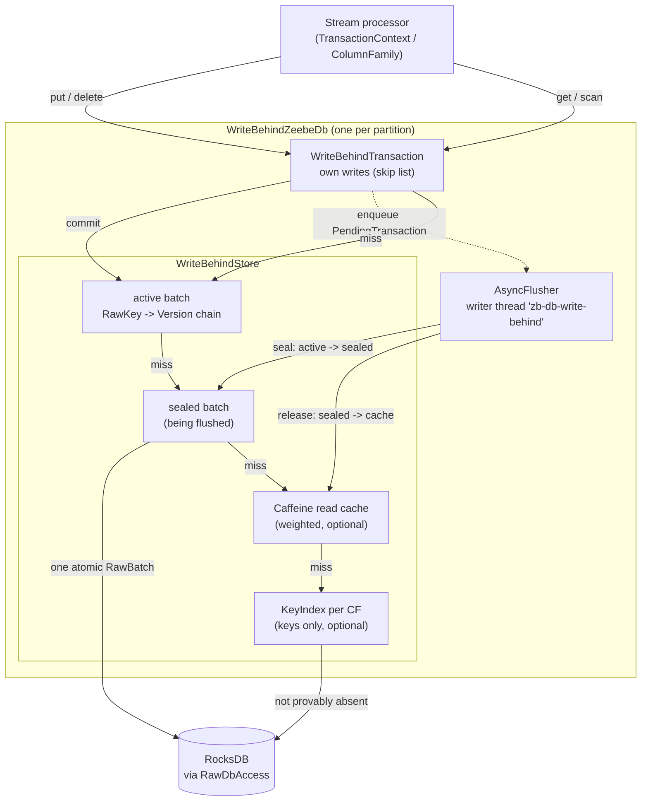

# Write-behind ZeebeDb

`zeebe-db-writebehind` is a `ZeebeDb` that sits in front of the RocksDB `ZeebeDb`. A transaction
commit writes into memory and returns. A single writer thread per DB later writes the committed
transactions to RocksDB in batches. Reads merge the unflushed state, a read cache and RocksDB.

## Why

The stream processor commits one RocksDB transaction per processed command. Most of the state it
writes is short-lived: a job, element instance or timer is created and deleted again within
seconds. With write-behind:

- a commit costs a few map inserts instead of a RocksDB write batch;
- keys that are written and deleted within one flush window never reach RocksDB (coalescing);
- deletes of keys that were never flushed are dropped (`keyMayExist` is false);
- lookups of keys that do not exist can be answered from memory by a per-column-family key index,
  instead of a RocksDB `get` or iterator seek.

The price is that up to `flush-delay` / `max-pending` of committed state lives only on the heap.
That is acceptable because RocksDB already runs without a WAL in Zeebe: runtime state is always
rebuilt from the last snapshot plus log replay (see [Durability](#durability-snapshots-and-recovery)).

The module is generic over the backing store through the [`Backend`](src/main/java/io/camunda/zeebe/db/writebehind/Backend.java)
SPI. In production it is [`RawBackend`](src/main/java/io/camunda/zeebe/db/writebehind/RawBackend.java)
over the [`RawDbAccess`](../api/src/main/java/io/camunda/zeebe/db/RawDbAccess.java) SPI, which
RocksDB implements in [`RocksDbRawAccess`](../rocksdb/src/main/java/io/camunda/zeebe/db/impl/rocksdb/transaction/RocksDbRawAccess.java).
The module has no RocksDB dependency.

## Architecture



### Write path

1. `ColumnFamily.insert/update/upsert/deleteExisting` run the same precondition and foreign-key
   checks as the RocksDB column family. The value is encoded once into an exact-size `byte[]`
   ([`Values.hold`](src/main/java/io/camunda/zeebe/db/writebehind/Values.java)). The store holds
   only these bytes, so it never shares an object with the caller.
2. The write goes into the transaction's own writes (`ConcurrentSkipListMap<RawKey, HeldValue>`,
   `null` value = tombstone). Raw keys are the RocksDB format: 8-byte big-endian column family id
   followed by the key.
3. On commit, [`WriteBehindTransaction`](src/main/java/io/camunda/zeebe/db/writebehind/WriteBehindTransaction.java)
   calls `WriteBehindStore.commit` with the sorted keys and values. The store:
   - checks the store is usable (writer not failed, not closed);
   - calls `flusher.awaitCapacity()`, the only place a commit blocks (see [Backpressure](#backpressure-and-memory-bounds));
   - under the publish write lock: assigns `seq = ++lastSeq`, puts a `Version(value, seq, previous)`
     per key into the active batch, updates key indexes, enqueues a `PendingTransaction` for the
     flusher, and sets `committedSeq = seq` last.
4. The transaction clears its writes only if the commit succeeded, so a failed commit can be retried
   with the same writes. An empty commit only checks that the store is usable.

### Read path (point lookups)

`get` and `exists` look, in order, at:

| Step | Source | Notes |
|---|---|---|
| 1 | transaction's own writes | own tombstone hides the key |
| 2 | active, then sealed batch | `Version.asOf(committedSeq)`: newest version at or below the read seq |
| 3 | read cache | holds flushed values only |
| 4 | key index of the CF | key inside the index window and not in the set: absent, no storage read |
| 5 | RocksDB `get` | a value is cached only if no flush ran during the read; a miss is not cached |

Step 5 reads `flushEpoch` (odd while a batch is being sealed or released) before the storage read and
caches a value that it found only if the epoch was even and unchanged afterwards. A
value loaded while a flush was in progress could otherwise overwrite a newer flushed value in the
cache. A read copies into the caller's instance by wrapping the held bytes.

### Iteration

Scans (`forEach`, `whileTrue`, `whileEqualPrefix`, ...) use a
[`MergingCursor`](src/main/java/io/camunda/zeebe/db/writebehind/MergingCursor.java): the
transaction's own writes, read live, merged with one committed source. Own writes win and own
tombstones hide keys. The committed source is one of:

| Source | When | What it reads |
|---|---|---|
| [`ViewSource`](src/main/java/io/camunda/zeebe/db/writebehind/ViewSource.java) | default | a fixed view: a storage iterator plus the sealed and active batch, taken together under the read lock. It reads the entries of the batches when you use it, up to the last commit that it includes, and copies nothing. Never stale. |
| [`IndexSource`](src/main/java/io/camunda/zeebe/db/writebehind/IndexSource.java) | CF has a loaded key index, stable as of the read seq, whose window covers the seek key | walks the live key set; values come from memory, else from `get` on storage |
| [`HandoverSource`](src/main/java/io/camunda/zeebe/db/writebehind/HandoverSource.java) | wraps an `IndexSource` when the scan direction leaves the window | opens a view at the window bound once the window is exhausted |

An `IndexSource` goes stale when the index changes or after 4 storage reads (one iterator is
cheaper than many random reads). The cursor then restarts from a view at the current key, so no
entry is returned twice or skipped (`keyindex.switches`). Nested iteration is limited to depth 2,
as in RocksDB.

### Flush lifecycle

[`AsyncFlusher`](src/main/java/io/camunda/zeebe/db/writebehind/AsyncFlusher.java) runs one daemon
thread per DB. The thread name is `zb-db-write-behind-` and the name of the DB, for example the partition.

1. **Wait.** Commits do not wake the writer. It parks for `max(flush-delay, 1ms)` and is unparked
   only when pending bytes cross `flush-threshold`, a snapshot asks for a flush, or the DB closes.
2. **Due.** The oldest queued transaction is due when `committedAt + flush-delay` has passed,
   pending bytes are at or above the threshold, a snapshot waits for its seq, or the store is
   stopping or failed.
3. **Seal.** Under the publish write lock it drains the queue, makes `flushEpoch` odd, turns the
   active batch into the sealed batch and starts a new active batch. Readers still see the sealed
   batch.
4. **Write.** The latest version of each key in the sealed batch goes into one `RawBatch`, written
   atomically. A tombstone becomes a RocksDB delete only if `keyMayExist` says the key may exist;
   otherwise it is skipped (`flushed.deletes.skipped`).
5. **Release.** Flushed values go into the read cache, tombstones invalidate cache entries, the
   sealed batch is dropped, `flushEpoch` becomes even, `flushedSeq` advances and waiting committers
   and snapshots are signalled.

A `ZeebeDbException` from the write is retried up to 10 times, backing off from 10 ms, doubling up
to 1 s. Any other error, or the last retry failing, marks the store failed. An error that ends the
writer thread outside the write, for example an `OutOfMemoryError`, marks it failed too (see
[Caveats](#limitations-caveats-and-open-questions)).

## Key concepts

| Concept | Meaning |
|---|---|
| `seq` | Monotonic commit number, assigned under the publish lock. `committedSeq` is the newest commit readers may see. |
| `Version` | `(value or tombstone, seq, previous)`. A chain per key inside one batch, so a reader at seq `s` never sees part of a later commit. |
| Batches | `active` (receives commits) and `sealed` (being flushed, nullable). Both `ConcurrentSkipListMap<RawKey, Version>`. |
| `flushEpoch` | Even when no flush is changing batches. Guards cache fills from storage reads. |
| Publish lock | A `StampedLock`. Write lock: commit, seal, release, key index install/disable, close. Read lock: opening a view, `awaitFlushed`. Point reads take no lock. |
| Read cache | Caffeine cache of flushed values and storage misses, weighted by `200 + key + value bytes`. |
| Key index | Per-CF sorted set of all live keys inside a window. Answers "absent" for lookups in the window and drives indexed scans. |
| Window | `bound == null`: the whole CF. `KEEP_LOWEST`: keys below the bound. `KEEP_HIGHEST`: keys above the bound. |

### Key index

[`KeyIndex`](src/main/java/io/camunda/zeebe/db/writebehind/KeyIndex.java) holds keys only, never
values. It is configured per column family with a
[`KeyIndexPolicy`](src/main/java/io/camunda/zeebe/db/writebehind/KeyIndexPolicy.java):

| Policy | Behaviour when the CF has more than `key-index-max-keys` keys |
|---|---|
| `DISABLE` | the index is dropped until restart |
| `KEEP_LOWEST` | keeps the lowest keys; evicts from the top and lowers the bound |
| `KEEP_HIGHEST` | keeps the highest keys; evicts from the bottom and raises the bound |

Lifecycle:

- **Load.** Lazily on the first lookup or scan of the CF, on the calling thread. Reads up to
  `key-index-max-keys` keys from a view, starting at the end the policy keeps (`DISABLE` loads from
  the lowest key).
- **Maintain.** Each commit adds and removes keys inside the window under the commit lock and records
  the commit seq. Windowed indexes then evict from the far end to stay at `key-index-max-keys`.
- **Refill.** When a windowed index drops below a quarter of the maximum, it is extended by
  `max/4` keys away from the covered end.
- **Discard.** If a commit overtakes a running load or refill, the result is discarded. After 3
  discarded loads or refills in a row the index is disabled until restart.
- **Trust.** A point read or scan uses the index only if it is loaded, not being changed (seqlock
  version even), and its last changing commit is not newer than the reader's seq.

The defaults (24 column families) live in
[`ColumnFamilyAccessPatterns`](../../engine/src/main/java/io/camunda/zeebe/engine/state/ColumnFamilyAccessPatterns.java).
Due-date style CFs that are scanned from the low end (`TIMER_DUE_DATES`, `JOB_DEADLINES`,
`MESSAGE_DEADLINES`, `JOB_BACKOFF`, `JOB_ACTIVATABLE_BY_PRIORITY`) use `KEEP_LOWEST`. CFs keyed by
growing keys (element instances, variables, jobs, subscriptions, ...) use `KEEP_HIGHEST`: recent keys
are the hot ones, and many lookups when an element ends find nothing.

## Consistency and durability

### Visibility

- A transaction sees its own writes, then the committed state as of the latest `committedSeq`.
- Point reads never see part of a commit: `committedSeq` is set after all versions are in place,
  and `asOf(seq)` skips newer versions.
- A view-based scan sees one fixed instant (`lastSeq` at view creation).
- An index-based scan is weaker: if another context commits to the same CF during the scan, results
  may mix state from before and after that commit. No entry is returned twice or skipped. The stream
  processor is the only writer and does not commit mid-scan.
- An entry deleted by another context between seeing the key and reading its value is skipped.

### Durability, snapshots and recovery

| Aspect | Behaviour |
|---|---|
| Unflushed commits | Heap only. Lost on crash, rebuilt from the snapshot plus log replay, as for RocksDB without WAL. |
| Storage content | Each flush is one atomic batch of whole transactions, so RocksDB always holds a transaction-consistent prefix. |
| `createSnapshot` | Calls `awaitFlushed()` for every commit readers can already see, then the RocksDB checkpoint. The snapshot holds at least the state the caller observed; it may hold later commits too. |
| Flush wait timeout | 30 s, then `IllegalStateException`. |
| Recovery | `StateControllerImpl` opens the snapshot with `openSnapshotOnlyDb` and copies it to the runtime directory on plain RocksDB. Only the runtime DB (`createDb(File)`) is wrapped. |
| Bulk copy | `createDb(path, avoidFlush)` and `openSnapshotOnlyDb` delegate to RocksDB: a bulk copy is one huge transaction that would otherwise sit on the heap. |
| Close | Closes the store first (flushes everything, stops the writer, joining for up to 30 s and then interrupting), then RocksDB. |

### Threading

| Thread | Does |
|---|---|
| Stream processor (one per partition) | commits under the publish write lock; reads lock-free; may load or refill key indexes |
| `zb-db-write-behind` (one per partition) | seals, writes and releases batches |
| Snapshot caller (`StateControllerImpl`) | `awaitFlushed`, then checkpoint |
| Other readers | lock-free point reads (seq, epoch and version checks); views take the read lock briefly |

## Backpressure and memory bounds

All bounds are per partition and come on top of the RocksDB memory limit.

| Bound | Mechanism |
|---|---|
| `max-pending` | `commit` blocks in `awaitCapacity` while pending bytes exceed it, until a flush frees space. A single transaction larger than the limit still commits once the queue is empty. |
| `flush-threshold` | Pending bytes at or above it wake the writer immediately. Capped at `max-pending`. |
| `flush-delay` | Upper bound on how long a commit stays unflushed when below the threshold. |
| `cache-size` | Caffeine maximum weight; `0` disables the cache. |
| `key-index-max-keys` | Keys per CF index. Bounded by count, not bytes (roughly 100 to 150 B per key measured). |

Pending bytes and cache weight use `200 + key length + value length` per entry. With defaults, expect roughly 96 MB per partition
(32 MB pending + 64 MB cache) plus key indexes.

## Configuration

Disabled by default. When enabled, `ZeebePartitionFactory.selectDbFactory` wraps the RocksDB factory
in [`WriteBehindZeebeDbFactory`](src/main/java/io/camunda/zeebe/db/writebehind/WriteBehindZeebeDbFactory.java).
Unified configuration prefix: `camunda.data.primary-storage.rocks-db.write-behind`
([`WriteBehind`](../../../configuration/src/main/java/io/camunda/configuration/data/primarystorage/WriteBehind.java),
mapped to the broker's [`WriteBehindCfg`](../../broker/src/main/java/io/camunda/zeebe/broker/system/configuration/WriteBehindCfg.java)).

| Property | Default | Environment variable |
|---|---|---|
| `enabled` | `false` | `CAMUNDA_DATA_PRIMARYSTORAGE_ROCKSDB_WRITEBEHIND_ENABLED` |
| `flush-delay` | `100ms` | `CAMUNDA_DATA_PRIMARYSTORAGE_ROCKSDB_WRITEBEHIND_FLUSHDELAY` |
| `flush-threshold` | `16MB` | `CAMUNDA_DATA_PRIMARYSTORAGE_ROCKSDB_WRITEBEHIND_FLUSHTHRESHOLD` |
| `max-pending` | `32MB` | `CAMUNDA_DATA_PRIMARYSTORAGE_ROCKSDB_WRITEBEHIND_MAXPENDING` |
| `cache-size` | `64MB` | `CAMUNDA_DATA_PRIMARYSTORAGE_ROCKSDB_WRITEBEHIND_CACHESIZE` |
| `key-index-max-keys` | `10000` (must be > 0) | `CAMUNDA_DATA_PRIMARYSTORAGE_ROCKSDB_WRITEBEHIND_KEYINDEXMAXKEYS` |
| `key-index.<CF>` | 24 CFs, see above | `CAMUNDA_DATA_PRIMARYSTORAGE_ROCKSDB_WRITEBEHIND_KEYINDEX_<CF>` |

Per-CF key-index overrides replace only the named entry; the other defaults stay. CF names are
matched case-insensitively, with `.` and `-` read as `_`. Values: `DISABLE`, `KEEP_LOWEST`,
`KEEP_HIGHEST`.

```yaml
camunda:
  data:
    primary-storage:
      rocks-db:
        write-behind:
          enabled: true
          flush-delay: 100ms
          key-index:
            VARIABLES: disable          # turn the VARIABLES index off
            JOB_BACKOFF: keep_lowest    # same as the default, shown for form
```

```bash
CAMUNDA_DATA_PRIMARYSTORAGE_ROCKSDB_WRITEBEHIND_ENABLED=true
CAMUNDA_DATA_PRIMARYSTORAGE_ROCKSDB_WRITEBEHIND_KEYINDEX_VARIABLES=DISABLE
```

Fixed in `WriteBehindConfiguration.defaults()` and not exposed by the broker: 10 write retries and
the 30 s flush/stop timeout.

The broker rejects a value that the DB cannot use, for example a `max-pending` of zero or less, when
it starts, if `enabled` is `true`.

## Metrics

Micrometer meters, prefix `zeebe.writebehind.`, tag `store=rocksdb`. They are registered when the
broker exports DB metrics (`StateControllerImpl.exportDbMetrics`); re-registration picks up column
families used since the last export.

Per column family (extra tag `columnFamily=<numeric id>`):

| Counter | Counts |
|---|---|
| `committed.puts`, `committed.deletes` | writes and deletes committed, before coalescing |
| `lookup.dirty.hits` | point reads answered by unflushed versions |
| `lookup.cache.hits` | point reads answered by the read cache |
| `lookup.keyindex.absent` | point reads answered "absent" by the key index |
| `lookup.storage.gets`, `lookup.storage.found` | point reads that went to RocksDB, and hits among them |
| `scan.storage.iterators` | storage iterators opened for scans |
| `flushed.puts`, `flushed.deletes` | writes and deletes sent to RocksDB after coalescing |
| `flushed.deletes.skipped` | tombstones dropped because `keyMayExist` was false |

Store-wide:

| Meter | Type | Meaning |
|---|---|---|
| `iterators.opened` | counter | storage iterators opened |
| `flush.duration` | function timer | flush count and total time |
| `flush.retries`, `flush.failures` | counter | retried writes; fatal flush failures |
| `keyindex.loads`, `keyindex.loads.discarded` | counter | index loads, and loads overtaken by a commit |
| `keyindex.refills`, `keyindex.refills.discarded` | counter | window refills, and refills overtaken |
| `keyindex.disables` | counter | indexes disabled until restart |
| `keyindex.switches` | counter | indexed scans that fell back to a view |
| `keyindex.handovers` | counter | indexed scans that continued past the window bound |
| `scan.indexed` | counter | scans served by a key index |
| `pending.bytes` | gauge | bytes committed but not flushed |
| `pending.transactions` | gauge | `committedSeq - flushedSeq` |
| `pending.age` | gauge | age of the oldest unflushed commit, in seconds |
| `cache.entries` | gauge | estimated read cache entries (only when the cache is enabled) |

Useful signals: `pending.age` well above `flush-delay` means the writer is behind or retrying;
`flush.failures > 0` means the store is dead (see below); `keyindex.disables` or a rising
`scan.storage.iterators` on an indexed CF means the window is too small for that CF.

## Limitations, caveats and open questions

- **Writer failure is permanent.** After a non-retryable error, an error that ends the writer
  thread, or 10 failed retries the store logs
  an ERROR and every later operation throws `IllegalStateException` until the DB is reopened.
  Unverified: how the broker reacts (health status, partition transition).
- **Unflushed state is heap-only.** Up to `flush-delay` / `max-pending` of commits is lost on a
  crash and replayed from the log.
- **A snapshot can contain more than the caller observed**, since commits continue while it waits
  for the flush.
- **Index scans are not snapshot-isolated** against concurrent commits from another context (see
  [Visibility](#visibility)).
- **Key-index disables last until restart**, whether caused by `DISABLE` overflow or by 3 discarded
  loads/refills in a row.
- **Key-index loads and refills run on the calling thread**, normally the stream processor. A load
  reads up to `key-index-max-keys` keys; a refill `max/4`.
- **`count()` and `countEqualPrefix` are O(n)**: a full merged scan, without decoding values.
- **Memory accounting is approximate**: fixed 200-byte overhead,
  key-index memory bounded by key count only, and everything multiplies by the partition count.
- **No cache for absent keys**: a lookup of a key that RocksDB does not have goes to RocksDB each
  time, unless a key index answers it. A small filter per column family can replace this later.
- **A writer that cannot stop is left behind**: if the writer ignores the interrupt for a second
  flush timeout, close logs an error and closes RocksDB anyway.
- **`columnFamily` metric tag is the numeric CF id**, not the name.
- **Not configurable from the broker**: retry count and the 30 s flush/stop timeout.
- **Delete skipping costs a read**: each flushed tombstone calls `keyMayExist`, which shows up as
  RocksDB get activity.
- Open: whether the memory settings should be tenant-overridable; the legacy
  `zeebe.broker.experimental.rocksdb.writeBehind` binding is overwritten by the unified config.

## Code map

| Class | Role |
|---|---|
| [`WriteBehindZeebeDbFactory`](src/main/java/io/camunda/zeebe/db/writebehind/WriteBehindZeebeDbFactory.java) | Wraps the runtime DB of another factory; snapshot-only and bulk-copy DBs pass through. |
| [`WriteBehindZeebeDb`](src/main/java/io/camunda/zeebe/db/writebehind/WriteBehindZeebeDb.java) | `ZeebeDb` facade: column families, contexts, snapshot, metrics, close. |
| [`WriteBehindConfiguration`](src/main/java/io/camunda/zeebe/db/writebehind/WriteBehindConfiguration.java) | Bounds, retries, timeouts and key-index policies. |
| [`WriteBehindTransactionContext`](src/main/java/io/camunda/zeebe/db/writebehind/WriteBehindTransactionContext.java) | `TransactionContext` with lambda-free begin/commit helpers. |
| [`WriteBehindTransaction`](src/main/java/io/camunda/zeebe/db/writebehind/WriteBehindTransaction.java) | Own writes of one transaction; commits them to the store. |
| [`WriteBehindColumnFamily`](src/main/java/io/camunda/zeebe/db/writebehind/WriteBehindColumnFamily.java) | Typed `ColumnFamily`: key encoding, checks, point ops, scans. |
| [`WriteBehindStore`](src/main/java/io/camunda/zeebe/db/writebehind/WriteBehindStore.java) | Batches, versions, read cache, key indexes, views; the commit and read paths. |
| [`AsyncFlusher`](src/main/java/io/camunda/zeebe/db/writebehind/AsyncFlusher.java) | Writer thread, queue, backpressure, retries, `awaitFlushed`. |
| [`Version`](src/main/java/io/camunda/zeebe/db/writebehind/Version.java) | Versioned value or tombstone with its predecessor. |
| [`HeldValue`](src/main/java/io/camunda/zeebe/db/writebehind/HeldValue.java) | The encoded bytes of a value. |
| [`Values`](src/main/java/io/camunda/zeebe/db/writebehind/Values.java) | Encode-once and copy-out helpers. |
| [`RawKey`](src/main/java/io/camunda/zeebe/db/writebehind/RawKey.java) | Immutable key bytes, unsigned bytewise order, cached hash. |
| [`KeyRange`](src/main/java/io/camunda/zeebe/db/writebehind/KeyRange.java) | Key range of a scan or view. |
| [`Backend`](src/main/java/io/camunda/zeebe/db/writebehind/Backend.java) | SPI to the backing store: get, cursor, batch write, weigh, groups. |
| [`RawBackend`](src/main/java/io/camunda/zeebe/db/writebehind/RawBackend.java) | `Backend` over `RawDbAccess`; groups are column families. |
| [`MergingCursor`](src/main/java/io/camunda/zeebe/db/writebehind/MergingCursor.java) | Merges own writes with a committed source; picks and swaps sources. |
| [`CommittedSource`](src/main/java/io/camunda/zeebe/db/writebehind/CommittedSource.java) | Interface for the committed side of a scan. |
| [`ViewSource`](src/main/java/io/camunda/zeebe/db/writebehind/ViewSource.java) | Fixed view: the unflushed batches up to one commit, merged with a storage cursor. |
| [`IndexSource`](src/main/java/io/camunda/zeebe/db/writebehind/IndexSource.java) | Scan over the key index set. |
| [`HandoverSource`](src/main/java/io/camunda/zeebe/db/writebehind/HandoverSource.java) | Continues an indexed scan past the window bound. |
| [`KeyIndex`](src/main/java/io/camunda/zeebe/db/writebehind/KeyIndex.java) | Per-CF key set, window bound, seqlock state. |
| [`KeyIndexPolicy`](src/main/java/io/camunda/zeebe/db/writebehind/KeyIndexPolicy.java) | `DISABLE`, `KEEP_LOWEST`, `KEEP_HIGHEST`. |
| [`WriteBehindMetrics`](src/main/java/io/camunda/zeebe/db/writebehind/WriteBehindMetrics.java) | Counters and timer; per-CF counters. |

Tests live in `src/test/java`; contract and RocksDB-vs-write-behind differential tests live in
[`zeebe/zb-db/tests`](../tests). Differential tests are tagged `randomized` and run only with
`-Pinclude-random-tests` (Maven) or `-PincludeRandomTests` (Gradle).
